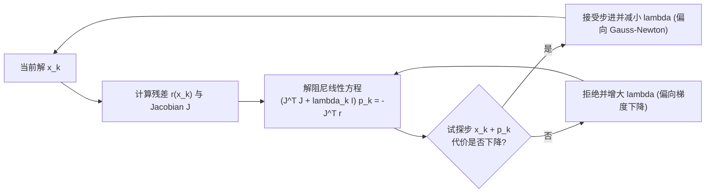

# Levenberg-Marquardt（LM 阻尼最小二乘）

**Levenberg-Marquardt（LM）**：在 [Gauss-Newton](./gauss-newton.md) 的 $J^T J$ 上加入阻尼 $\lambda I$，搜索方向 $p = -(J^T J + \lambda I)^{-1} J^T r$；$\lambda$ 大时接近梯度下降，$\lambda$ 小时接近 GN，是 **病态 Jacobian** 非线性最小二乘的默认求解器。

## 一句话定义

> 在 GN 和梯度下降之间拧旋钮——Jacobian 不靠谱时多信梯度，靠谱时加速冲线。

## 英文缩写速查

| 缩写 | 英文全称 | 简要说明 |
|------|----------|----------|
| LM | Levenberg-Marquardt | Levenberg (1944) + Marquardt (1963) |
| GN | Gauss-Newton | $\lambda \to 0$ 时的极限 |
| GD | Gradient Descent | $\lambda$ 很大时的近似 |
| NLS | Nonlinear Least Squares | $\min \|r(x)\|^2$ |
| IK | Inverse Kinematics | 冗余关节 IK 常用 LM |

## 为什么重要

在机器人运动学标定、冗余逆运动学（IK）与小规模状态估计中，雅可比矩阵 $J$ 常常接近奇异或秩亏，纯 Gauss-Newton 会直接发散；LM 通过阻尼项 $\lambda I$ 在收敛稳定性与二阶收敛速度之间自适应切换，是工程中最常用的默认非线性最小二乘求解器。

## 核心原理

### 主要技术路线

### 1. 阻尼 GN 更新

$$
p_k = -(J^T J + \lambda_k I)^{-1} J^T r
$$

等价于信赖域子问题：限制 $\|p\|$ 的近似形式（Marquardt 原始推导）。

### 2. $\lambda$ 调度策略

| 迭代结果 | 典型调整 |
|---------|---------|
| 代价下降 | 减小 $\lambda$（更 GN） |
| 代价上升 | 增大 $\lambda$（更保守） |

实现库（如 Ceres、g2o、scipy.optimize.least_squares）内置启发式调度。

### 3. 与修正牛顿法的关系

[Line Search 课程页](./line-search-steepest-descent.md) 中的 **Levenberg-Marquardt 正则化 Hessian** 与 LM 同一思想：$(H + \lambda I)p = -g$。

## 优势与局限

| 优势 | 局限 |
|------|------|
| 对病态/秩亏 $J$ 鲁棒 | 每步需解线性系统 |
| 实现成熟、默认可用 | 高维大规模不如 L-BFGS 批量 TrajOpt |
| 标定/IK 社区事实标准 | $\lambda$ 调度影响收敛速度 |

## 工程实践（在机器人中的典型应用）

- **相机-机器人手眼标定**（见 [hand-eye-calibration](../concepts/hand-eye-calibration.md)）、IMU 标定
- **冗余 IK**、retargeting 初值求解
- **小规模状态估计** bundle adjustment
- **cuRobo 等大规模 TrajOpt**：高维场景更常用 [L-BFGS](./l-bfgs.md)，LM 多用于中低维 NLS

## 关联页面

- [Gauss-Newton](./gauss-newton.md)
- [Newton's Method](./newtons-method.md)
- [Line Search & Steepest Descent](./line-search-steepest-descent.md)
- [Convex Functions](../formalizations/convex-functions.md)
- [Second-Order Optimizers 对比](../comparisons/second-order-optimizers.md)

## 参考来源

- [Second-Order Optimizers 论文摘录](../../sources/papers/second_order_optimizers.md) — Levenberg (1944)、Marquardt (1963)
- [数值优化基础课程](../../sources/courses/numerical_optimization_foundations_robotics.md) — 第 1 章 LM 阻尼

## 推荐继续阅读

- [Levenberg (1944)](https://doi.org/10.1137/0116009)
- [Marquardt (1963)](https://doi.org/10.1137/0116030)
- Ceres Solver documentation — Levenberg-Marquardt
