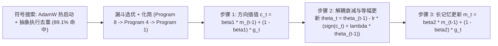

# Lion（EvoLved Sign Momentum）

**Lion**（Chen et al., 2023）是通过**命令式符号程序搜索**自动发现的深度学习优化算法：仅保留**一阶动量**状态 $m_t$ 并以逐元素 `sign` 算子决定参数更新方向，砍掉二阶矩缓存与方差除法，作为 [深度学习基础](../concepts/deep-learning-foundations.md) 中在大批次视觉与多模态训练上与 [AdamW](./adamw.md) 竞争的轻量备选优化器。

## 一句话定义

> 只用单一动量记历史、以 $\mathrm{sign}$ 输出等幅 $\pm 1$ 更新方向——用长短双 $\beta$ 插值加符号步长砍掉二阶矩显存与计算，换取在大批次视觉与扩散预训练上的高内存效率和泛化平坦度。

## 英文缩写速查

| 缩写 | 英文全称 | 简要说明 |
|------|----------|----------|
| Lion | EvoLved Sign Momentum | Google Brain 符号演化搜索发现的符号动量优化器 |
| EMA | Exponential Moving Average | 指数移动平均，Lion 使用 $\beta_1, \beta_2$ 分离当下与历史衰减 |
| WD | Weight Decay | 解耦权重衰减系数 $\lambda$，需随学习率缩放保持有效强度 |
| LR | Learning Rate | 峰值学习率 $\eta$，在 Lion 中通常需设为 AdamW 的 1/3–1/10 |
| L2O | Learning to Optimize | 利用元学习或程序搜索自动发现优化算法的范式总称 |

## 为什么重要

- **优化器状态显存直接减半**：仅追踪一阶动量 $m_t$（支持 `bfloat16` 存储），在 ViT-B/16（分辨率 224、batch size 4,096）训练中把所需 TPU V4 芯片数由 AdamW 的 16 颗降至 **8 颗**（§3.2），在分布式数据并行场景降低通信与显存墙压力，单步运行速度提升 **2–15%**。
- **大规模视觉与生成训练显著省算力**：在 JFT-300M 上助 ViT-L/16 用 **3–5× 更少算力** 追上或超过 AdamW 训练的 ViT-H/14；在 ImageNet 256×256 无条件扩散生成上把步数压缩 **2.3×** 并取得更优 FID（4.1 vs 4.7）。
- **证明符号自动发现可产生可理解且能跨数量级迁移的算法**：借助 [反向传播](../concepts/backpropagation.md) 提供的瞬时梯度与抽象执行剪枝，演化搜索发现双 $\beta$ 解耦与 `sign` 正则协同机制，收敛到比 AdamW 更平坦的损失极小值（Table 10 扰动损失 1.37 vs 3.74）。

## 核心机制

给定随机梯度 $g_t = \nabla_\theta f(\theta_{t-1})$（可从[特征空间梯度下降](../concepts/feature-space-gradient-descent.md)视角对比不同参数/几何约束下的步长尺度），Lion 每步维护唯一历史状态 $m_{t-1}$（初始为 0）并依次执行三步更新（Algorithm 2）：

$$
c_t = \beta_1 m_{t-1} + (1 - \beta_1) g_t
$$

$$
\theta_t = \theta_{t-1} - \eta_t \big(\mathrm{sign}(c_t) + \lambda \theta_{t-1}\big), \qquad m_t = \beta_2 m_{t-1} + (1 - \beta_2) g_t
$$

- **双时间尺度 $\beta_1, \beta_2$ 解耦记忆与响应**：默认 $\beta_1 = 0.9, \beta_2 = 0.99$。其中 $\beta_2=0.99$ 让状态 $m_t$ 保留比常见 0.9 长约 **10×** 的梯度历史记忆，而执行更新前先用 $\beta_1=0.9$ 混入 10% 当步梯度 $g_t$ 决定符号方向；同时省去 $\epsilon$ 与偏差修正项。
- **等幅符号步长的正则化机制**：$\mathrm{sign}(c_t) \in \{-1, +1\}^d$ 令每个参数维度在单步都移动完全相同的 $\eta_t$ 幅值（等价于在无穷范数约束下取最速下降方向并附加离散噪声）。实测 ViT-B/16 上 Lion 终训损失 $L_{\text{train}}$ 略高于 AdamW（0.75 vs 0.61），但参数高斯噪声平坦度 $L_{\text{train}}^{\mathcal{N}}$ 更低（**1.37 vs 3.74**），验证集准确率反超 **+1.96%**（Appendix G）。

## 主要技术路线

1. **符号程序搜索与抗元过拟合管线（§2, App. F/H/I）**：不同于把黑箱神经网络当优化器的 L2O（难以跨任务和训练步数外推），作者以 43 个支持 n 维张量/PyTree 的常见算子构成无限稀疏搜索空间；通过类型/形状静态检查、功能哈希去重（缓存命中率 **89.1 ± 0.6%**，评估量从 200–300K 降至 20–30K）及依赖追踪删除 **69.8 ± 1.9%** 冗余语句，配合在 TPU V2 <20 分钟代理任务上逐级放大的 **Funnel Selection** 跨过 $>10^4\times$ 规模鸿沟。
2. **与传统自适应/一阶符号方法的对比选型**：

| 优化器 | 维护状态 | 单步更新方向与尺度 | 相对显存 | 典型定位 |
|------|------|------|------|------|
| [AdamW](./adamw.md) | $m_t + v_t$（两份） | 逐元素自适应方差缩放 | 基准（2× 状态） | 通用默认最稳，小批次与常规 RL 首选 |
| [SGD Momentum](./sgd-momentum.md) | 仅 $m_t$（一份） | 梯度正比连续幅度 | 约 1× 状态 | 经典 ConvNet / 视觉微调基线 |
| `signSGD`（手写动量版） | 零或单一 $m_t$ | 同步取历史或瞬时符号 | $\le 1\times$ 状态 | 面向分布式通信压缩，无双 $\beta$ 解耦 |
| **Lion** | **仅 $m_t$（支持 `bfloat16`）** | 双 $\beta$ 解耦 + $\mathrm{sign}$ 等幅 $\pm \eta$ | **约减半（1× 状态）** | 大批次 ViT、对比学习与扩散生成提效 |

## 实验与评测

基于 Chen et al. (2023) §4 系统评测（对比充分调参后的 AdamW / Adafactor）：

- **图像分类（Table 2–3）**：ImageNet 无强增强从头训练 ViT-B/16 **77.44% vs AdamW 75.48%**（+1.96%）、Mixer-B/16 **70.11% vs 68.12%**；加入 RandAug+Mixup 后 CoAtNet-3 仍领先 +0.42%（84.87% vs 84.45%）；JFT-3B 预训练微调 ViT-G/14 达 **90.71%**。
- **视觉-语言与扩散（Table 1, 4, §4.3）**：BASIC-L 零样本 ImageNet **88.3%**（超 Adafactor 85.7% 达 +2.6%），微调达 **91.1%**；LiT-B/16-B 零样本 **+1.13%**；ImageNet 256×256 扩散生成 FID **4.1 vs AdamW 4.7** 且减步 **2.3×**。
- **语言建模与微调（§4.4, Table 5–6）**：在 Wiki-40B（中模型）与 PG-19（大模型）分别取得 **1.6×** 与 **2×** 收敛加速，T5 Base/Large/11B 在 GLUE 平均全胜 AdamW；但在高质量 **1.6T token 大规模语言模型**训练上困惑度与 Adafactor **无统计显著差异**（仅 1-shot NLG/NLU 平均略高）。
- **关键消融（Table 7 & Fig. 8）**：固定单衰减率 $\beta_1=\beta_2=\beta$ 的 `Ablation_0.9` / `Ablation_0.99` 在 ViT 与 PG-19 上全面劣于原版 Lion 甚至逊于 AdamW，证明双系数缺一不可；批大小扫描显示 AdamW 峰值在 BS=256，Lion 峰值在 **BS=4,096** 且在 **BS=32K** 领先 AdamW **+2.5%**（77.9% vs 75.4%）。

## 源码实现剖析

逐文件核对官方仓库 [google/automl/lion](https://github.com/google/automl/tree/master/lion) 提供的 PyTorch 与 JAX/Optax 参考实现：

- **`lion_pytorch.py`（`Lion(Optimizer)`）**：默认 `lr=1e-4, betas=(0.9, 0.99), weight_decay=0.0`。注意源码中实际**先执行解耦权重衰减** `p.data.mul_(1 - group['lr'] * group['weight_decay'])`，随后计算 `update = exp_avg * beta1 + grad * (1 - beta1)` 并原地步进 `p.add_(update.sign_(), alpha=-group['lr'])`，最后更新动量 `exp_avg.mul_(beta2).add_(grad, alpha=1 - beta2)`（一阶精度下等价于论文 Pseudocode 且避免额外临时张量开销）。
- **`lion_optax.py`（`lion()` 组合链）**：由 `scale_by_lion(b1, b2, mu_dtype)` → `add_decayed_weights(weight_decay, mask)` → `_scale_by_learning_rate(learning_rate)` 构成。亮点在于显式支持 **`mu_dtype`**（如传入 `jnp.bfloat16` 将一阶状态内存直接减半），在 `scale_by_lion` 内部临时将动量 cast 回 `grad.dtype` 完成插值与 `sign` 判决后再压缩存盘。

## 在机器人中的典型应用

- **大型视觉主干与 VLA 预训练**：在多机大批次（batch size $\ge 1024$）预训练机器人视觉表征、图像-动作对比模型或视频世界模型遇到显存墙时，Lion 可显著节省优化器状态显存与步时开销。
- **低比特与边缘端轻量微调研究**：单动量与二值等幅特性对量化友好的潜在方向（工程仍需针对任务验证精度）。
- **当前默认选型边界**：在需要极小批次、高方差策略梯度（PPO/SAC）或高频小规模微调的机器人控制栈中，默认依然优先采用经过充分验证的 [AdamW](./adamw.md)。

## 工程实践

切换自 [AdamW](./adamw.md) 时的**黄金换算法则**（论文 §5 & Table 12）：

- **学习率同步下调 3–10×**：由于 `sign` 输出全维度 $\pm 1$ 拥有更大 $L_2$ 范数，须将峰值、初始预热与最小衰减学习率同比例缩为 AdamW 的 $1/3 \sim 1/10$；例如扩散模型由 `3e-4` 改为 `3e-5`，7.5B 语言模型由 `1e-3` 改为 `1e-4`。
- **权重衰减同比放大 3–10×**：为保证有效衰减率 $lr \cdot \lambda$ 不被削弱，将 `weight_decay` 对应乘以 3–10 倍（如 ViT-B/16 强增强下从 `lr=1e-3, λ=1.0` 迁至 `lr=1e-4, λ=10.0`；扩散与 7.5B LM 分别设为 `λ=0.1` 与 `λ=0.01`）。
- **语言及长序列稳定性调优**：在自回归或掩码语言建模遇到早期震荡时，参考论文 §4.4 / §5 将默认 `(0.9, 0.99)` 调整为 **`betas=(0.95, 0.98)`**，适当缩短历史梯度记忆长度以换取更好收敛稳态；其余学习率调度器与梯度裁剪可直接沿用 AdamW 配方。
- **使用 `bfloat16` 存储动量**：大规模训练务必将一阶动量精度设为 `bfloat16`（Optax 可直接设置 `mu_dtype=jnp.bfloat16`），在几乎无精度损失下最大化压低内存成本。

## 常见误区与局限

- **沿用 AdamW 学习率/权重衰减的直接失配**：直接套用 AdamW 的 `lr=1e-3, wd=0.01` 极易因过大的恒定符号步长在训练初期直接发散；反之仅调低 `lr` 而忘记放大 `weight_decay` 则会造成实际正则力度暴跌并引发过拟合。
- **小批次与强正则化任务无明显增益（§6）**：原文明确指出当 **batch size < 64** 时 Lion 往往不优于 AdamW；在 ConvNet（ResNet-50）、强数据增强、Imagen base 64×64 模型、C4 MLM 与高质量海量语料 LLM 预训练（1.6T tokens）上，Lion 与 AdamW 的优势差距会缩窄甚至持平。
- **缺少曲率自适应与高噪声强化学习实证不足**：相比依赖二阶方差倒数做各向异性缩放的 AdamW 或矩阵正交化的 [Muon](./muon.md)，Lion 对剧烈梯度尺度跨度与强化学习小批次高方差奖励信号仍缺少系统性实证优势。
- **符号搜索局限与巨人模型状态成本（§6）**：原搜索空间缺少 K-FAC / Shampoo 等二阶算子；且百亿至千亿级模型即便 `bfloat16` 一阶动量也仍有可观显存压力，需要与分片或因子化方案配合。

## 关联页面

- [AdamW](./adamw.md)
- [Adam](./adam.md)
- [SGD Momentum](./sgd-momentum.md)
- [Muon](./muon.md)
- [Deep Learning Optimizers 对比](../comparisons/deep-learning-optimizers.md)
- [深度学习基础](../concepts/deep-learning-foundations.md)
- [反向传播](../concepts/backpropagation.md)
- [特征空间梯度下降](../concepts/feature-space-gradient-descent.md)
- [PyTorch](../entities/pytorch.md)

## 参考来源

- [Lion 一手论文精读与源码核对归档（arXiv:2302.06675）](../../sources/papers/lion_reading_arxiv_2302_06675.md)
- [Deep Learning Optimizers 论文簇摘录](../../sources/papers/deep_learning_optimizers.md)
- Chen et al., *Symbolic Discovery of Optimization Algorithms*, arXiv:2302.06675v4（2023）：<https://arxiv.org/abs/2302.06675>
- 官方实现（`lion_pytorch.py`, `lion_optax.py`, `README.md`）：<https://github.com/google/automl/tree/master/lion>

## 推荐继续阅读

- [Deep Learning Optimizers 对比](../comparisons/deep-learning-optimizers.md)
- [Muon 优化器](./muon.md)
- [Chen et al. 原论文（arXiv:2302.06675）](https://arxiv.org/abs/2302.06675)
- [google/automl/lion 官方实现](https://github.com/google/automl/tree/master/lion)
