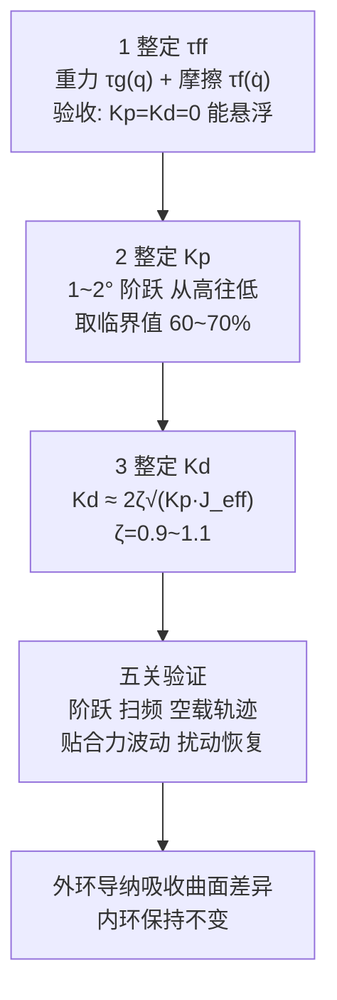

# MIT 模式模拟 CSP：前馈优先的内环整定与五关验证

## 一句话定义

在机械臂 MIT 关节模式（τ = Kp·(q_des − q) + Kd·(q̇_des − q̇) + τff）下，用**高 Kp、临界阻尼 Kd、完整前馈 τff** 让关节功能上逼近位置伺服，作为外环导纳 / 力控的**内环**；整定顺序是 τff → Kp → Kd（具身小站，2026-11-08，第三方工程解读，清洁臂场景）。

## 英文缩写速查

| 缩写 | 英文全称 | 简要说明 |
|------|----------|----------|
| MIT 模式 | — | 驱动器的紧凑阻抗帧：位置 / 速度指令 + Kp / Kd + 前馈力矩 |
| CSP | Cyclic Synchronous Position | CiA 402 的循环同步位置模式：主站按周期发绝对目标位置，驱动器内部跑位置环 |
| τff / τg / τf | feedforward / gravity / friction torque | 前馈力矩 / 重力项 / 摩擦项 |
| J_eff | effective inertia | 关节等效惯量（含连杆与工具） |
| ζ | damping ratio | 阻尼比，ζ = 1 为临界阻尼 |
| RNEA | Recursive Newton–Euler Algorithm | Pinocchio 里算逆动力学的函数 `rnea` |

## 为什么重要

- MIT 内环没有位置环积分：稳态精度几乎全靠前馈，顺序做反（先把 Kp 调高）会把重力静差放大成持续力矩，发热和噪声被误判为参数问题。
- 与本库已有的 [MIT 关节阻抗模式参数整定](./mit-joint-impedance-mode-tuning.md) 互补：那页给多关节优先序与三条整定路径，本页给「前馈优先」的另一种顺序、五关验证和分层（内环 / 外环导纳）原则。
- 把「换曲面要不要改内环」说清：不改，曲面差异归外环（见 [导纳控制](./admittance-control.md)）。

## 核心原理

**公式（文章）与本库自洽核对：**

- Kp ≈ J_eff·ω_target²（ω_n = √(Kp/J_eff)），ω_target 取期望带宽的 2~3 倍；Kd ≈ 2ζ√(Kp·J_eff)；稳态偏差 Δq ≈ Δτ/Kp。三式在二阶系统下自洽。
- **示例（本库代入，非文章数据）：** J_eff = 0.05 kg·m²、期望带宽 5 Hz → Kp ≈ 49 N·m/rad、Kd ≈ 3.1 N·m·s/rad。
- **前馈缺口的代价：** 缺 0.1 N·m 重力项，Kp = 100 N·m/rad 时静差 ≈ 0.057°，Kp = 300 时 ≈ 0.019°。前者已超过文章自己的 < 0.05° 验收线，说明验收实际由前馈完整度保证，不是靠 Kp。
- **J_eff 变化 ±20%：** ω_n 与 ζ 都按 1/√J 变，约 +12% / −9%；文章「超过 ±20% 才考虑增益调度」与此相容（本库推算）。

**τff：** 重力项多姿态静态悬浮标定或 Pinocchio `rnea(q,0,0)`；摩擦项多速度匀速实验线性拟合库仑 fc、粘滞 fv，见 [重力补偿](../concepts/gravity-compensation.md)、[关节摩擦模型](../concepts/joint-friction-models.md)。

**双俯仰 J5、J6：** 惯量耦合，J5 的 Kd 按最不利姿态（工具伸出最远）；重力前馈按 τg5(θ5,θ6)、τg6(θ5,θ6) 联合算，不能各按自己的角度。

## 主要技术路线

| 路线 | 顺序 | 适用 / 取舍 |
|------|------|-------------|
| 前馈优先（本页，文章） | τff → Kp → Kd | 先让重力与摩擦扛住，Kp 才能安全取高；需先有可信的重力 / 摩擦模型 |
| Kp 先行（[既有整定页](./mit-joint-impedance-mode-tuning.md)） | Kp（Kd = 0、τff = 0）→ Kd → τff | 先感受弹簧刚度再补前馈；并给多关节优先序（J5 → J3 → J1 → J2 → J6 → J4） |
| 增益调度（可选） | 按 θ5 分 3~5 段插值 Kp、Kd | 仅当 J_eff 变化超过 ±20% 且验证超标时引入，调度变量须平滑连续 |

两种顺序都没有对比实验，不能判优劣。

## 工程实践

**五关验证（作者经验阈值，无实验数据）：**

| 关 | 内容 | 文章合格线 |
|----|------|------------|
| 1 单关节阶跃（空载） | 1°~2° 阶跃 | 超调 < 5%、稳态误差 < 0.05°、0.2~0.5 s 内达 95%、电流平稳无嗡鸣 |
| 2 扫频 | 1~5 Hz 小幅正弦 | 幅值衰减 / 相位滞后符合预期，无谐振峰 |
| 3 整臂空载轨迹 | 螺旋 / 弓字 | 误差 < 0.1°~0.2°，力传感器补偿后近零，30 min 外壳 < 60 °C |
| 4 贴合 | 恒力贴合 | 力波动 < ±0.5 N，曲面过渡无脱力 / 冲击，长时无漂移 |
| 5 扰动恢复 | 手推 / 短时外力 | 无持续余振，力控不被残差监测误触发 |

只过阶跃、贴合时力波动大，文章判断多半是外环导纳或力补偿的问题，不要回头盲调内环。

**什么时候才改内环：** 工具姿态使 J_eff 变化超过 ±20%（可按 θ5 分 3~5 段线性插值 Kp、Kd，调度变量必须平滑连续，不能按曲面类型离散切换）；更换清洁模组（重新辨识 τff 与 J_eff，必要时重算 Kd）；摩擦随温度漂移时补偿或定期校零。曲面曲率变化、低速贴合静差大（先查摩擦前馈与力传感器零漂）不用动 Kp。

**与既有整定页的差异：** [既有页](./mit-joint-impedance-mode-tuning.md) 的 Step 顺序是 Kp（Kd = 0、τff = 0）→ Kd → τff，本页是 τff → Kp → Kd；两篇都未给对比实验，不能判哪个更好。

## 局限

- 来源是单篇公众号文章，**没有实验数据**：没有驱动器型号、减速比、J_eff 数值，阈值（5%、0.05°、±0.5 N、60 °C、60~70%）都是作者经验值，不是通用标准。
- 「CSP 没有位置环积分」文章未给出处；各厂驱动器的位置环内部结构不同，本库未核。CSP 的定义来自供应商手册（CiA 402），未取到规范原文。
- MIT 模式公式来自 Mini Cheetah 执行器工作，本库这次没重读原论文。
- 文末 4 条评论未读；第 4 张图下载失败未看。
- 场景是清洁臂 6-DOF（J5、J6 双俯仰），结论迁移到其他臂型需自行验证。

## 关联页面

- [MIT 关节阻抗模式参数整定](./mit-joint-impedance-mode-tuning.md)
- [阻抗控制](../concepts/impedance-control.md) · [导纳控制](./admittance-control.md)
- [重力补偿](../concepts/gravity-compensation.md) · [关节摩擦模型](../concepts/joint-friction-models.md) · [摩擦补偿](../concepts/friction-compensation.md)
- [Pinocchio](../entities/pinocchio.md) · [电机驱动器总线协议总览](../overview/motor-drive-firmware-bus-protocols.md) · [Katz 低成本模块化执行器](../entities/paper-low-cost-modular-actuator-katz.md)

## 参考来源

- [具身小站《MIT模拟CSP的力控参数整定浅析》归档（含本库核对）](../../sources/blogs/wechat_embodied_station_mit_mode_csp_tuning_2026-11-08.md)

## 继续阅读

- CiA 402 驱动行规与 IEC 61800-7-201（CSP 的规范定义，本库未读原文）。
- Katz 的 Mini Cheetah 执行器论文 / 学位论文（MIT 模式的出处）。
