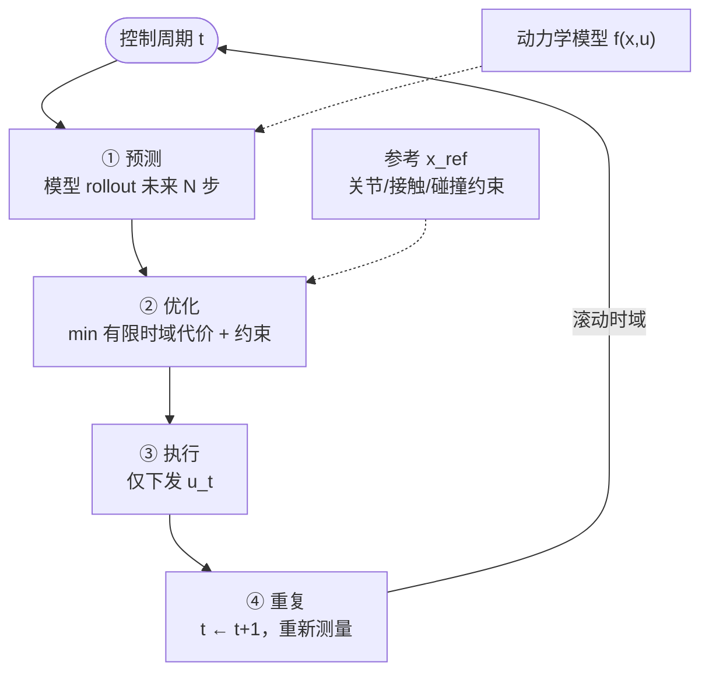
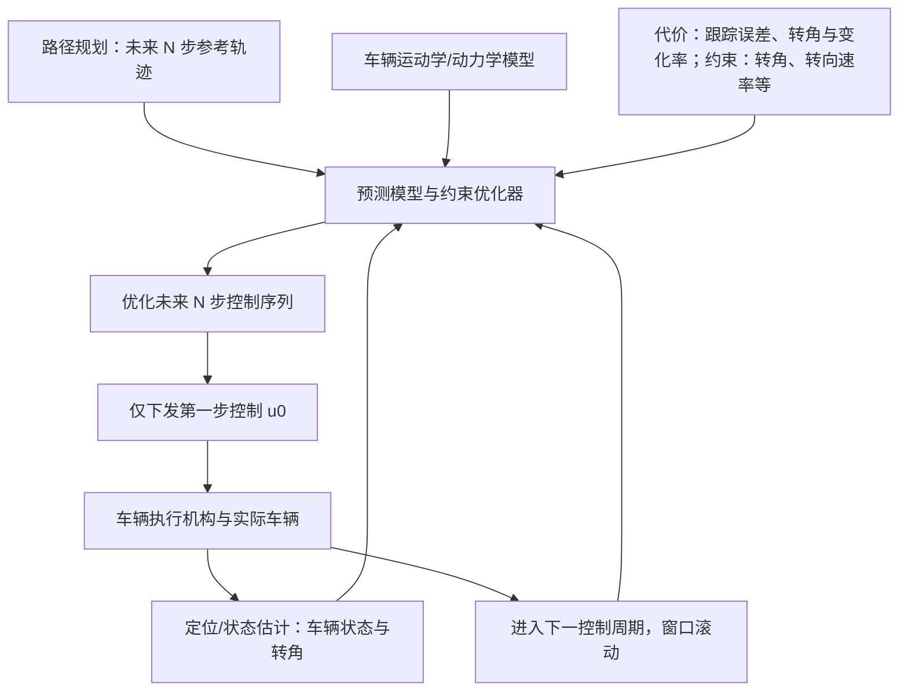

# Model Predictive Control (MPC，模型预测控制)

模型预测控制：一种基于滚动时域优化的控制方法，在每个时刻求解一个有限时域的最优控制问题，只执行第一步，然后重复。

## 一句话定义

不是一次性算出全局最优控制，而是**每一步都在线求解一个有限时域优化问题，只执行当前动作，然后重复**。

## 英文缩写速查

| 缩写 | 英文全称 | 简要说明 |
|------|----------|----------|
| MPC | Model Predictive Control | 滚动时域内优化控制序列 |
| OCP | Optimal Control Problem | MPC 每步求解的有限时域最优控制 |
| QP | Quadratic Programming | 线性化动力学下的常见求解形式 |
| CoM | Center of Mass | 质心轨迹是 loco MPC 核心状态 |
| WBC | Whole-Body Control | MPC 输出参考，低层 QP 跟踪全身 |

## 为什么重要

MPC 是机器人控制中最接近“万能控制框架”的东西——只要你能建模，就能控制。

核心优势：

- 处理约束：关节限位、接触力限制、碰撞避免——都可以自然地塞进优化约束里
- 处理多目标：同时处理平衡、跟踪、能耗等多个目标
- 处理非线性：非线性 MPC 可以处理复杂动力学
- 处理时变系统：每步重新计算，自然适应变化

代价是**计算量大**，实时性要求高。

## 核心原理速览

每个控制周期：测量当前状态 → 在有限时域内用简化模型预测 → 求解带约束的最优控制序列 → 只执行第一步 → 下一周期重复。足式机器人上的典型落地形式（Li & Nguyen 双足凸 MPC，[原文通读](../../sources/papers/force_moment_mpc_biped_reading_arxiv_2104_00065.md)）：

- 模型：忽略腿质量的简化刚体，状态 x=[姿态, 质心位置, 角速度, 质心速度, g]，输入为各接触足的地面反力（及力矩），小角度假设下对输入线性；
- 约束：摩擦锥、法向力上下界（下界为正以保持接触）、关节力矩限幅，摆动足输入置零；
- 求解：整个时域堆叠成 QP（min ½UᵀhU+Uᵀf），文中报告 <1 ms；
- 落地：支撑腿 τ=Jᵀu，摆动腿用笛卡尔 PD 跟踪落足点。

详细推导见下文「核心工作原理」。

## 核心工作原理

### 预测模型
首先需要一个动力学模型：

$$\dot{x} = f(x, u)$$

或者离散形式：

$$x_{k+1} = f(x_k, u_k)$$

这个模型不需要很精确（这也是 MPC 的一个优点），但越精确效果越好。

#### 预测模型从哪里来：牛顿投影 → 浮动基 → 离散优化

[完整公式推导（MPC Prediction Model Derivation）](../formalizations/mpc-prediction-model-from-floating-base-dynamics.md) 整理深蓝具身智能 2026-11-16 的 27 页教学原文：单摆牛顿投影与虚功 → 材料块雅可比 `J_a` → `M(q)·v̇ + C(q,v)v + G(q) = Sᵀτ + Jcᵀfc` → 固定接触加速度约束。核心辨析：**连续时间全阶动力学是预测模型的力学起点，并非直接可运行的 MPC**。选择状态/输入、支撑模式、降阶近似、离散化和约束后才构成控制器使用的 `f_d`；文章本身没有提供四足 MPC 源码与真机验证。

### 有限时域优化
在每个时刻 $t$：

1. 预测：用模型预测未来 $N$ 步的状态序列
2. 优化：求解一个优化问题，找到使代价函数最小的控制序列 $u_t, u_{t+1}, ..., u_{t+N-1}$
3. 执行：只把 $u_t$ 发给机器人
4. 重复：到下一个时刻，重新预测 + 求解

这就是"滚动时域"（receding horizon）控制的核心。下图概括每个控制周期内的闭环：



### 代价函数
典型形式：

$$J = \sum_{k=0}^{N-1} (x_k - x_{ref})^T Q (x_k - x_{ref}) + u_k^T R u_k$$

包含两项：
- 状态代价：状态跟参考值的偏差
- 控制代价：控制输入的大小（防止过于激进）

可以加硬约束（不等式）和软约束。

### 约束处理
这是 MPC 相比 LQR 等方法最关键的优势：

- 关节角度限位：$\underline{q} \leq q \leq \bar{q}$
- 关节速度限位：$\underline{\dot{q}} \leq \dot{q} \leq \bar{\dot{q}}$
- 接触力约束：$f_z \geq 0$（地面反力非负）
- 碰撞避免：作为不等式约束加入

## 自动驾驶工程例子：PID 为什么不一定被 MPC 替代？

> 来源：深蓝 AI 2026-11-17 [《彻底搞懂 MPC｜PID 免费又好用，自动驾驶为什么还要上模型预测控制？》](../../sources/blogs/wechat_shenlan_ai_mpc_vs_pid_autonomous_driving_2026-11-17.md)（用户提供 13 页 PDF 通读）以及 Autoware/MathWorks/MIT 官方文档。以下是方法归纳，不是本文原创算法或性能复现。

### 弯道预瞄：同样的误差不代表相同控制动作

在笔直路段与连续弯道入口，车辆可能具有相同的横向误差，但下一个动作应考虑**前方参考轨迹曲率、当前速度、转向执行器约束**。PID 并非绝对不能提前响应：它可以叠加前馈、预瞄、增益调度与限幅；MPC 的差异在于把未来若干步的模型预测、多目标代价和约束集中求解。

| 判断维度 | PID + 前馈 / 预瞄 / 限幅 | MPC |
|---|---|---|
| 决策依据 | 误差反馈，必要时叠加前馈与补偿 | 当前估计状态、未来参考轨迹、预测模型 |
| 运动平顺性 | 通过增益、滤波、限幅等工程设计 | 在代价函数中显式惩罚控制量及相邻控制量变化 |
| 执行器限制 | 输出限幅与外围逻辑实现 | 可纳入优化硬约束或经选择设计软约束 |
| 算力与开发成本 | 较低；易调试与维护 | 在线求解 QP / NLP，须保证时限与可行性 |
| 典型适用 | 简单、弱耦合的速度/关节反馈闭环 | 轨迹曲率变化、多变量耦合、多约束工况 |

### 车辆横向 MPC 的滚动闭环

以运动学自行车模型为入门例子，状态可含平面位置、航向、速度，输入可为转向角；高动态或低附着工况可能需要侧偏、轮胎力、转向迟滞等更完整模型。下图是**文章所述概念数据流**，并非根据 Autoware 代码重建的源码运行时序图。



如果优化器发现很小的横向误差，却知道接下来有连续弯道，它可以在当下提前选择较温和的转向动作；下一周期仍会用**新测状态**重算，以缓解侧风、坡度、轮胎侧偏等模型误差。此处的“N 步”是抽象预测时域，不代表统一固定 10 步。

### 跟踪精度、动作平顺与硬约束不能混为一谈

- **代价（可权衡）**：横向偏差、航向误差、转向量及转向增量，通过权重取舍；追求误差极小可能导致转向过猛，过度惩罚动作又会导致入弯滞后。
- **硬约束（必须满足才是可行解）**：例如转向角机械限位、转向速率、加速度边界；**软约束**可以容许指定的有限违反并附加惩罚，必须明确哪些安全边界绝不可软化。
- **有限时域不是形式安全保证**：求解成功不代表现实安全；未建模障碍、估计偏差、约束冲突与下一周期不可行仍需独立处理。递归可行性需要额外设计（见 MIT 课程）。

### 官方系统的分工：横向 MPC 与纵向 PID 可以并存

- [Autoware MPC Lateral Controller 官方文档](https://autowarefoundation.github.io/autoware_universe/main/control/autoware_mpc_lateral_controller/)：接收规划轨迹、里程计和转向反馈，设置车辆模型与 QP 求解器后计算横向转向控制；`calculateMPC()` 是文档给出的计算接口。
- [Autoware PID Longitudinal Controller 官方文档](https://autowarefoundation.github.io/autoware_universe/latest/control/autoware_pid_longitudinal_controller/)：纵向速度/加速度跟踪仍可用 PID，辅以转向之外的延迟补偿、坡度补偿等，不意味着 PID 被 MPC 全面取代。
- [MathWorks MPC-ACC 官方示例](https://www.mathworks.com/help/mpc/ref/adaptivecruisecontrolsystem.html)：另一种纵向设计通过 MPC 同时处理设定速度、与前车的安全距离、加速度边界；它是示例，不代表所有 Autoware 车辆采用该 ACC 设计。

### 上车验收清单（依据文章第 9–11 页归纳）

1. **先查模型适用域**：标定车辆与执行器，覆盖目标速度、转向迟滞及轮胎附着变化；避免将理想自行车模型误用到低附着极限工况。
2. **再查预测时域与截止时间**：太短预瞄不足，太长延迟/模型误差与计算负担变大；实测每周期最坏求解耗时，而不只看均值。
3. **分清代价与约束**：针对跟踪误差、方向盘振荡、弯道迟滞分别调整权重/约束，而不是复制一套“标准参数”。
4. **设计失败兜底**：监测优化不可行、超时、估计失真与越界，明确保持控制、降级控制或安全停车等独立处置机制。

相关入口：[PID 控制](./pid-control.md)、[Autoware](../entities/autoware.md)、[MPC 调参指南](../queries/mpc-tuning-guide.md)、[MIT Underactuated Robotics](https://underactuated.csail.mit.edu/trajopt.html)。

## 主要分类

### 1. 线性 MPC（LMPC）
假设线性系统：

$$x_{k+1} = A x_k + B u_k$$

可以用 QP（二次规划）求解，速度快，适合实时控制。

典型应用：双足行走的 ZMP 控制、轮式机器人轨迹跟踪。

### 2. 非线性 MPC（NMPC）
用非线性动力学模型，需要求解非线性优化问题（NLP）。

计算量比 LMPC 大很多，通常需要：

- 实时非线性优化求解器（e.g. Acados, FORCES Pro）
- 比较好的初值（可以用线性 MPC 的结果做 warm start）

### 3. 凸非线性 MPC
把非线性问题凸化——比如用多面体约束、凸成本函数。

IsaacGym /机器人领域常见。

### 4. 随机 MPC
处理模型不确定性和外界干扰。

加入随机约束或者 robustness budget。

### 5. 学习式候选轨迹评估（相关方向：LiteNWM）

[LiteNWM](../entities/paper-litenwm-efficient-latent-world-model-navigation.md) 也采用“预测短期后果 → 选择轨迹 → 执行一段 → 重新规划”的滚动闭环，但它保留冻结导航策略给出的候选集，再用学习到的潜空间世界模型和评分器重排序；它不是经典的显式动力学 MPC，也不通过求解 OCP 从头优化控制序列。两者相通的是 receding-horizon 的反复更新机制，分野在候选如何产生、如何评估。

## 在人形机器人中的典型应用

### 行走控制
用 centroidal dynamics + NMPC：

- 预测未来几步的质心/角动量
- 优化接触力分配
- 保持平衡约束

代表工作：
- Di Carlo et al., "Dynamic Locomotion in the MIT Cheetah 3 Through Convex Model-Predictive Control"（IROS 2018，四足凸 MPC）
- Li & Nguyen, "Force-and-moment-based Model Predictive Control for Achieving Highly Dynamic Locomotion on Bipedal Robots"（arXiv:2104.00065，双足）
- ANYmal 的行走控制

### 全身控制
用 WBC 框架下：

- 上层用 MPC 计算 task-space 指令
- 下层用 QP 分配关节力矩

### 足式机器人
四足/双足机器人的站立、行走、跑跳控制几乎都离不开 MPC。

代表：
- MIT Cheetah 的凸 MPC
- Unitree 的 NMPC 控制器

## 关键参数 (详见 [MPC 调参指南](../queries/mpc-tuning-guide.md))

### 预测时域 $N$
- $N$ 太短：来不及规划，响应快但可能不稳定
- $N$ 太长：计算量大，实时性差
- 通常 $N=10\sim 40$ 步（取决于控制频率）

### 控制频率
- 人形机器人典型：1-5 kHz
- 越快越好，但受限于求解器速度
- 高频MPC + 低频 RL 是常见组合

### 模型精度 vs 计算速度
这是一个 trade-off：
- 精确模型 → 更好的跟踪和预测，但计算慢
- 简化模型 → 计算快，但跟踪精度差

常用 trick：用简化模型做 MPC，用更精确的模型做仿真验证。

## 和强化学习的比较

| 维度 | MPC | 强化学习 |
|------|-----|---------|
| 依赖模型 | 必须有模型 | 不需要（model-free）|
| 计算量 | 在线优化，实时要求高 | 离线训练，在线推理快 |
| 泛化能力 | 受模型精度限制 | 可泛化到新任务 |
| 处理约束 | 自然 | 需要专门设计 |
| 超越人类 | 难 | 可以 |

常见组合：
- **RL 训练低层策略 + MPC 做高层规划**
- **RL 训练一个 "policy prior" + MPC 在其中做优化**

## 最小代码骨架

下面这段代码把 MPC 的最小闭环写清楚：
- 每个控制周期枚举几组候选控制序列
- 用模型前向 rollout
- 计算有限时域代价
- 只执行当前第一步控制

```python
import numpy as np

A = np.array([[1.0, 0.1], [0.0, 1.0]])
B = np.array([[0.0], [0.1]])
Q = np.diag([5.0, 0.5])
R = np.diag([0.1])


def mpc_step(x0, candidates):
    def cost(U):
        x = x0.copy()
        total = 0.0
        for u in U:
            total += x.T @ Q @ x + u.T @ R @ u
            x = A @ x + B @ u
        return float(total)

    best_U = min(candidates, key=cost)
    return best_U[0]


x = np.array([[0.2], [0.0]])
candidates = [np.zeros((10, 1)), 0.1 * np.ones((10, 1)), -0.1 * np.ones((10, 1))]
u = mpc_step(x, candidates)
print("apply control:", u.ravel())
```

真正的机器人 MPC 会把这里的候选序列枚举换成 QP / NLP 求解器，并显式加入接触、摩擦锥、力矩限位等约束。

## 工程实践

- **选模型要与可控自由度匹配**：原文中每足 3D 力的模型做不了俯仰、加 3D 力矩的模型做不了横滚，最终用 3D 力 + 2D 力矩——先用仿真逐个验证姿态自由度（原文 §IV-A）。
- **时域与频率**：原文取 10 步预测、一个 0.3 s 步态周期、MPC 0.03 s 采样、底层 1 kHz；这是该论文的取值，不是通用推荐（调参见 [MPC 调参指南](../queries/mpc-tuning-guide.md)）。
- **MPC 之下仍需底层**：摆动腿、关节力矩映射、WBC 等由下层完成；求解器选型见 [MPC Solver Selection](../queries/mpc-solver-selection.md)。
- **证据边界**：该双足论文只在仿真验证，无硬件结果（原文结论自述）；实机迁移的难度属本页推断。

## 方法局限性

- 对计算资源敏感：预测时域一长、模型一复杂，实时性马上成为瓶颈
- 对模型质量敏感：特别是人形机器人接触切换和摩擦建模不准时，预测会漂
- 约束设计很考经验：硬约束和软约束怎么取舍，直接决定求解器稳定性
- 通常还要下层控制器配合：MPC 负责规划得漂亮，但最后还得靠 WBC / impedance / PD 把它落到关节上

## 参考来源

- [深蓝具身智能《机器人控制算法 MPC 的预测模型从哪来？完整公式推导》（2026-11-16）](../../sources/blogs/wechat_shenlan_mpc_floating_base_derivation_2026-11-16.md) — 27 页原文，从单摆虚功、浮动基材料块雅可比到接触约束；[结构化推导笔记](../formalizations/mpc-prediction-model-from-floating-base-dynamics.md)。

- [LG-DKGP 原文与边界复核](../../sources/papers/lg_dkgp_arxiv_2611_16645.md)

- [wechat_shenlan_robot_control_eight_paradigms.md](../../sources/blogs/wechat_shenlan_robot_control_eight_paradigms.md) — 深蓝八大控制体系：MPC 代表算法
- [wechat_shenlan_ai_ad_planning_control.md](../../sources/blogs/wechat_shenlan_ai_ad_planning_control.md) — 车载轨迹跟踪 MPC 与 PID/LQR 分工
- [深蓝 AI：MPC 与 PID 的自动驾驶工程选型（2026-11-17，原文通读）](../../sources/blogs/wechat_shenlan_ai_mpc_vs_pid_autonomous_driving_2026-11-17.md) — 滚动时域、代价/约束、Autoware 和 ACC 一手交叉核验
- Di Carlo et al., *Dynamic Locomotion in the MIT Cheetah 3 Through Convex Model-Predictive Control*（IROS 2018，[DOI 10.1109/IROS.2018.8594448](https://doi.org/10.1109/IROS.2018.8594448)）— 凸 MPC 代表论文（四足）
- Li & Nguyen, *Force-and-moment-based Model Predictive Control for Achieving Highly Dynamic Locomotion on Bipedal Robots*（[arXiv:2104.00065](https://arxiv.org/abs/2104.00065)）— 双足行走 MPC
- [CMU Optimal Control 2025 策展](../entities/cmu-optimal-control-curriculum.md) — Lec 10 Convex MPC（播放列表归档）
- [Optimal Control 2025 (YouTube Course)](https://www.youtube.com/playlist?list=PLZnJoM76RM6IAJfMXd1PgGNXn3dxhkVgI), Lecture 10: Convex MPC — 理论讲解
- Acados (http://acados.org/) — 开源 NMPC 求解器，实现参考
- Li & Nguyen 原文通读归档：[force_moment_mpc_biped_reading_arxiv_2104_00065.md](../../sources/papers/force_moment_mpc_biped_reading_arxiv_2104_00065.md)
- **ingest 档案：** [sources/papers/mpc.md](../../sources/papers/mpc.md)、[lqr_ilqr_primary_refs.md](../../sources/papers/lqr_ilqr_primary_refs.md)（LQR 与 MPC 关系）

## 关联页面

- [TimesFM 3.0](../entities/timesfm-3.md) — 零样本运营时序预测可作为负荷/产能规划的外部需求先验；与 MPC 的动作条件动力学预测不同，不能直接替代控制器或系统模型。

- [MPC 预测模型推导](../formalizations/mpc-prediction-model-from-floating-base-dynamics.md) — 完整动力学的来源以及离散预测模型需要补齐的步骤。

- [LG-DKGP](../entities/paper-lg-dkgp.md) — 冻结 LeWM，并用已执行动作历史构造连续性先验来初始化 CEM；主设置每次规划为 300 候选 × 30 轮、执行 25 步后重规划，属于采样式滚动规划实例，不是硬实时伺服的验证。（[来源复核归档](../../sources/papers/lg_dkgp_arxiv_2611_16645.md)）
- [《自动驾驶核心算法盘点》专栏技术地图](../overview/autonomous-driving-core-algorithms-series.md) — 车载 MPC 在规控组合中的位置
- [八大机器人控制体系分类](../comparisons/robot-control-eight-paradigms-taxonomy.md)
- [滚动优化与 ILC（体系⑥）](../overview/robot-control-paradigm-receding-horizon-ilc.md)
- [Iterative Learning Control](./iterative-learning-control.md)
- [雅可比矩阵](../formalizations/robot-jacobian.md) — 工作点局部线性化的运动学接口
- [Whole-Body Control](../concepts/whole-body-control.md)
- [Locomotion](../tasks/locomotion.md)
- [Reinforcement Learning](./reinforcement-learning.md)
- [LQR / iLQR 算法详解](./lqr-ilqr.md)
- [Optimal Control (OCP)](../concepts/optimal-control.md)
- [MPC vs RL](../comparisons/mpc-vs-rl.md) — 控制范式选型对比
- [π MPC](./pi-mpc.md) — parallel-in-horizon、construction-free ADMM NMPC
- [MPC-RL](../entities/paper-mpc-rl-humanoid-locomotion-manipulation.md) — 训练期 CD-MPC 地标奖励指导 PPO
- [SMPC-to-RL](../entities/paper-smpc2rl-loco-manipulation.md) — 采样 MPC 只做仿真专家，稀疏 RL 上真机
- [Nonlinear MPC](./nonlinear-model-predictive-control.md) — 完整非线性动力学滚动优化
- [Quadratic Programming](../formalizations/quadratic-programming.md) — 凸 MPC / WBC 子问题形式
- [MPC Solver Selection](../queries/mpc-solver-selection.md) — OSQP / Acados 等选型
- [SRL-MPC](../entities/paper-srl-mpc.md) — PPO 读取邻域 GSF 在线调形状感知二阶软罚 HOCBF-MPC 参数（arXiv:2608.21175；仓库暂公开项目材料，算法源码未发布）
- [赛车漂移 RL 开源景观](../overview/racing-drift-rl-open-source-landscape.md) — F1/10 **LearningMPC** 与 **drift-mpc-ackermann** 等非线性/学习 MPC 真机栈
- [mpc_python](../entities/mpc-python.md) — **CVXPY 迭代线性化 MPC** 路径跟踪 + MuJoCo/MuSHR demo（MIT，~520★；教学向 QP 闭环）

- [DSLC：隐蔽执行器攻击下的多机器人安全学习控制](../entities/paper-dslc-multirobot-secure-control.md) — 将分布式 MPC 扩展为面向隐蔽执行器攻击的对抗式闭环策略学习。

## 推荐继续阅读

- [CMU Optimal Control 2025（课程归档）](../../sources/courses/cmu_optimal_control_16_745_2025_youtube.md) — Lecture 10: Convex Model-Predictive Control
- [Optimal Control 2025 (YouTube Course)](https://www.youtube.com/playlist?list=PLZnJoM76RM6IAJfMXd1PgGNXn3dxhkVgI) - Lecture 10: Convex Model-Predictive Control
- [Dynamic Locomotion in the MIT Cheetah 3 Through Convex Model-Predictive Control](https://doi.org/10.1109/IROS.2018.8594448) - Di Carlo et al., IROS 2018
- [Force-and-moment-based MPC for Bipedal Robots](https://arxiv.org/abs/2104.00065) - Li & Nguyen
- Acados: http://acados.org/ - NMPC solver
