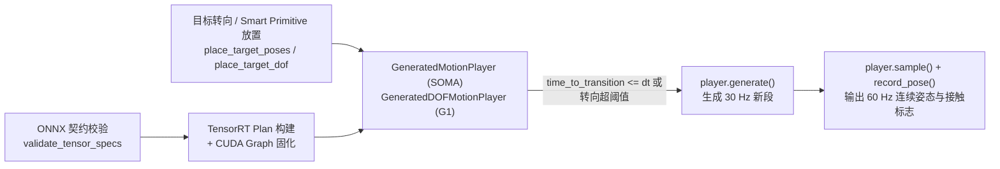

# MotionBricks: 模块化生成式运动合成框架

> **Query 产物**：本页由「NVIDIA MotionBricks 技术细节与 GR00T 关联」研究触发，并于 2026-11-20 对照 `NVlabs/motionbricks` 独立仓库运行时源码核对补充。

**MotionBricks** 是 NVIDIA Research 推出的实时高保真运动生成框架，代表从「判别式运动先验」（如 [AMP](./amp-reward.md)）向「模块化可组合生成式运动基元」演进的典型路径；在 [AMP 运动先验专题 #05/19](../overview/humanoid-amp-motion-prior-survey.md) 策展中，它被定位为比 Kimodo 更贴近高频控制循环的实时身体运动 API（论文身份与开源边界详见 [paper-motionbricks](../entities/paper-motionbricks.md)）。

## 一句话定义

通过解耦的 **Modular Latent Generative Backbone**（Root / Pose / Contact 离散潜空间分词 + 渐进自回归与细化解码）与 **Smart Primitives** 高层引导接口，在 TensorRT + CUDA Graph 上以约 `2 ms` 延迟实时流式生成 SOMA 与 Unitree G1 全身参考运动的生成式框架。

## 英文缩写速查

| 缩写 | 英文全称 | 简要说明 |
|------|----------|----------|
| AMP | Adversarial Motion Prior | 用对抗判别约束状态转移接近专家运动分布的先验 |
| VAE | Variational Autoencoder | 变分自编码器，学习隐变量生成表示 |
| Locomotion | Robot Locomotion | 足式/人形等无轮移动能力的总称 |
| VLA | Vision-Language-Action | 视觉-语言-动作多模态基础策略方向 |
| WBC | Whole-Body Control | 协调全身关节满足多任务/约束的控制基础设施 |
| G1 | Unitree G1 Humanoid | 宇树入门级教育科研人形平台 |
| Sim2Real | Simulation to Real | 把仿真中学到的策略迁移落地真机的工程主线 |
| Retargeting | Motion Retargeting | 将人体/动物动作映射到目标机器人骨架 |
| Isaac Lab | NVIDIA Isaac Lab | 基于 Omniverse 的机器人学习训练框架 |

## Survey 坐标（策展索引）

### 在 AMP 运动先验专题 19 篇中

| 字段 | 内容 |
|------|------|
| 编号 | 05/19 |
| 分组 | 01 分布约束与先验组件化 |
| 索引来源 | [具身智能研究室 · AMP 运动先验专题长文](https://mp.weixin.qq.com/s/YZsm3855iP3TNTTt1aou7w) |

## 为什么重要

- **弥合离线高保真生成与高频控制延迟**：[Kimodo](../entities/kimodo.md) 适合离线多约束导演式编辑，而 MotionBricks 把单次生成延迟压缩至 **~2 ms**（~15,000 FPS 批吞吐口径），支持游戏角色与人形控制器每 4 帧过渡前动态续写。
- **模块化潜空间 + Smart Primitives 可组合**：不用为每个动作重训单一控制器，而是把目标速度/朝向/风格（Smart Locomotion）与物体代理关键帧（Smart Objects）统一映射为通用潜码生成条件。
- **跨数字人骨架（SOMA）与人形机器人（Unitree G1）共用引擎**：官方独立仓库 `NVlabs/motionbricks` 同时封装 `GeneratedMotionPlayer`（SOMA）与 `GeneratedDOFMotionPlayer`（Unitree G1 关节角输出），并与 [GR00T-WholeBodyControl](../entities/gr00t-wholebodycontrol.md) 协同衔接真机 WBC。

## 核心原理：模块化潜空间与智能基元

### 1. 多头离散化 Tokenizer 与渐进解码

- **解耦编码**：将连续运动序列拆解为**根轨迹 (Root)**、**姿态意图 (Pose)** 与**接触 (Contact)** 结构化潜空间（FSQ/VQ 离散化），覆盖 **350,000+** 动作片段的宽分布建模。
- **渐进式生成流水线**：先按目标引导位姿或路径规划 Root 演变，再自回归生成全身 Pose Token，并经 Refinement Decoder 输出 `30 Hz` 连续骨架姿态或 G1 关节目标。

### 2. Smart Primitives (智能基元) 接口

| 基元类型 | 技术实现 | 应用场景 |
|----------|----------|----------|
| **Smart Locomotion** | 速度/朝向与风格标签引导的连续运动片段 | 任意转向、快走、僵直/潜行风格零样本组合 |
| **Smart Objects / Target Poses** | 代理关键帧 / 局部锚点（`TargetPoseInferenceParams`） | 坐卧、避障、开门等交互动作过渡补全 |
| **Smart Interaction** | 时空锚点 (S-T Anchors) | 多体协同或人-机动作时序同步 |

## 主要技术路线

```text
多源运动数据
  -> Root / Pose / Contact 分解式 Tokenizer
  -> 模块化潜空间生成骨干
  -> Smart Primitive 条件控制
  -> Refinement Decoder 生成全身轨迹
  -> WBC / SONIC / 仿真或真机控制器执行
```

## 工程实践与运行时架构

对照独立官方源码仓 `NVlabs/motionbricks`（`motionbricks/model/engine.py`、`docs/runtime_api.md`、`docs/examples/locomotion_loop.py`）：



- **核心 API 入口（实测源码）**：`MotionBricksEngine` 继承 `InferenceEngine`，构造时检查 `self.contract.validate_tensor_specs(...)` 并缓存 `.trt-cache` 加速计划（默认 `bake_cuda_graph=True`）。在连续移动例程 `docs/examples/locomotion_loop.py` 中，外部游戏或控制循环以 `60 Hz` 运行：当转向角度变化超过 `TURN_THRESHOLD=15°` 或距窗口切换只剩 `4` 帧（`time_to_transition <= dt`）时，用 `adjust_target_dof_speed` / `place_target_dof` 刷新目标并调用 `player.generate()`，随后每帧通过 `player.sample()` 与 `player.record_pose()` 维持平滑历史。
- **社区轻量运行档**：[motion-bricks.cpp](../entities/motion-bricks-cpp.md) 将 Unitree G1 batch-1 推理移植至 C++/GGML，并支持串联 GGML 版 [SONIC](../entities/nvidia-sonic.md) + MuJoCo 仿真追踪。

### 在 GR00T Whole-Body Control 中的角色

1. **高层任务层 (VLA)**：将视觉/语言指令转为方向速度、目标位置或物体关键帧目标。
2. **MotionBricks (运动生成层)**：实时流式合成为 `30 Hz -> 60 Hz` 连续全身姿态或 G1 关节参考。
3. **WBC 控制层 (WBC / SONIC)**：追踪执行 MotionBricks 产出的参考并保证平衡、摩擦锥与碰撞安全。

## 局限与风险

- **运动学生成 ≠ 物理可行控制**：MotionBricks（包括 `GeneratedDOFMotionPlayer` 输出的 G1 关节轨迹）仍处于**运动学参考层**，在例程代码中高期望速度下即可观测到足滑；真机闭环必须经过 [SONIC](../entities/nvidia-sonic.md) / WBC 跟踪器抑制动力学违背。
- **预览代码与完整版 GR00T 集成边界**：独立仓 `NVlabs/motionbricks`（及 `GR00T-WholeBodyControl/motionbricks/`）提供完整 TensorRT/Warp 推理与部分示例；部分涉及深度嵌入 GR00T WBC 全身操作与特定商业数据集配方需结合上层文档核验（实体与开源清单追踪见 [paper-motionbricks](../entities/paper-motionbricks.md)）。
- **显卡与 TensorRT 环境绑定**：官方 Python 运行时重度依赖 `warp-lang`、`CUDA Graph` 与 `.trt-cache` ONNX 构建流程，边缘设备部署须重新交叉编译导出。

## 关联页面

- [人形 AMP 运动先验综述](../overview/humanoid-amp-motion-prior-survey.md) — 19 篇总览（MotionBricks #05 专题坐标）与姊妹篇对照
- [paper-motionbricks](../entities/paper-motionbricks.md) — SIGGRAPH 2026 论文实体与开源边界
- [Whole-Body Control (WBC)](../concepts/whole-body-control.md) — MotionBricks 为其提供参考轨迹
- [GR00T-WholeBodyControl](../entities/gr00t-wholebodycontrol.md) — 官方单仓中 `motionbricks/` 子项目与一体化文档
- [Kimodo](../entities/kimodo.md) — 同生态离线多约束扩散生成对照
- [motion-bricks.cpp](../entities/motion-bricks-cpp.md) — 社区 C++/GGML 本地运行时
- [ARDY](../entities/ardy.md) — 交互式自回归扩散 + 长时域约束（SIGGRAPH 2026；同生态对照）
- [Motion Retargeting](../concepts/motion-retargeting.md) — 利用 SOMA Retargeter 处理跨骨骼转换
- [Isaac Lab](../entities/isaac-gym-isaac-lab.md) — 训练与验证环境
- [Unitree G1](../entities/unitree-g1.md) — 部署验证硬件

## 参考来源

- [sources/papers/motionbricks.md](../../sources/papers/motionbricks.md) — SIGGRAPH 2026 论文全文精读归档
- [sources/repos/motionbricks.md](../../sources/repos/motionbricks.md) — `NVlabs/motionbricks` 独立源码仓 API 与运行例程核查
- [sources/repos/gr00t_wholebodycontrol.md](../../sources/repos/gr00t_wholebodycontrol.md) — GR00T WBC 单仓中 `motionbricks/` 子项目与训练/部署文档入口
- [NVIDIA MotionBricks Project Page](https://nvlabs.github.io/motionbricks/)
- [MotionBricks: Scalable Real-Time Motions with Modular Latent Generative Model and Smart Primitives](https://arxiv.org/abs/2604.24833)
- 原始抓取：[wechat_humanoid_amp_19_survey_2026-05-26.md](../../sources/raw/wechat_humanoid_amp_19_survey_2026-05-26.md)

## 推荐继续阅读

- [GitHub：NVlabs/motionbricks](https://github.com/NVlabs/motionbricks) — Runtime API 文档与 `locomotion_loop.py` 示例
- [MotionBricks 项目页（nvlabs.github.io/motionbricks）](https://nvlabs.github.io/motionbricks/) — Smart Primitives 与 2 分钟 UE5 无剪辑演示
- [paper-motionbricks（论文实体详情页）](../entities/paper-motionbricks.md) — 消融与定量评测详表
