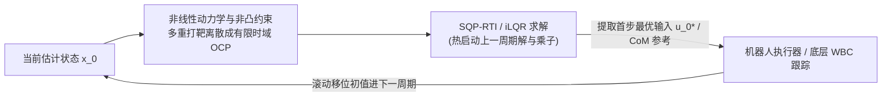

# Nonlinear Model Predictive Control（NMPC）

**NMPC（非线性 MPC）**：在每个控制周期求解 **非线性** 有限时域 OCP——非线性动力学 $x_{k+1}=f(x_k,u_k)$、非线性代价与约束（碰撞、摩擦等），只执行首步控制后滚动重规划。

## 一句话定义

> 线性 MPC 的「完全体」：不线性化掉动力学，直接解 NLP——更强表达力，更高算力需求。

## 英文缩写速查

| 缩写 | 英文全称 | 简要说明 |
|------|----------|----------|
| NMPC | Nonlinear Model Predictive Control | 非线性滚动时域优化 |
| MPC | Model Predictive Control | 广义的滚动 OCP；常指线性/凸特例 |
| OCP | Optimal Control Problem | NMPC 每步的数学对象 |
| SQP | Sequential Quadratic Programming | NMPC 常用求解框架 |
| RTI | Real-Time Iteration | 每周期只做有限 SQP 迭代 |

## 为什么重要

- **处理全阶与质心耦合非线性**：传统凸 MPC 在高动态翻滚、大俯仰角或操作臂负载耦合时会因小角度/定线性化假设失效（Sleiman et al., RA-L 2021；Wensing et al., T-RO 2024），NMPC 可直接在每步求解质心或全阶非线性动力学与双线性角动量交叉项。
- **在线避障与非凸安全约束**：能够统一纳入全身多连杆避障距离函数、关节扭矩边界与非线性轨迹追踪代价，作为腿式 loco-manipulation 与无人机敏捷飞行的主力实时规划框架。

## 与线性/凸 MPC 的区别

| 维度 | 凸/线性 MPC | NMPC |
|------|------------|------|
| 动力学 | 线性化固定 | 完整非线性 |
| 求解 | QP（OSQP 等） | NLP（Acados SQP-RTI、IPOPT） |
| 实时性 | 50–500 Hz 常见 | 10–100 Hz，依赖 horizon |
| 约束 | 线性/凸 | 任意光滑约束 |

## 核心原理（与线性 MPC 区别及典型求解流程）

1. **打靶 / 多重打靶** 离散 OCP
2. **SQP-RTI** 或 **iLQR**：每周期 warm start 上一步解
3. **增广拉格朗日 / 内点** 处理等式动力学与不等式
4. 执行 $u_0^*$，移位初值，重复

## 机器人应用（课程 3.8–3.9）

- 足式 / 人形 **全身 NMPC**（CD-MPC、Whole-body NMPC 等研究线）
- **避障 loco-manipulation**：碰撞距离约束进 NLP
- 与 WBC 分层：NMPC 出 wrench/CoM 参考，WBC 做 QP 跟踪

## 工程实践

- **SQP + RTI（Real-Time Iteration）截断优化**：在线控制周期严格受限时，每个控制步只做有限次（甚至 1 次）SQP 线性化 QP 步并热启动上一周期的轨迹与拉格朗日乘子（Sleiman et al., RA-L 2021；Wensing et al., T-RO 2024）。
- **直接转录 vs 打靶法折中**：MIT *Underactuated Robotics* Ch. 10 指出，多重打靶/直接配点具有更好的局部敏感度缩放和并行性，而 iLQR/DDP 依靠 Riccati 递推在长时域高自由度串联刚体上具备 $O(N)$ 复杂度。

## 局限与常见误区（优势与局限）

| 优势 | 局限 |
|------|------|
| 完整动力学与约束 | 非凸、初值敏感 |
| 统一处理避障与任务 | 需严格实时预算与 fallback |
| 与 TrajOpt 共享工具链 | 调参（horizon、权重）成本高 |

## 主要分类

| 层级 | 方法 | 频率 |
|------|------|------|
| 凸 NMPC 近似 | 线性化 + QP | 50–500 Hz |
| SQP-RTI | 有限 SQP 步 | 20–100 Hz |
| 完整 NLP | IPOPT / 多步 SQP | 离线 / 慢环 |

## 关联页面

- [Model Predictive Control](./model-predictive-control.md) — 线性/凸基础
- [Trajectory Optimization](./trajectory-optimization.md) — 离线同源 OCP
- [MPC Solver Selection](../queries/mpc-solver-selection.md)
- [Constrained Optimization](../concepts/constrained-optimization.md)

## 推荐继续阅读

- [SRBD + 凸 MPC + WBC](../concepts/srbd-convex-mpc-wbc.md) — 与 CD-NMPC 的路线分叉
- [OCS2](../entities/ocs2.md) — ETH RSL 切换系统 NMPC 工具箱（[文档](https://leggedrobotics.github.io/ocs2/)）
- [acados](../entities/acados.md) — 嵌入式 RTI-SQP NMPC

## 参考来源

- [MIT Underactuated Robotics（Ch. 10 Trajectory Optimization / MPC）](../../sources/courses/mit_underactuated_robotics.md) — Direct Transcription / Direct Collocation / Pontryagin / iLQR 与 MPC
- [MPC 论文索引与核对档案](../../sources/papers/mpc.md) — Sleiman et al. 2021（Whole-Body NMPC，arXiv:2103.00946）与 Kim et al. 2019
- [Wensing et al. 2024 T-RO 综述档案](../../sources/papers/wensing_opt_control_tro_arxiv_2211_11644.md) — 优化 legged 控制的 NMPC/DDP/Contact-Implicit 演化
- [sources/courses/numerical_optimization_foundations_robotics.md](../../sources/courses/numerical_optimization_foundations_robotics.md) — 第 3 章 3.8–3.9 NMPC（待全书通读）
