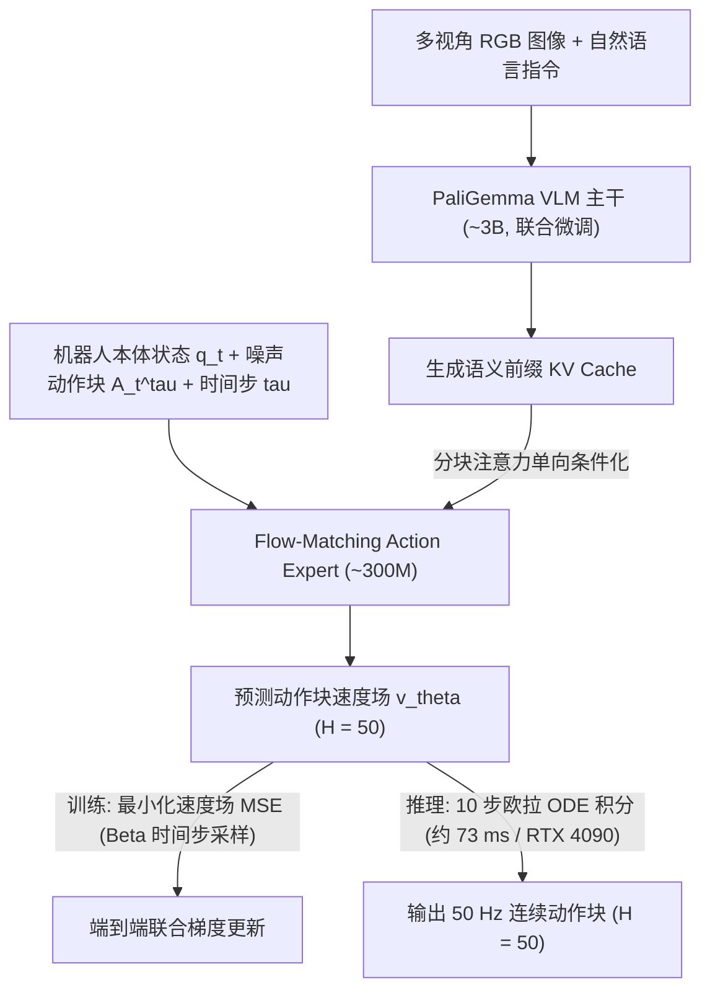

# π₀ 策略（Pi-Zero Policy）

## 一句话定义

**π₀（Pi-Zero）** 是 Physical Intelligence 提出的一种将预训练视觉-语言模型（PaliGemma，约 3B 参数）与独立连续[流匹配具身策略](../concepts/flow-matching-embodied-policy.md)动作专家（Action Expert，约 300M 参数）通过共享注意力混合（Mixture-of-Transformers）联合端到端训练的通用 [VLA](vla.md) 策略，用于以 50 Hz 动作分块高频执行灵巧桌面与[双臂操作](../tasks/bimanual-manipulation.md)任务。

## 英文缩写速查

| 缩写 | 英文全称 | 简要说明 |
|---|---|---|
| VLA | Vision-Language-Action | 融合视觉感知、自然语言指令与机器人动作输出的通用策略模型 |
| VLM | Vision-Language Model | 承担语义理解与多模态观测编码的预训练视觉-语言骨干（如 PaliGemma） |
| LLM | Large Language Model | VLM 内部负责跨模态自回归推理与词元交互的语言主干部分 |
| FM | Flow Matching | 通过回归连续速度场沿概率流 ODE 采样高质量动作块的生成框架 |
| FAST | Frequency-space Action Sequence Tokenization | 基于 DCT 频域压缩把连续动作离散化为高效词元的分词方案 |
| KI | Knowledge Insulation | 隔断连续动作专家梯度回流以保护 VLM 语义推理能力的训练机制 |
| RTC | Real-Time Chunking | 跨异步推理与执行窗口平滑衔接动作块边界的实时控制机制 |

## 为什么重要

早期 VLA（如自回归离散化动作词元的 RT-2 / OpenVLA）受限于词元化精度与单步自回归推理节拍，难以兼顾语义泛化与灵巧高速控制；而传统 [Diffusion Policy](diffusion-policy.md) 虽能生成细腻的连续多峰动作轨迹，却缺乏互联网级多模态预训练主干。π₀ 的方法学价值在于同时打通了两条路径：

- **互联网语义先验 + 高频连续动作块**：以 3B PaliGemma 承接开放世界视觉-语言表征，再借由专用 Action Expert（$H=50$ 动作块、仅需 10 步欧拉积分）在连续空间直接输出高频关节或末端控制序列，无需把连续关节角硬塞进有限词表。
- **跨本体大规模预训练 + 快速下游微调**：在涵盖多种单臂、双臂与移动操作平台的跨本体真机混合数据上完成预训练后，下游具体任务（如叠衣、清理桌面、装盒）只需少量对应形态的精调数据即可激活灵巧技能（论文详述见 [π₀ 论文实体页](../entities/paper-pi0.md)）。
- **开放生态与后续进化基座**：官方开源实现 [openpi](../../sources/repos/openpi.md) 成为具身 VLA 领域的事实工程底座，直接衍生出 `π₀-FAST`、面向开放世界层次推理的 `π₀.₅`（含 [Knowledge Insulation](../entities/paper-knowledge-insulation.md)）、以及针对真机后训练闭环强化的 [χ₀ / Kai0](../entities/paper-kai0.md) 与 [π₀.₇](pi07-policy.md) 等路线。

## 核心原理

### 1. 双专家混合架构（PaliGemma VLM + Flow-Matching Action Expert）

π₀ 并没有把所有张量丢进一个单一 MLP 动作头，而是构建了类似 **Mixture-of-Transformers** 的双流联合注意力结构（见 [跨模态注意力](../formalizations/cross-modal-attention.md)与 [VLA 词元化](../formalizations/vla-tokenization.md)）：

- **VLM 语义前缀流（~3B 参数）**：接收多视角 RGB 图像与文本指令，通过 PaliGemma（SigLIP 视觉编码器 + Gemma 语言主干）生成环境语义与空间上下文的 Key-Value（KV）缓存；**在原版 π₀ 预训练与微调中，VLM 主干与动作专家默认联合端到端训练**（而非强制冻结），因此能将物理控制线索反向塑造至多模态视觉特征。
- **Action Expert 连续Suffix流（~300M 参数）**：输入机器人本体感知状态 $q_t$ 与带噪动作块 $A_t^\tau \in \mathbb{R}^{H\times d}$（$H=50$）以及扩散/流时间步嵌入 $\tau$；通过分块因果注意力掩码读取前方 VLM 前缀的 KV Cache（允许观测与状态之间单向可见，防止动作噪声污染图像文本前缀键值），最终映射出速度场预测 $v_\theta(A_t^\tau, o_t)$。

### 2. 条件流匹配（Conditional Flow Matching）目标与推理 ODE

与 [概率流（Probability Flow）](../formalizations/probability-flow.md) 理论一致，π₀ 用条件流匹配目标直接监督从标准高斯噪声到目标动作块 $A_t$ 的线性插值路径：

- **论文符号约定（$\tau: 0 \to 1$）**：构造线性插值 $A_t^\tau = \tau A_t + (1-\tau)\epsilon$（$\epsilon \sim \mathcal{N}(0,I)$），网络预测与真实速度场 $u(A_t^\tau \mid A_t) = \epsilon - A_t$（或对应正向差分符号）对齐：
  $$\mathcal{L}^{\tau}(\theta) = \mathbb{E}_{p(A_t \mid o_t),\, q(A_t^\tau \mid A_t)} \Big[\| v_\theta(A_t^\tau, o_t) - u(A_t^\tau \mid A_t) \|^2\Big]$$
- **采样时间步非均匀分布**：论文对 $\tau \in [0,1]$ 采用截断 Beta 分布 $\text{Beta}(1.5, 1)$ 进行重采样，加重高噪声段到精细末端轨迹段的训练覆盖；推理时通常仅执行 **10 步欧拉 ODE 积分** 即可得到高质量 $50$ 步动作块，无需 DDPM 的百步迭代，也使后续单次动作块推理在 RTX 4090 上控制在约 `73 ms` 量级并稳态支撑 50 Hz 控制输出。

### 流程总览

## 主要技术路线

| 策略 / 演化变体 | 动作表示与生成头 | VLM 主干梯度策略 | 核心定位与适用场景 |
|---|---|---|---|
| **π₀（原版连续流匹配）** | 独立 Action Expert + 10 步条件流匹配 ODE（$H=50$） | 预训练与下游微调默认与动作专家联合更新 | 灵巧连续轨迹、高频率[双手操作](../tasks/bimanual-manipulation.md)与精细接触任务 |
| **π₀-FAST（自回归离散化路线）** | 频域 DCT + BPE 压缩为离散动作词元，由 VLM 直接自回归解码 | 单一离散语言模型自回归交叉熵训练 | 训练吞吐极快、显存开销紧凑；但推理步长随词元数增加 |
| **π₀.₅ + [Knowledge Insulation](../entities/paper-knowledge-insulation.md)** | VLM 同时预测高阶语义/FAST 动作，Action Expert 连续出动作 | `stop_gradient` 阻断流匹配损失反传进 VLM 权重 | 兼顾多任务开放世界泛化、保留 VLM 高级语义与连续低层精度 |
| **工程强化后继（[χ₀ / Kai0](../entities/paper-kai0.md)、[π₀.₇](pi07-policy.md) 等）** | 复用 π₀/π₀.₅ 流匹配主干，叠加阶段优势加权、Model Arithmetic 与 RTC | 面向真机稳健性的微调调度、DAgger 纠错与时间平滑控制 | 把基础策略从“能演示成功”推进到长程高鲁棒真机闭环 |
| **纯视觉 [Diffusion Policy](diffusion-policy.md)** | UNet / Transformer DDIM 去噪（无大型 VLM 骨干） | 从零训练轻量视觉编码器 | 单一固定工作台、小样本从零起步（无多模态语言泛化需求） |

## 工程实践

官方仓库 [Physical-Intelligence/openpi](../../sources/repos/openpi.md) 同时提供了 JAX（官方主力全功能后端，含 FSDP 分布式训练与评估）与 PyTorch（便捷微调与推理后端）两套实现。工程微调与真机部署需重点核对以下四处关键差异与实践要点：

1. **源码时间方向约定与论文相反（务必留意对齐）**：
   - 原论文采用 $\tau = 0$ 为纯噪声、$\tau = 1$ 为真实动作的约定；而在 `openpi` 源码（`pi0.py` / `pi0_pytorch.py`）中，时间方向为 **`t = 1` 代表纯高斯噪声、`t = 0` 代表真实目标动作**，加噪公式为 `x_t = t * noise + (1 - t) * actions`，速度目标为 `u_t = noise - actions`，推理积分由 `t = 1.0` 步进至 `0.0`（`dt = -1 / num_steps`）。切勿直接混用两者符号而不反转调度。
2. **公开微调脚本不包含完整 KI 隔离训练管线**：
   - `openpi` 公开发布的 `pi0` / `pi05` 微调配置允许切换 LoRA 与全参数微调，但并未附带原论文内部多模态共训阶段使用的全套 [Knowledge Insulation](../entities/paper-knowledge-insulation.md) 离散词元联合监督与精确梯度隔离脚本，微调小数据集时需留意 VLM 语言指令跟随能力退化风险。
3. **推理节拍与动作分块异步衔接**：
   - 借助 10 步欧拉积分，`openpi` 在单张 RTX 4090 上约 `73 ms`（约 13.7 Hz 块更新能力）即可产出一整段 $H=50$（1 秒长度、50 Hz 控制步）动作块；实际真机部署常采用 [VLA 部署指南](../queries/vla-deployment-guide.md) 中的客户端/服务端 WebSocket 分离模式，或在边缘端（如 [Jetson Thor 上的 OpenPI 部署](../entities/jetson-openpi-pi05-on-thor.md)）配合异步预取与 RTC/时序平滑消除切块边界跳变（参见 [ApxInf](../entities/apxinf.md)）。
4. **本体与动作空间归一化对齐**：
   - 微调新机器人前必须全量统计数据集的 `norm_stats`（均值/方差或分位数缩放，详见 `openpi` 的 `compute_norm_states` 管线），并将不足最大槽位的关节维填充至统一模型输入维度（如 32 维）并在注意力/损失计算中正确掩码。

## 局限与风险

- **预训练算力与数据门槛极高**：3B 级 VLM + 跨本体大规模真机混合预训练高度依赖工业级集群与跨机构数据规模；外部团队通常只能基于 `openpi` 发布的权重做 LoRA 或全参下游微调，难以从零复现底座能力。
- **开环动作块内部无即时视觉反馈**：若执行单段 $H=50$ 动作块期间未以足够高频重推理或未叠加轨迹融合平滑（如仅执行完整 1 秒才重新观测），在刚性碰触或目标发生意外滑动时会表现出反应迟滞；而过度高频重采样又会受限于模型前向耗时与跨块轨迹不连续。
- **微调阶段的灾难性遗忘与过拟合**：在窄域真机任务上全参微调联合训练的 VLM + Action Expert 时，VLM 原有的多语言、多视角泛化能力容易快速坍缩为单场景视觉记忆。
- **离线纯监督模仿的天花板**：原版 π₀ 仍属于离线行为克隆范畴，若示教数据缺失从失误状态自我恢复的演示片段，单靠监督流匹配拟合在真机长视野多阶段操作中仍可能累积漂移，常需后接 [Kai0](../entities/paper-kai0.md) 式的阶段优势微调与 DAgger 数据闭环。

## 与其他页面的关联

- 论文与同家族成员：[π₀ 论文实体页](../entities/paper-pi0.md)、[π₀.₇ 策略](pi07-policy.md)、[Knowledge Insulation](../entities/paper-knowledge-insulation.md)、[χ₀ / Kai0 实体页](../entities/paper-kai0.md)
- 同族通用 VLA 与流匹配研究：[VLA 综述](vla.md)、[Diffusion Policy](diffusion-policy.md)、[LWD](lwd.md)、[SPD](../entities/paper-spd.md)、[DexHoldEm](../entities/paper-dexholdem.md)、[STEAM Advantage Modeling](../entities/paper-steam-advantage-modeling.md)、[FM-VLA](../entities/paper-fm-vla.md)
- 形式化与概念底座：[流匹配具身策略](../concepts/flow-matching-embodied-policy.md)、[概率流（Probability Flow）](../formalizations/probability-flow.md)、[VLA 词元化](../formalizations/vla-tokenization.md)、[跨模态注意力](../formalizations/cross-modal-attention.md)
- 部署与工程指南：[Jetson Thor OpenPI π₀.₅ 部署](../entities/jetson-openpi-pi05-on-thor.md)、[ApxInf](../entities/apxinf.md)、[VLA 部署指南](../queries/vla-deployment-guide.md)、[HMI 开源项目覆盖](../queries/hmi-opensource-projects-coverage.md)
- 任务与纵深路线：[机器人操作](../tasks/manipulation.md)、[双臂操作](../tasks/bimanual-manipulation.md)、[模仿学习纵深路线（Stage 6）](../../roadmap/depth-imitation-learning.md)

## 参考来源

- [π₀ (arXiv:2410.24164) 原文精读归档](../../sources/papers/pi0_arxiv_2410_24164.md) — 核对 PaliGemma + Flow-Matching Action Expert 双架构、跨本体训练设置、$\text{Beta}(1.5,1)$ 时间步采样与灵巧操作实验。
- [Physical-Intelligence/openpi 官方仓核对归档](../../sources/repos/openpi.md) — 核对 JAX / PyTorch 双实现、时间步逆向约定（`t=1 -> 0`）、4090 推理耗时实测及公开微调管线边界。
- [扩散与生成模型理论归档](../../sources/papers/diffusion_and_gen.md) — 梳理条件流匹配、扩散采样与概率流 ODE 数学同源关系。
- [模仿学习基础与经典论文归档](../../sources/papers/imitation_learning.md) — 对照离线模仿策略在长程多模态分布建模上的演进位置。

## 推荐继续阅读

- **核对论文完整实验数据**：[π₀ 论文实体页](../entities/paper-pi0.md) — 查看 7 种机器人本体混合预训练细节、桌面叠衣/收拾餐桌成功率曲线与消融结论。
- **看如何用后训练攻克真机长程可靠性**：[χ₀ / Kai0 论文实体页](../entities/paper-kai0.md) — 学习如何在 `openpi` 底座之上引入 Model Arithmetic、Stage Advantage 与平滑控制，把成功推向 24 小时连续稳定作业。
- **对比推理与部署优化工程**：[VLA 部署指南](../queries/vla-deployment-guide.md) → [ApxInf](../entities/apxinf.md) — 掌握分块动作异步调度与边缘算力加速。
