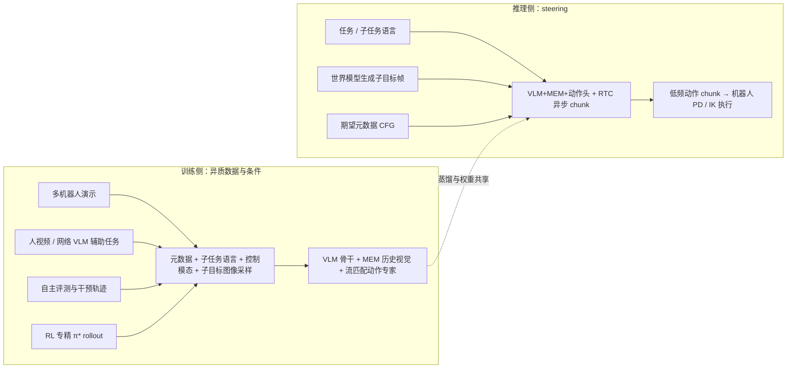

# π₀.7（Pi-zero 0.7）通才 VLA

**π₀.7** 是 Physical Intelligence 在 2026 年公开的**通才机器人基础策略（VLA）**：在保留 π 系 **flow matching 动作头**与 **MEM 式历史视觉**的前提下，把「数据规模」与「**可条件化的执行方式**」绑在一起——用统一的**多模态提示结构**告诉模型**做什么**以及**以何种策略/质量/速度去做**，从而能同时吃下高质量演示、带标注的次优自主数据、跨机器人形态日志、人视频与网络辅助任务，并在多项 dexterous 任务上达到此前需要 **RL 专精（π*₀.₆）** 才能拿到的成功率与吞吐，同时在官方实验中展示**组合式任务指令**与**跨本体零样本迁移**的早期迹象。

## 一句话定义

把 VLA 的提示从「一句任务语言」扩展为**语言子任务 + 片段元数据 + 控制模态 +（可选）视觉子目标**的可 dropout 上下文，用同一通才模型吸收异质数据并在测试时继续 steer 行为。

## 英文缩写速查

| 缩写 | 英文全称 | 简要说明 |
|------|----------|----------|
| VLA | Vision-Language-Action | 视觉-语言-动作多模态基础策略方向 |
| RL | Reinforcement Learning | 通过与环境交互最大化长期回报来学习策略的范式 |
| LLM | Large Language Model | 大语言模型，常作高层任务/语言接口 |
| VLM | Vision-Language Model | 视觉-语言多模态理解模型，VLA 的上游 |
| RT-2 | Robotics Transformer 2 | 将 web 规模 VLM 能力迁移到机器人控制的代表工作 |
| WAM | World Action Model | 联合世界模型与动作预测的架构 |

## 为什么重要

- **异质数据 ≠ 直接混合**：多机器人、多风格、不同质量的数据 naive 合并常导致策略对多模态行为取平均；π₀.₇ 用**显式条件**把不同执行模式变成提示空间中的不同模式，而不是互相污染。
- **把 RL 专精「蒸馏进通才」**：团队将 Recap / π*₀.₆ 路线产生的自主 rollout 作为训练源，通过元数据区分「高表现专精行为」，使单一 π₀.₇ 在洗衣、浓缩咖啡、折箱等任务上对标或超过任务专训 RL 策略的归一化吞吐（官方博客图表叙事）。
- **组合泛化与跨本体**：博客与论文均强调在**未见厨电组合操作**、**语言分步 coaching**、以及**未见本体上的折衣**等设置上的定性/定量证据——这是机器人基础模型是否具备「LLM 式组合性」的关键压力测试之一。
- **长程记忆对照：** π₀.₇ 使用 **MEM 式历史视觉**；同系 **π₀.₅** 上的可插拔 **[KEMO](../entities/paper-kemo-event-driven-keyframe-memory-vla.md)** 则存 **稀疏事件关键帧**（运动学检测 + 门控融合），面向双臂长程 **stage ambiguity** 的另一条记忆路线；当进度写在 **接触力** 而非画面上时，见 **[FM-VLA](../entities/paper-fm-vla.md)**（Force-VAE 压缩 wrench 历史注入 π₀.₅ action expert）。

## 核心原理

### 模型规格（论文 §IV、§VI-B）

π₀.₇ 约 **5B 参数**：VLM 骨干初始化自 **Gemma3 4B**（含 400M 视觉编码器）+ MEM 式视频历史编码器 + **860M 动作专家**（flow matching，adaptive RMSNorm 注入时间步，每次 **50 个动作 token**、5 步去噪）。输入最多 4 路相机（前、两路腕部、可选后视），每路最多 6 帧历史（stride 1 秒，整体历史以 0.3 概率整体丢弃），最多 3 张子目标图，图像统一缩放到 448×448；本体状态用**线性投影**成 token（π₀.₆ 是离散文本化状态）；注意力为块因果：观测与子目标 token 块内双向、子目标可看观测、文本 token 因果。训练沿用知识隔离（KI）配方：VLM 用 FAST token 的离散交叉熵训练，动作专家的梯度不回传 VLM。训练期还用 **RTC**（模拟 0–12 步延迟，对应 50 Hz 机器人最大 240 ms 推理延迟）。

### 提示里有什么

- **任务语言**与**子任务语言**（可由人 coaching 或高层语言策略给出）。
- **片段元数据**：整体速度（以 500 步为间隔离散化的 episode 长度）、整体质量（1–5 分，5 最高）、是否失误（人工粗标）；用于标定演示或 rollout 的「档次」。
- **控制模态标签**：关节空间 vs 末端执行器空间等，对齐不同控制接口的数据。
- **视觉子目标图像**：刻画当前子步骤末态布局；训练时真帧以 0.25 概率取片段末帧、0.75 概率取未来 0–4 秒均匀采样，并混入大量世界模型生成图像以缓解训练-测试错配；测试时由轻量世界模型（**BAGEL 14B** 初始化，约 1 万 token 序列；4 卡张量并行 + 8 bit 量化，25 步去噪约 1.25 秒）在语义意图改变或每 Δ=4 秒刷新。

训练时对上述分量做**随机 dropout**（论文数值：子目标图只加在 25% 样本里；有子目标图的样本里子任务文本 30% 概率丢弃；元数据整体 15% 丢弃、速度/质量/失误三项各 5% 单独丢弃；控制模态不丢弃），迫使模型在缺失部分条件时仍能工作；推理时则可按需启用子目标或 **CFG**（论文对元数据 CFG 给出中等强度系数）以拉高成功率或执行速度。

### 流程总览（训练数据 ↔ 推理闭环）

**读图要点**：左侧强调「**同一提示 schema**」是合并异质数据源的前提；右侧强调测试时可以用**世界模型**补全视觉子目标，用**元数据 + CFG** 拉高「做得快 / 做得好」的偏好，并与 **RTC** 异步推理兼容（论文给出延迟仿真与异步子目标刷新策略）。

### 运行时提示（论文 §VII）

任务始终带控制模态和元数据：速度取该任务 episode 长度的 **15 分位**，质量恒设 5，失误恒设 false；子任务由高层语言策略或人给出；可对元数据做 **CFG**（权重 β∈{1.3, 1.7, 2.2}）；全部实验 5 步去噪、每次执行 Ĥ∈{15, 25} 步，子目标图与子任务在独立线程异步更新，VLA 用最新可用的上下文。

## 主要方法路线

π₀.₇ 的路线可概括为三条（均出自上文各节，非另立结论）：

1. **多样化提示条件化**：任务/子任务语言、片段元数据（速度、质量、失误）、控制模态标签、视觉子目标图一起作为条件，训练时随机 dropout，使同一模型能吸收不同质量与不同接口的数据。
2. **异质数据**：多机器人演示、人视频与网络 VLM 辅助任务、自主评测与干预轨迹、RL 专精策略 rollout 混合训练。
3. **运行时闭环**：用轻量世界模型生成子目标图，配合 RTC 与可选 CFG 在推理时调节成功率与执行速度。

## 工程实践

| 项 | 论文给出的信息 |
|----|----------------|
| 机器人 | 双臂移动操作机器人、静态双臂 BiPi、双臂 UR5e（跨本体用）、单臂；UR5e 20 Hz，其余 50 Hz；动作经 PD 控制器执行，末端指令经数值 IK 转关节 |
| 推理 | 单张 H100：最小变体（3 相机、5 步去噪、训练期 RTC）约 **38 ms**；开启 MEM 历史与子目标图最坏约 **127 ms**；世界模型另用 4×H100 |
| 控制空间 | 主实验用关节空间；附录 E 显示对 π₀.₅/π₀.₆ 基线，末端空间控制无明显收益 |
| 训练数据 | 多机器人演示、自主策略评测数据、人类干预、开源机器人数据、第一人称人类视频、网络辅助任务（定位、VQA、纯文本预测、视频字幕）；**自主数据排除了任何泛化类评测任务** |
| 评分 | 附录 G 为每个任务给出逐步给分细则（例如 Take Out Trash 满分 12） |
| 开源 | 本次通读未见公开代码或权重；第三方复现资料见 [Kuan Yi Wang 图解](../../sources/sites/acastapaloma-pi07-training-guide.md)（非官方） |

## 实验与评测（论文 §IX 要点）

- **开箱即用 dexterity（A）**：同一 π₀.₇ 在洗衣、浓缩咖啡、折箱上匹配 π*₀.₆ RL 专精的成功率，并在难度较高的洗衣与折箱上**吞吐更高**；与 SFT 专精（三明治、翻面衬衫、过门、切西葫芦、削皮、倒垃圾袋）接近。消融：去掉元数据（no metadata）或去掉评测自主数据（no eval data）都全面更差，吞吐差距最明显。需要记忆的任务（换杯、找物体、舀咖啡）上与 π₀.₆-MEM 专精相当或更好。
- **指令跟随（B）**：4 个未见厨房 + 2 个未见卧室、14 个场景、3–6 步指令序列，显著优于 π₀.₅/π₀.₆；复杂指代（"我用来喝汤的物体"）上子目标图进一步提升；"Reverse Bussing / Reverse Fridge to Microwave" 这类反数据偏置任务上，π₀.₇ 能打破偏置，后者靠世界模型生成子目标（GC）才成功。
- **跨本体（C）**：UR5e 上零样本折衬衫——π₀.₇(GC) 任务进度 **85.6%**、成功率 **80%**，对照 10 名顶尖 2% 经验的遥操作者首次在 UR5e 上折衬衫的 **90.9% / 80.6%**；策略会发现适配目标本体的新策略（垂直抓取、单臂代替双臂等）。
- **组合泛化（D）**：空气炸锅装/卸、烤面包等需要口头 coaching；用 coaching 数据训练高层策略后，全自主表现接近 coaching 时的表现，无需额外遥操作数据。
- **数据规模与多样性（E）**：洗衣任务按质量/速度把数据分为前 30%/50%/80%/全部四档；有元数据时随数据增多持续提升，无元数据时反而下降；去掉任务多样性最高的 20% 比去掉随机 20% 差得多。

## 局限与风险

论文 §X 自述：零样本泛化成功率低于分布内任务——已见任务常超过 90%，未见任务或未见任务-机器人组合多在 **60–80%**；难以确定哪些任务真正"未见"（数据太大，相关技能可能以别的标签出现在数据里，可能主要是在"重混"已有技能）；未来方向是利用高可操控性从测试任务数据中高效学习（更多 coaching 或在线 RL）。系统层面的代价：需要数据标注（速度/质量/失误）、世界模型子目标生成（14B，需多卡）、高层语言策略与异步推理，部署复杂度高于单模型 VLA；本页结论基于官方论文与博客，缺少第三方复现。

## 与 π₀、MEM 与 LWD 的关系

- **[π₀（Pi-zero）](./π0-policy.md)**：π₀.₇ 继承 π 系 **VLM + flow matching 连续动作** 的基本范式，但把研究重心移到**提示工程化的多模态条件**与**跨源数据对齐**。
- **MEM 历史视觉**：π₀.₇ 明确建立在 **π₀.₆-MEM** 一脉的历史帧编码之上，并加入子目标图像与新的本体状态 tokenization。
- **[LWD](./lwd.md)**：同属「部署/评测产生的经验如何回到通才模型」语境；LWD 用 **offline-to-online RL** 显式优化价值，而 π₀.₇ 此文侧重用**条件模仿 + 蒸馏**吸收大量自主与次优轨迹——二者可并列阅读以理解工业界两条「闭环数据」路线。

## 常见误区

- **误区 1：视觉子目标只是测试时技巧。** 论文强调训练–测试在子目标上的联合分布设计（真帧采样区间、生成图像混合、dropout 比例），否则世界模型图像与策略训练分布错配会伤害泛化。
- **误区 2：通才必然弱于专精。** 在官方报告的若干 dexterous 任务上，单一 π₀.₇ 的归一化吞吐与成功率可以对齐或超过 **π*₀.₆** 专精策略；代价是系统复杂度转移到**数据标注、提示与推理管线**。
- **误区 3：组合泛化已被完全解决。** 博客中的厨电案例表明，**零样本长指令**仍可能不完整成功，**分步语言 coaching** 或学习高层策略生成子任务可显著提升表现——组合能力更像「出现迹象」而非已闭合问题。

## 参考来源

- **原文通读：** [sources/papers/pi07.md](../../sources/papers/pi07.md)（arXiv:2604.15483v2 全文含附录 + 官方博客，2026-11-07）
- [sources/papers/pi07.md](../../sources/papers/pi07.md) — 论文 + 官方博客的统一归档
- [Kuan Yi Wang 的 π0.7 Training Walkthrough](../../sources/sites/acastapaloma-pi07-training-guide.md) — 第三方图解补充
- Physical Intelligence, *$\pi_{0.7}$ : a Steerable Generalist Robotic Foundation Model with Emergent Capabilities*, arXiv:2604.15483 — <https://arxiv.org/abs/2604.15483>
- Physical Intelligence, *π0.7: a Steerable Model with Emergent Capabilities*（博客）— <https://www.pi.website/blog/pi07>

## 关联页面

- [π₀ (Pi-zero) 策略模型](./π0-policy.md) — π 系前代 flow-matching VLA 基线
- [VLA（Vision-Language-Action）](./vla.md) — 通才策略模型族谱与工程瓶颈
- [DPC](../entities/paper-dpc.md) — 异构数据先对齐到 G1 关节空间，对照本页的多模态提示混合（Symbiosis 2026-08）
- [LEGS（论文实体）](../entities/paper-legs-embodied-gaussian-splatting-vla.md) — π0.5 为 LEGS 实验骨干之一（arXiv:2606.01458）
- [Foundation Policy（基础策略模型）](../concepts/foundation-policy.md) — 与 RT-2、Octo 等并列的代表模型视角
- [World Action Models（WAM）](../concepts/world-action-models.md) — 当子目标由世界模型在线给出时，与「未来观测–动作联合建模」讨论相邻
- [Action Chunking](./action-chunking.md) — 与 RTC、异步推理配套的低层执行接口
- [Perceptron Isaac 0.5](../entities/perceptron-isaac-05.md) — 开源对照：作者配方表把 π0.7 标为未开源；Isaac 强调 RTC + 非机器人视频 + Flow
- [LWD（Learning while Deploying）](./lwd.md) — 另一条把车队经验喂回通才 VLA 的 RL -centric 路线
- [GSR / ParaVLA](../entities/paper-gsr-paravla.md) — 给 π₀.₅ 补冻结 T5 重绑；LIBERO-Para PRIDE 70.4

## 推荐继续阅读

- Black et al., *π₀: A Vision-Language-Action Flow Model for General Robot Control* — <https://arxiv.org/abs/2410.24164>（π 系方法学前身）
- [π*₀.₆ / RECAP](../entities/paper-rcl-2511-14759-0-6-a-vla-that-learns-from-experience.md) — 优势条件专精，π₀.₇ 蒸馏源之一
- [Hi Robot](../entities/paper-hi-robot.md) — 高层语言步骤与低层 π₀ 的分层参照
