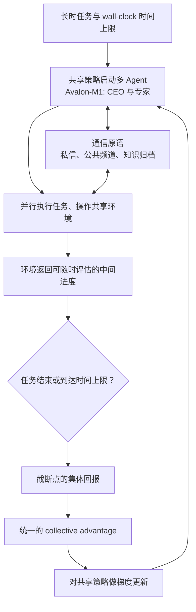

# 集体奖励强化学习（RLCR）：如何训练智能体群 | How to Train a Swarm

## 一句话定义

**Reinforcement Learning from Collective Rewards（RLCR，集体奖励强化学习）**通过对共享策略的多个 Agent 施加**共同任务回报**，并让有限的现实执行时间成为约束，使其学习如何分工、沟通并利用**并行推理计算**。本文整理 [General Reasoning 2026-11-02 官方博客](https://www.gr.inc/blog/how-to-train-a-swarm) 的方法解释与 Avalon-M1 观察；它讨论的是**软件 AI Agent 群**，不等于实体机器人蜂群控制。

## 英文缩写速查

| 缩写 | 英文全称 | 简要说明 |
|---|---|---|
| RLCR | Reinforcement Learning from Collective Rewards | 同一集体回报用于多个 Agent 的共享策略学习 |
| RL | Reinforcement Learning | 通过试错和回报优化策略 |
| MARL | Multi-Agent Reinforcement Learning | 更广义的多智能体学习，含竞争/合作及机器人控制 |
| GAE | Generalized Advantage Estimation | 优势估计方法；文章用其超参偏差示例说明推理长度激励 |
| PPO | Proximal Policy Optimization | 策略优化家族；文章警示折扣/优势估计可能抑制长推理 |

## 为什么重要

- 单个推理模型可花更多 token 提升正确率，但长时任务的**顺序执行时延**仍高；多个 Agent 同时工作可以降低完成时间，却会增加沟通成本和冲突。
- 若 RL 只奖励最终正确性，同分的快慢执行不会被区分；**要让更短 wall-clock 延迟带来训练利益**，才可能学会有效并行。
- 对 [MARL](./marl.md) 的方法论启发是：**奖励口径、训练规模和通信通道**共同决定协同行为，而不是给 Agent 更多实例就一定更快。

## 核心原理

RLCR 的训练目标围绕**共享策略、可分解的多 Agent 工作与限时集体回报**构成。具体方案如下。

## 主要技术路线

### RLCR 如何组织训练信号

原文对 RLCR 的描述是：**共享策略（shared policy）+ flat collective advantage（平坦集体优势）+ latency pressure（延迟压力）**。多个 Agent 在同一长时任务环境中行动，集体获得单一回报，策略梯度用这份共享信号更新，而不显式标注每个子任务、每条消息的个人功劳。

#### 原文机制主干流程

本图只表达原文公开的**概念级训练流程**，不是经源码确认的训练函数调用图。

### 让并行工作获得优势：两种不同的时间压力

| 激励方式 | 奖励规则 | 原文定位 |
|---|---|---|
| 显式 latency penalty | 任务回报减去与用时相关的惩罚，可在任务期间连续偏好更快方案 | 讨论的**备选设计**，不是 Avalon-M1 已使用的方案 |
| Wall-clock time limit | 达到时间上限时立即停止，按当时进度给回报；在有限时长内完成更多进度才得利 | **Avalon-M1 所用方案**，训练时逐渐延长时间上限 |

文中给出的**显式惩罚候选形式**为：

$$
R(\tau) = R_{\mathrm{task}}(\tau) - \beta\,\bar p(q)\,\frac{T(\tau)}{T_{\max}}.
$$

其中 $T(\tau)$ 是 rollout 的现实耗时，$T_{\max}$ 是上限，$\bar p(q)$ 是任务 $q$ 的平均通过率，$\beta$ 决定惩罚强度。**不可把该公式当成 Avalon-M1 的实际奖励函数**。

Avalon-M1 的时间上限方案依赖 **anytime-return** 环境：在任意截断时刻都能评价当前进度（如软件测试通过数）。此方案**不对截止前的每一秒速度提升额外计分**；两个在截止前取得相同总回报的 rollout 得分相同。

### 通信是一种有代价的计算

文章区分三种计算组织：单 Agent 长链推理、多个 Agent 各自独立尝试再选择、允许交换中间结果的集体。独立尝试已足够时，沟通可能增加用时；任务需要交接与互补信息时，直接消息、频道和归档才有价值。

Avalon-M1 采用 CEO 可招募和解雇专家的先验组织结构，且 Agent 间可以直接通信；这是一种 **harness 先验**，并非已证明的唯一最优群体拓扑。文中对照的 Kimi 系统采用训练 orchestrator 而冻结子 Agent，不能把两者混为一种训练方法。

## 证据与测量

| 文章报告的 Avalon-M1 现象 | 正确解读 |
|---|---|
| 5–8 名受雇专家在训练 step 200 附近，对环境的“有用工作”代理量约为平均 rollout 的 2 倍 | 指对环境执行动作的 turn 中推理与输出 token 统计，不是任务真实效率直接翻倍 |
| 相同总输出 token 预算下，扩展思考的单 Agent 基线达到类似任务能力所需 wall-clock 时间约为集体的 4 倍 | 时延优势有任务、时间预算和基线条件，不能推广为固定加速比 |
| EdgeBench 中最多 8 名受雇专家的组织约在 2.4 h derived latency 后超越单 Agent | 早期组织有协调成本，优势在足够长的任务中显现 |

作者还观察到训练中通信强度上升，但**消息量增多本身无法证明通信有效**。评估时应一起追踪：任务回报随时间曲线、实际完成的环境操作、通信强度（按 rollout 时长归一）、同分完成耗时与 token 总量。

## 工程实践

| 检查项 | 应如何设计或记录 |
|---|---|
| 任务接口 | 首先确认是否可提供可信的 anytime-return，不能只在结束时返回二元成功值 |
| 时间约束 | 记录 wall-clock 截止时间的训练调度；对照无约束、固定约束和不同阶段的表现 |
| 集体策略 | 标清共享/非共享权重，集体回报如何分配为 advantage，避免把组奖励当作精确贡献分配 |
| 通信通道 | 最小化私信/频道/归档的接口；记录发送频率、重复劳动、冲突和交接耗时 |
| 对照组 | 至少分别比较单 Agent、匹配 token 的长思考单 Agent、独立并行尝试和可通信集体 |
| 机器人迁移 | 需重新建模真实通信延迟、环境状态同步、安全冲突与物理执行约束，原文**没有验证真机机器人群** |

**源码运行时序图：不适用。** 本次指定材料是方法博客，未给出可运行的 RLCR/Avalon-M1 源码入口；因此只给出有原文依据的项目概念流程图，不伪造 Python 模块或训练启动命令。

## 局限与风险

1. **小规模训练到大规模部署：** Avalon-M1 在至多 9 个 Agent（CEO + 最多 8 名专家）下训练，不能据此推断上百/上千 Agent 的稳定泛化（原文称 *village problem*）。
2. **粗粒度信用分配：** 数小时、甚至数百万 token 的长时轨迹共享一份优势，具体贡献难判；不同环境任务分布也分散有效训练样本。
3. **跨 episode 公共品：** 后续 rollout 才用上的论文、代码库或知识共享，难被当前 episode 的回报正确激励。
4. **并行不是越多越好：** 通信、冲突与协调有固定成本；必须对照单位 wall-clock 产出，而不只看 Agent 数量或 token 数。
5. **领域外推有限：** 原文是长时**软件 Agent 工作流**的研究解读，未提供机器人运动控制、物理安全、实时网络或实体编队的验证。
6. **可复现性边界：** 原博客提供技术报告参考，但没有给出本次已核实的可运行训练源码；该页不包含源码级实现结论。

## 关联页面

- [Multi-Agent Reinforcement Learning（MARL）](./marl.md) — 更广义的多智能体协作与竞争；RLCR 给出共享奖励与时延驱动的具体激励读法。
- [Reinforcement Learning](./reinforcement-learning.md) — 策略梯度与奖励设计的基础。
- [Generalized Advantage Estimation（GAE）](./gae.md) — 原文指出有偏优势估计超参可能压短推理链，进而改变预期训练行为。
- [RL Runner](../concepts/rl-runner.md) — 对照多 Agent rollout、环境操作和训练编排。

## 参考来源

- [General Reasoning 官方博客原文归档（2026-11-02，已通读）](../../sources/blogs/gr_how_to_train_a_swarm_2026_11_02.md)
- [How to Train a Swarm — General Reasoning](https://www.gr.inc/blog/how-to-train-a-swarm)

## 推荐继续阅读

- [Avalon-M1: Reinforcement Learning from Collective Rewards — 官方技术报告](https://gr.inc/avalonm1.pdf)（进一步研究资料；本次未以已通读论文标记）
- [General Reasoning 原文参考资料](https://www.gr.inc/blog/how-to-train-a-swarm)（含 Kimi / DeepSeek / Open-Reasoner-Zero 对照）
