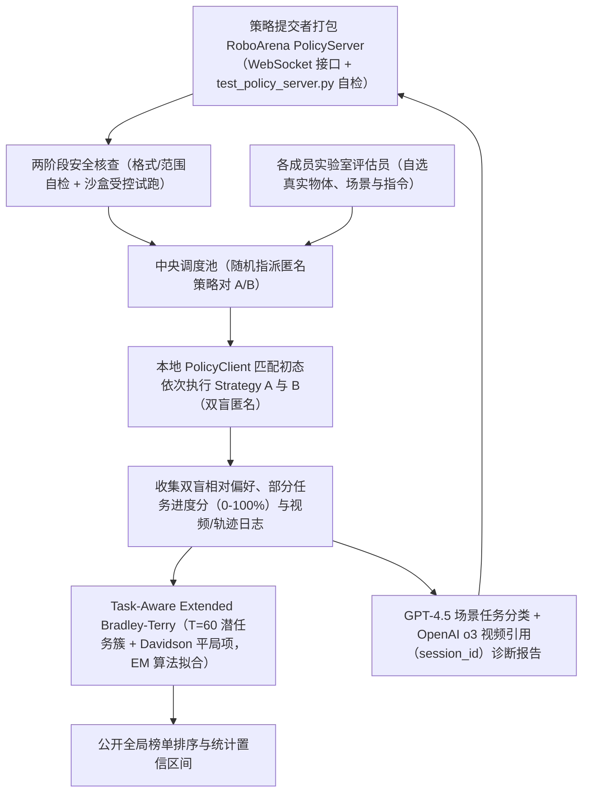
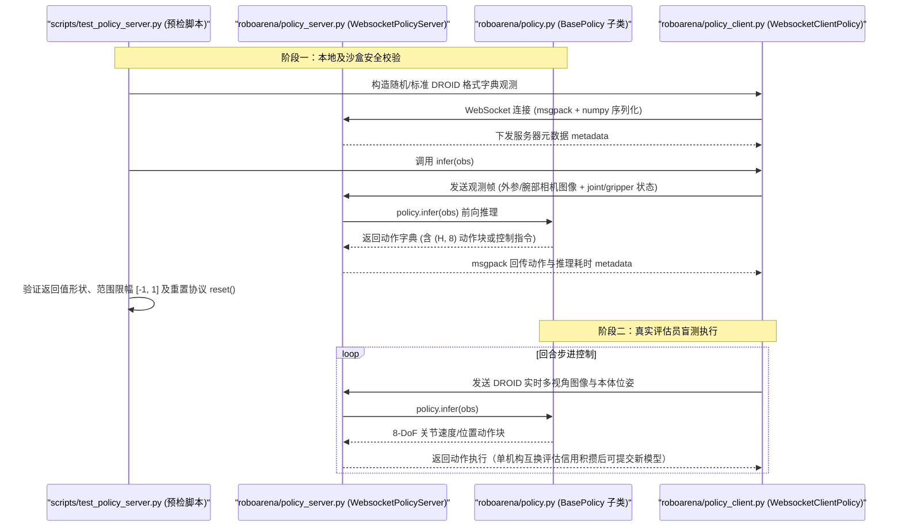

# RoboArena：通用机器人策略分布式真机众包评测方法

## 一句话定义

**RoboArena**（[arXiv:2506.18123](https://arxiv.org/abs/2506.18123)，项目与榜单 [robo-arena.github.io](https://robo-arena.github.io/)，UC Berkeley、Stanford 等）是一种面向通用视觉-语言-动作策略的 **去中心化、众包双盲 A/B 真机评测框架**：将分布于不同物理场所的标准化机器人平台（如 DROID）接入统一推理接口，在未知环境、物体与自然语言指令下进行匹配初态的成对同台对比，并利用 **任务感知扩展 Bradley-Terry 统计模型** 与 **多模态大模型自动归因报告** 输出抗过拟合的策略全局排名与精细反馈。

## 英文缩写速查

| 缩写 | 英文全称 | 简要说明 |
| --- | --- | --- |
| BT | Bradley-Terry Model | 经典成对比较潜实力统计模型，RoboArena 在此基础上扩展平局项与任务难易偏置 |
| MMRV | Mean Maximum Rank Violation | 最大排名违背均值，衡量估测榜单相对真实全量基准排名失真的核心指标（越低越好） |
| VLA | Vision-Language-Action | 视觉-语言-动作多模态通用策略，是本评测框架最主要的服务与对比对象 |
| EM | Expectation-Maximization | 期望最大化算法；用于联合估计隐藏任务簇分布、各任务难度偏置与策略能力参数 |
| DROID | Distributed Robot Interaction Dataset | 跨机构通用 Franka 桌面移动双摄开源硬件标准，为第一期协同评估奠定硬件一致性 |

## 为什么重要

通用具身基础模型向跨实验室开放世界迈进后，传统的单实验室固定桌面基准陷入“可复现与泛化性不可兼得”的僵局：如果把测试物体、背景布景与相机角度固定成标准套件，模型很容易在微调或超参搜索中无意甚至有意“刷榜过拟合”，偏离真正未见环境的零样本表现；反之，如果允许研究者各测各的任务，不同实验室内物体的物理难度、评估员松严尺度与成功率定义差异会导致分数完全不可横比。此外，单个实验室通常缺乏跨场景采样数百种家庭物体的物理资产与人力。RoboArena 用 **“统一远程策略网关 + 同场初态锁定成对盲测 + 任务异质性去偏建模”** 把评测分散到全网成员实验室的日常真实桌面上，既彻底打破特定场景过拟合，又以统计建模抵消了各实验室自选任务的难易不均，使“真实环境外部验证”成为可持续运转的公共基础设施。

## 核心原理

### 1. 双盲匹配的成对在野评测协议（Algorithm 1）

在每次测试会话中，分布式评估员完全自主决定测试桌面、目标物体及任意自然语言指令，仅需将机器人重置回近似同一初始布局后，分别调用中央路由随机分配且匿名伪装为 `Policy A` 与 `Policy B` 的两套策略：
- **严格初态对齐与盲测隔离**：避免评估员因已知模型品牌产生期望偏差，也消除两次 rollout 间物体摆放难易漂移。
- **双信号标注体系**：评估员同时提交 **离散相对偏好（A 胜 / B 胜 / 平局）** 与 **连续部分任务进度（0–100% 关键子目标得分）**。研究发现在长程多步操作中，即使两策略最终均未完全成功，约 **11%** 的局部偏好判决与部分进度分存在补充差异，因此双信号可极大提升有限采样下的信息量。

### 2. 任务感知扩展 Bradley-Terry 统计排名（Algorithm 2）

由于不同评估员提交的“任务难易、平局倾向与策略垂域专长”高度异构，直接套用标准 Elo 或常规 BT 模型会产生显著失真。RoboArena 提出 **Task-Aware Extended Bradley-Terry** 概率模型：
- 引入 **Davidson 平局建模项（`nu_tie`）** 处理双方均卡死或同等接近成功时的平局样本。
- 引入 **潜任务簇变量 `T = 60`**：假设每个在野评估任务隐式隶属于某潜在任务类型 `t in {1..60}`，具有任务难度先验 `tau_t`、特定任务平局率 `nu_t` 以及策略在该任务簇的专精偏差 `psi_{p, t}`。
- 通过 **60 步带裁剪牛顿法的 EM 算法（`EM_ITERS = 60`，L2 正则 `1e-2`）** 联合求解全局策略实力 `theta_p` 与各任务分布参数，在不强制预先给自由语言指令写死人工标签的情况下消除“某策略恰好只在简单任务上多测了几轮”的抽样偏差。

### 3. 自动轨迹语义剖析与可追溯归因

为防止只给冷冰冰的分数排名无法指导模型迭代，系统内置两级大模型自动分析管线：首先使用 **GPT-4.5** 对各实验视频与文本指令做场景及动作类别聚类（在 448 条人工验证样本上分类准确率达 **94.6%**）；随后由推理模型（**OpenAI o3**）生成多维能力雷达剖析，并在每句失败模式结论旁强制内联 `<ref>session_id</ref>` 标签直接锚定对应失败视频片段，确保提交者能立刻定位具体是抓空、早停还是语言指令误读。

## 主要技术路线

当前评估通用机器人操作能力主要有四条差异化技术路线，各自处于不同的真实度-成本权衡象限：

| 评测路线 | 代表系统 | 核心机制 | 主要优势 | 主要瓶颈 |
| --- | --- | --- | --- | --- |
| **分布式众包真机配对** | **RoboArena** | 跨机构统一硬件与远程网关，随机盲测配对 + 去偏统计拟合 | 真机真实物理全分布、防单场过拟合、随社区规模自然扩充样本 | 吞吐受真实评估员人工重置桌面限制，单次对照需秒级至分钟级执行 |
| **本地静态真机基准** | DROID / Bridge 标准台架评估 | 单一实验室固定桌面物品集，人工逐条计分 | 局域复现一致，物理与网络通信零外部延迟 | 极易被调优过拟合；不同实验室间物理摆件与计分口径难直接对齐 |
| **纯物理仿真器评测** | SimplerEnv / LIBERO / RoboTwin | 引擎批量并行渲染与脚本判定状态成功率 | 极低边际成本、可秒级跑完数千条分布变换消融 | 受渲染光学材质、刚体接触摩擦及长程变形物体 [Sim-vs-Real 评测鸿沟](../concepts/sim-vs-real-eval-gap.md) 限制 |
| **生成式世界模型代理评估** | [OSCAR](../entities/paper-oscar.md)、[WorldGym](../entities/paper-shenlan-wm-15-worldgym.md) | 动作条件视频世界模型闭环推演 rollout 并预测成功 | 无需实机部署即可廉价预筛跨构型策略与新场景指令 | 依赖世界模型自身物理真实度（如 OSCAR 在 RoboArena 7 策略池与真机榜单相关性 `rho = +0.750`，尚未完全替代真机终审） |

## 实验与评测

根据 [RoboArena 论文（arXiv:2506.18123）](../../sources/papers/roboarena_arxiv_2506_18123.md) 在 7 所大学 DROID 联盟展开的大规模实测验证（覆盖 **7 个代表性通用策略**、**612 组配对试验**、总计 **4,284 次全量参考 rollout**）：

| 实验对照设定 | 对比方法 | Pearson 相关系数 `r` | 最大排名违背 `MMRV` | 关键结论 |
| --- | --- | --- | --- | --- |
| 7 校分布式真实采样 vs 全量参考真值 | 传统常规绝对打分（Regular） | `0.69` | `13%` | 不同高校任务难易与宽严不均导致绝对成功率排序严重失真 |
| 7 校分布式真实采样 vs 全量参考真值 | 标准 Elo 排名 | `0.90` | — | 对顺序敏感且难处理高平局率与多维任务混杂 |
| 7 校分布式真实采样 vs 全量参考真值 | 基础 Bradley-Terry（BT） | `0.98` | `5.7%` | 相对成对比较可大幅削弱机构间主观测评口径差异 |
| 7 校分布式真实采样 vs 全量参考真值 | **RoboArena 任务偏好（TASK）** | **`0.98`** | **`2.7%`** | 引入平局项与 60 维潜任务簇显著砍半严重排名倒挂 |
| 7 校分布式真实采样 vs 全量参考真值 | **RoboArena 进度建模（PROG）** | **`0.98`** | **`1.8%`** | 细粒度 0–100% 部分进展进一步压低有限采样方差，仅 **~100 对** 试验即收敛 |
| 跨高校剧烈分布偏移测试 | Regular vs **RoboArena（PROG）** | `0.692` -> **`0.838`** | `0.141` -> **`0.058`** | 在各机构测试任务完全错位分布下，仍维持稳健排序一致性 |

## 源码运行时序图

以下通信协议与两级校验机制严格核对自 [`robo-arena/roboarena`](../../sources/repos/roboarena.md) 仓库源码（`roboarena/policy.py`、`roboarena/policy_server.py`、`roboarena/policy_client.py`、`scripts/test_policy_server.py`）：

## 工程实践

1. **严格通过 `test_policy_server.py` 与受控沙盒双重网关**：面向未知远程策略执行真机控制存在极高碰撞风险，接入 RoboArena 必须先实现 `BasePolicy.infer()` 与 `reset()` 并通过开源脚本的张量尺寸/数值范围校验，再由枢纽工作人员在物理限速与防撞工作区内人工监护试跑，切勿裸连未限幅的策略端口。
2. **理解去中心化“信用互换（Credit Barter）+ 赞助评估池”运转模式**：联盟通过以评换评机制避免纯白嫖提交导致排队阻塞——高校或独立研究组在自己本地 DROID 机器上完成盲测评估后累积评测信用点（credits），再据此优先安排自有策略接受全网多站点测评，工业界赞助池则为无真机纯算法团队提供公共配额。
3. **以 `PolicyClient` 作为真机榜单前的自动化代理筛选**：由于真机双盲配对依然消耗人力，工程团队通常先结合物理仿真或视频世界模型代理（如 [OSCAR](../entities/paper-oscar.md)）完成架构与数据配方消融筛选，再把少数 Top 候选模型推上 RoboArena 做最终真实分布定榜。

## 常见误区与局限

- **误区 1：误以为 RoboArena 是单向在线“公开评测服务器”直接托管所有权重大模型**：实际架构中策略推理计算仍运行在各提交方自有的 GPU 节点（通过 WebSocket 暴露 `WebsocketPolicyServer`），中央系统只负责任务调度、匿名路由与统计拟合，既保护研究组未发论文模型权重不泄露，也减少中心算力开销。
- **误区 2：将成对胜率等同于绝对任务成功率**：Extended BT 得分反映的是策略在同一批受评竞争者中的相对优势与泛化梯度，不能脱离参照策略池直接换算为单一任务成功率百分比。
- **核心局限**：(1) 当前一期主要锁定标准化 **DROID（Franka 7-DoF + 三视角相机配置）**，跨异构机械臂构型（如双臂、灵巧手或移动底盘）的公平配对仍在拓展；(2) 若不同实验室在硬件末端夹爪磨损、相机帧率标定或桌面照明存在极少数硬件故障且未标记，仍需依赖评估员规范提报剔除无效局。

## 关联页面

- [具身基础策略（Foundation Policy）](../concepts/foundation-policy.md) — 通用跨场景策略为什么必须依赖分布外全局评测而非固定基准
- [样本外泛化（Out-of-Distribution Generalization）](../concepts/out-of-distribution-generalization.md) — 去中心化未知家居场景采样对应的泛化能力度量目标
- [仿实评测鸿沟（Sim-vs-Real Eval Gap）](../concepts/sim-vs-real-eval-gap.md) — 对比纯仿真并行评测与真机众包评测的失效边界
- [运动控制策略评测指标（Motion Control Policy Evaluation Metrics）](../concepts/motion-control-policy-evaluation-metrics.md) — 成对偏好、部分进度分、`MMRV` 与绝对成功率指标的关系
- [视觉-语言-动作模型（VLA）](../methods/vla.md) — 现阶段接入 RoboArena 排名最核心的模型族
- [Octo Model](./octo-model.md) — 早期开源通用操作策略基准参照
- [机器人操作（Manipulation）](../tasks/manipulation.md) — 第一阶段桌面与通用物体操作核心评估任务
- [DROID Policy Learning](../entities/droid-policy-learning.md) — 奠定 RoboArena 第一期跨校硬件与相机布局一致性的底层标准平台
- [Open X-Embodiment](../entities/paper-open-x-embodiment.md) — 推动跨机构数据与泛化评测从单机迈向全网协作的先驱工作
- [π₀ (pi0)](../entities/paper-pi0.md) / [π₀.₅ (pi0.5)](../entities/paper-pi05-open-world-vla.md) / [FAST Action Tokenization](../entities/paper-rcl-2501-09747-fast-efficient-action-tokenization-for-vision-la.md) — 参与早期 DROID 跨校盲测对照的高关注通用策略实例
- [OSCAR](../entities/paper-oscar.md) / [WorldGym](../entities/paper-shenlan-wm-15-worldgym.md) — 与 RoboArena 真机七策略池对比皮尔逊相关性的世界模型代理评测路线
- [机器人学习三时代演进叙事](../queries/robot-learning-three-eras-narrative.md) — 从固定任务到通用泛化验证范式的演进脉络归档

## 参考来源

- 论文通读归档：[RoboArena 论文全文归档](../../sources/papers/roboarena_arxiv_2506_18123.md)（arXiv:2506.18123 全文与算法核对）
- 仓库源码归档：[robo-arena/roboarena 客户端与服务网关核查](../../sources/repos/roboarena.md)
- 演进线索归档：[具身三时代一手资料整理](../../sources/blogs/ted_xiao_embodied_three_eras_primary_refs.md)
- 原始来源：https://arxiv.org/abs/2506.18123 | https://robo-arena.github.io/ | https://github.com/robo-arena/roboarena

## 推荐继续阅读

- [仿实评测鸿沟（Sim-vs-Real Eval Gap）](../concepts/sim-vs-real-eval-gap.md) — 理解何时可用仿真/世界模型预筛，何时必须推进分布式真机双盲终审。
- [运动控制策略评测指标](../concepts/motion-control-policy-evaluation-metrics.md) — 对比绝对成功率、Elo 与任务感知扩展 Bradley-Terry（`MMRV`）在统计稳定性上的优劣。
