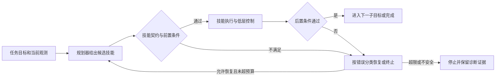

# Robot Agent Harness · 机器人智能体执行框架

## 一句话定义

用可检查的技能接口、执行状态和限额恢复，把高层任务提议变成可观察、可拒绝、可停止的机器人技能调用。

## 英文缩写速查

| 缩写 | 英文全称 | 说明 |
|---|---|---|
| LLM | Large Language Model | 根据任务上下文提出候选技能，可由规则规划器替代 |
| API | Application Programming Interface | 定义技能参数、权限、反馈和取消的接口 |
| BT | Behavior Tree | 通过节点状态组织序列、回退和有限恢复的编排方式 |
| RL | Reinforcement Learning | 可训练技能或其价值函数的一种方法 |

## 为什么重要

“计划合理”“当前可执行”“机器人确实完成”是三个不同判断。若只依赖模型的自报成功，抓空或动作超时也可能触发下一步。执行框架把失败留在可定位的边界：规划选错技能、当前状态不满足前置条件、技能执行失败，或观测不能验证完成。

## 核心机制

| 层 | 输入与输出 | 边界 |
|---|---|---|
| 规划器 | 任务、状态摘要 → 候选技能及参数 | 提议，不直接发底层驱动指令 |
| 调度器 | 技能契约和最新观测 → 执行、拒绝或请求澄清 | 校验参数、时效、前置条件及资源占用 |
| 技能执行器 | 限定动作请求 → 反馈、完成/失败/取消 | 控制器负责实际运动及独立保护 |
| 结果判定与恢复 | 后置条件、错误码 → 继续、有限重试、重规划或停机 | 只在观测验证后推进；不无限重试 |

SayCan 是“技能提议与可行性结合”的论文实例：对同一技能同时计算语言相关性与状态下的技能价值，再执行得分合适的候选。作者分开报告计划正确率和实机执行成功率，在 101 条指令上报告 PaLM-SayCan 分别为 84% 与 74%；这不是下面这套通用恢复流程的性能。Nav2 的默认行为树是另一个例子：按错误类型尝试局部恢复，超出重试预算则把失败交回上层；它不需要 LLM。

## 主要技术路线

- **固定流程：** 已知且稳定的任务可直接用状态机或行为树约束转移和故障回退。
- **技能排序：** 对开放指令先由模型给候选，再用已声明的接口和可行性约束选择。
- **混合调度：** 用确定性执行器守住资源与恢复边界，只在确实需要重规划时回到模型。

## 工程实践

- **为技能定义契约。** 例如“把杯子放到托盘”发送前检查杯子与托盘目标有效、坐标系与时间戳匹配、夹爪状态可用；完成条件是观测复核杯子在托盘上且已释放，而非动作请求返回成功。
- **区分恢复错误。** 目标检测过期可刷新一次；持续的坐标或驱动故障要停止并交给维护人员；对有物理副作用的动作，只有重验状态后才重试，避免因等待超时而重复下发。
- **记录并注入故障。** 用请求 ID 串联提议、参数、接收、结果和原因；在仿真或隔离测试中检验重复请求、取消、反馈丢失和重试耗尽是否按契约退出。部署前另行验证硬件急停与接触限制。

[Contact Harness](../entities/paper-contact-harness.md) 是接触任务案例：模型解释状态和提议动作，执行器本地做力反馈、时效校验与停止，避免模型等待阻断快环。

## 局限与风险

可行性分数不是安全证明，规划器或调度器也不能替代实时控制与独立保护。SayCan 官方公开的是桌面仿真示例，不能当成论文中的移动操作真机栈原样复现；Nav2 文档的恢复示例也不等同于任意机器人都可安全执行的策略。本页是跨例子的编排方法，不是独立发布的软件。

## 关联页面

- [LLM 机器人控制接口](../concepts/llm-robotics-control-interfaces.md)
- [行为树与 VLA 编排](../concepts/behavior-tree-vla-orchestration.md)
- [智能体操作策略](./agentic-manipulation-policies.md)
- [具身智能体评测方法](./embodied-agent-benchmarking.md)
- [SayCan 论文实体](../entities/paper-saycan.md)

## 参考来源

- [SayCan 原论文及公开示例归档](../../sources/papers/saycan_arxiv_2204_01691.md)
- [Nav2 Jazzy 行为树官方说明](https://docs.nav2.org/jazzy/getting_started/nav2_behavior_trees/detailed_behavior_tree_walkthrough/detailed_behavior_tree_walkthrough/)
- [具身智能体项目索引（延伸检索）](../../sources/repos/awesome-agentic-robots-survey-index.md)

## 推荐继续阅读

- [SayCan v2 原文](https://arxiv.org/html/2204.01691v2)
