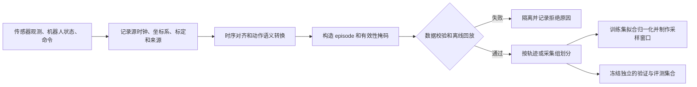

# 机器人学习数据管线 · Robot Learning Data Pipelines

## 一句话定义

把不同传感器与控制循环产生的原始机器人记录，转成可追溯、可验证且可按任务划分的学习样本，而不丢失动作含义、时间关系和轨迹边界。

## 英文缩写速查

| 缩写 | 英文全称 | 说明 |
|---|---|---|
| RLDS | Reinforcement Learning Datasets | 以 episode 和有序 step 为中心的数据约定 |
| OXE | Open X-Embodiment | 多来源、多本体机器人数据集合，不等同于某个模型的训练混合 |
| TFDS | TensorFlow Datasets | 可存储、注册和读取 RLDS 格式数据集的工具 |
| FPS | Frames Per Second | 视频采样率，不能直接代替机器人命令的频率 |
| PTP | Precision Time Protocol | 在设备支持时同步时钟；不消除采集链路的固定延迟 |

## 为什么重要

坏数据有时能通过训练张量的形状检查。例如图像比标签落后一帧、左右手顺序颠倒、用世界系的位姿差替代工具系增量。损失仍可能下降，但策略第一次闭环就会朝错方向运动。先锁定数据契约，比换更大的模型更容易定位这类错误。

## 主要技术路线（核心机制）

1. **采集层保留事实**：分别记录图像采样、状态测量、命令发送时间；保留来自遥操作、专家策略、脚本或仿真的标签。不要把收到数据包的时刻当采样时刻，也不要混用发出命令和真实执行量。
2. **规范层保留语义**：记录动作单位、坐标系、旋转表示、控制模式、关节顺序及夹爪开闭极性；区分传感器缺失与观测数值等于零。RLDS 约定了 episode 结束标记及最后一步字段有效性；LeRobotDataset v3 则把多 episode 装入共享文件，用元数据恢复边界。容器选择不免除接口映射。
3. **采样层隔离泄漏**：先按 episode、采集会话或目标泛化轴划分，再切观察历史与动作块。若目标是新场景泛化，同一场景不能只随机拆帧到训练与评测；统计量、过滤规则及版本写入发布清单。

## 工程实践

| 关口 | 最少验收 |
|---|---|
| 采集回放 | 在少量不同条件的轨迹中叠加图像时间、命令和实际运动，检查丢帧、跨钟漂移、动作变化是否对应下一状态。 |
| 动作契约 | 用一个方向明确的位移和一次夹爪开闭做往返转换；归一化和反归一化之后应回到原单位。按本体分别记录限幅和无效维度。 |
| 边界与覆盖 | 检查零长度/截断 episode、训练窗口不跨段，报告每来源/任务的有效轨迹数、缺失模态和失败轨迹比例。 |
| 可复现 | 固定数据版本、校准及转换器版本、拆分清单和采样权重；明示采集者许可、数据使用范围和去标识规则。 |

## 局限

同一种格式无法自动纠正延迟或不兼容的控制语义；不同站点的视频、传感器采样率及复位分布仍可能不可比。上线验收不能只检查下载成功、磁盘大小或离线损失。

## 关联页面

- [机器人数据监督信号](../concepts/robot-data-supervision-signal-types.md)与[遥操作](../tasks/teleoperation.md)：理解不同采集方式提供什么监督。
- [Open X-Embodiment](../concepts/open-x-embodiment.md)与[LeRobotDataset v3](../concepts/lerobot-dataset-v3.md)：比较跨源混合和可定位 episode 的存储设计。
- [机器人策略学习流程](./robot-policy-learning.md)：从可追溯样本到闭环评估。

## 参考来源

- [RLDS、Open X-Embodiment 与 LeRobotDataset 一手归档](../../sources/sites/robot-learning-data-pipelines-primary.md)。

## 推荐继续阅读

- [RLDS：格式及数据转换](https://github.com/google-research/rlds#dataset-format)
- [LeRobotDataset v3：文件布局和流式读写](https://huggingface.co/docs/lerobot/lerobot-dataset-v3)
