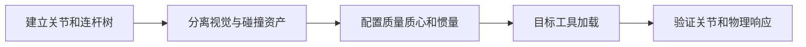

# Robot Model Description and Asset Integration · 机器人模型描述与资产接入

## 一句话定义

用结构、关节和物理属性描述机器人，并把模型接入软件与仿真工具。

## 英文缩写速查

| 缩写 | 英文全称 | 说明 |
|---|---|---|
| URDF | Unified Robot Description Format | 机器人 XML 描述格式 |
| MJCF | MuJoCo Modeling XML File | MuJoCo 模型格式 |
| USD | Universal Scene Description | 可组合的场景描述格式 |
| SI | International System of Units | 统一几何与物理单位 |

## 为什么重要

模型能显示不表示关节运动学、碰撞体、惯量和尺寸正确。把资产分层可以使换网格不意外修改运动学或接触设计。

## 主要技术路线（核心机制）

ROS 官方教程将 visual、collision 和 inertial 作为不同的连杆子元素。碰撞形状及原点可以与视觉不同，惯量原点定义质心和惯性参考帧相对连杆的位置与姿态。

## 工程实践

从已知零位逐一验证关节正向位移。显示用高细节网格，碰撞可用简模但应覆盖足底、夹爪等任务接触面；核对动态连杆质量、质心、惯量和单位。转格式后重新加载并检查轴向、缩放、关节映射、网格路径与碰撞开关。

## 局限与风险

URDF、MJCF 与 USD 的执行器、约束和接触语义并不一一对应。导入成功仅校验了部分格式，不代表动力学正确或资产可重新分发。

## 关联页面

- [URDF 机器人描述](../concepts/urdf-robot-description.md)
- [机器人仿真环境集成](robot-simulation-integration.md)

## 参考来源

- [ROS 2 Humble URDF Adding Physical and Collision Properties](../../sources/sites/platform-method-robot-model-description-workflow.md)

## 推荐继续阅读

- [官方教程源文档](https://github.com/ros2/ros2_documentation/blob/humble/source/Tutorials/Intermediate/URDF/Adding-Physical-and-Collision-Properties-to-a-URDF-Model.rst)
