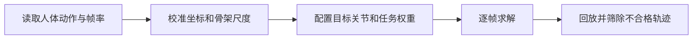
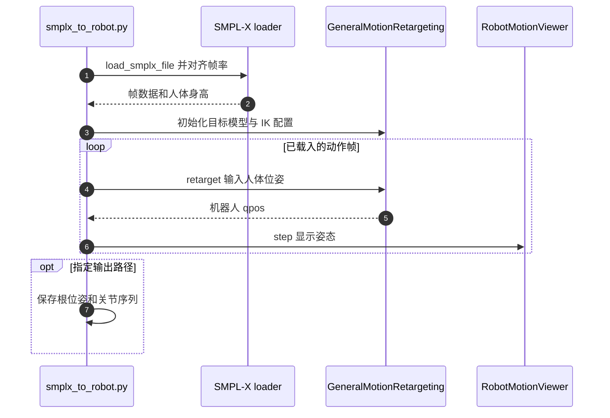

# Robot Motion Retargeting Workflow · 机器人动作重定向流程

## 一句话定义

将人体或其他机器人参考动作映射到目标机器人，并检查运动可行性。

## 英文缩写速查

| 缩写 | 英文全称 | 说明 |
|---|---|---|
| IK | Inverse Kinematics | 反求满足目标位姿的机器构形 |
| DoF | Degree of Freedom | 机器人可独立运动的维度 |
| SMPL-X | Skinned Multi-Person Linear Model with Expressive Hands and Face | 本文示例的人体参数化输入 |

## 为什么重要

不同本体的骨长、自由度、零位和限位不相同，直接复制人体关节角不能保证机器人运动可行。

## 主要技术路线（核心机制）

以 GMR 为例，先按人体与机器人配对配置加载 MuJoCo 模型和 Mink 帧任务；对人体关节位置缩放并加入偏移，再逐帧更新目标、解逆运动学并积分。默认包含构形限制，速度限制是可选配置。

## 源码运行时序图

## 工程实践

先用站立、单侧抬手检查轴向和左右；记录源帧率、根位姿、四元数顺序及机器人关节名称。批处理后检查末端误差、关节限位与速度突变；步态还要核对足底滑移、触地时序。可作为跟踪训练的参考，不直接下发真机。

## 局限与风险

运动学适配不是动力学可行性证明；接触力、力矩饱和、冲击和稳定性需要独立验证。镜像、坐标约定和输出四元数顺序错配可能被单帧回放掩盖。

## 关联页面

- [动作重定向流水线](../concepts/motion-retargeting-pipeline.md)
- [GMR 动作重定向](motion-retargeting-gmr.md)
- [机器人模型描述](robot-model-description-workflow.md)

## 参考来源

- [GMR · SMPL-X 示例入口与求解器实现](../../sources/repos/platform-method-robot-motion-retargeting-workflow.md)

## 推荐继续阅读

- [官方离线入口](https://github.com/YanjieZe/GMR/blob/25f56db79ac411258b377b6d4ccba0c8ff3372ac/scripts/smplx_to_robot.py)
- [官方求解器](https://github.com/YanjieZe/GMR/blob/25f56db79ac411258b377b6d4ccba0c8ff3372ac/general_motion_retargeting/motion_retarget.py)
