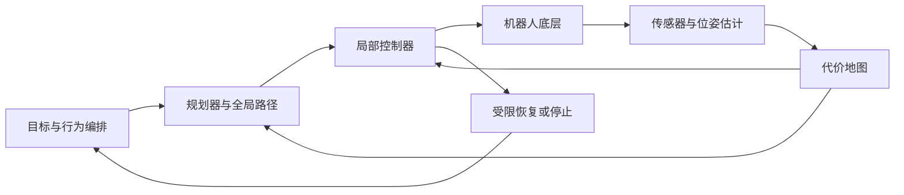

# Robot Navigation Workflow · 机器人导航与路径执行

## 一句话定义

将目标、环境感知、路径规划和运动控制连接为可验证的机器人导航流程。

## 英文缩写速查

| 缩写 | 英文全称 | 简要说明 |
|---|---|---|
| BT | Behavior Tree | 编排计划、控制、重试与恢复行为 |
| SLAM | Simultaneous Localization and Mapping | 在未知环境联合估计位置与地图 |
| TF | Transform | ROS 的时序坐标变换接口 |

## 为什么重要

全局可达不代表当前能安全通过。把定位、路径、局部控制和行为恢复分开，可区分地图认错、规划不可行、跟踪失败和恢复策略问题。

## 主要技术路线（核心机制）

1. Nav2 将行为编排与规划、控制、恢复服务解耦。代价地图把占用、未知和障碍膨胀编码进二维网格；感知层可融合激光、深度等障碍来源。全局规划搜索可行路线，控制器读取路线与局部环境并输出控制量。
2. [A*](a-star.md) 与 [动态窗口法](dwa.md) 分别是全局搜索与局部控制的例子，不是 Nav2 的唯一或固定组合。状态估计需提供一致的 `map → odom → base_link`，局部控制应避免直接承受全局重定位跳变。

### 流程总览

## 工程实践

- 先录制定位变换、全局路径、局部代价图和命令速度；控制接入前，用袋回放确认动态障碍和机器人轮廓影响的代价区间。
- 测试堵路、定位跳变、传感器中断和窄通道：记录成功率、碰撞、重规划次数、控制超时和人工接管；区分行为终止与单次计划失败。

## 局限与风险

二维占用与膨胀半径不能刻画台阶、坡面和可跨越体积，不应视为复杂地形上的可通行性证明。规划器输出也不能替代硬件急停与安全层。

## 关联页面

- [四足分层导航](../concepts/hierarchical-quadruped-navigation-stack.md)
- [机器人状态估计](robot-state-estimation-workflow.md)
- [导航与 SLAM 技术栈](../overview/navigation-slam-autonomy-stack.md)

## 参考来源

- [方法一手资料与核对范围](../../sources/sites/methods-primary-robot-navigation-workflow-2026-11-26.md)

## 推荐继续阅读

- [Nav2 Navigation Concepts](https://docs.nav2.org/rolling/getting_started/navigation_concepts/)
- [Nav2 Environmental Representation](https://docs.nav2.org/rolling/getting_started/navigation_concepts/environmental_representation/)
- [ROS REP-105](https://www.ros.org/reps/rep-0105.html)
