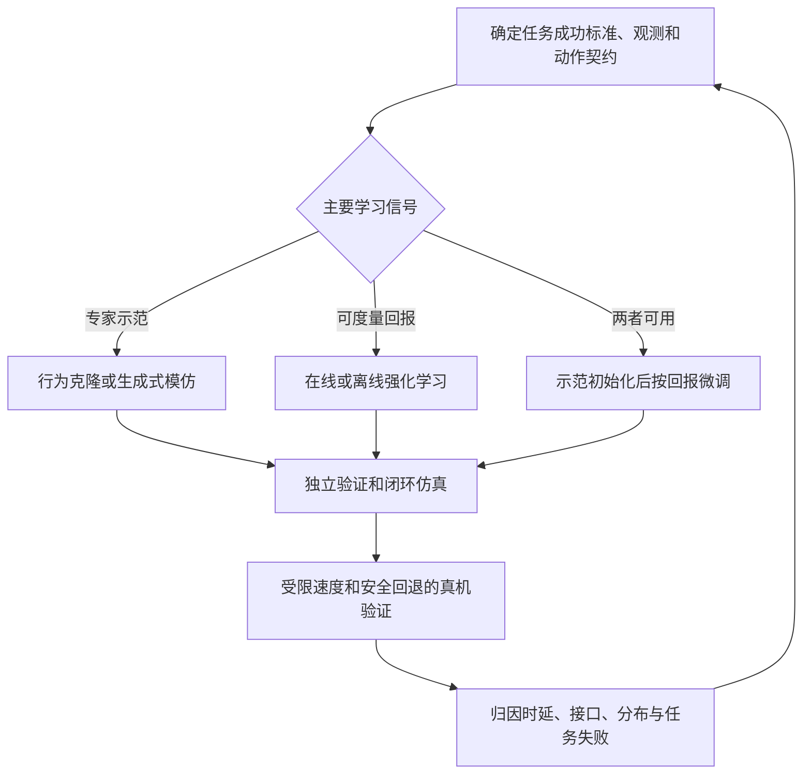

# 机器人策略学习流程 · Robot Policy Learning

## 一句话定义

机器人策略学习用示范、交互奖励或两者来训练从可部署观测到控制动作的映射，再在目标任务上用闭环反馈检验其表现，而非只评估静态预测。

## 英文缩写速查

| 缩写 | 英文全称 | 说明 |
|---|---|---|
| BC | Behavior Cloning | 以示范动作作为监督目标的模仿学习方法 |
| IL | Imitation Learning | 从专家示范、纠错等信号获取行为 |
| RL | Reinforcement Learning | 以累积回报作为优化目标，不同于直接拟合示范动作 |
| RHC | Receding Horizon Control | 只执行预测动作序列的一部分，然后用最新观测重规划 |
| P95 | 95th Percentile | 95% 实测样本不高于该值，可用于表征推理与传输时延尾部 |

## 为什么重要

相同模型在离线动作误差上相近，闭环失败方式仍可能完全不同：一个平均了两条有效路径，一个复制了训练时才存在的信息，一个把正确动作发迟了。把学习目标、运行接口与最终验收拆开，才能定位问题。

## 主要技术路线（核心机制）

- **训练策略**：演示稳定且采集成本可接受时，先跑 BC 基线。若同一观测对应多个合理的未来动作，连续确定性回归可能平均不同模式；[Diffusion Policy](../entities/paper-diffusion-policy.md) 将动作序列分布建模成条件去噪。当任务有可验证奖励时，RL 才有可用的比较目标；奖励应与独立任务验收对照，以发现策略只满足代理指标的问题。
- **适配接口**：先冻结观测字典、控制类型与坐标系，再决定共享初始化或新训练。以 [Octo](../entities/paper-octo.md) 为例，要把预训练分布内的开箱表现和用目标演示做的跨接口微调分开判断；传感模态、动作维度或归一化改变需要明确适配。
- **运行闭环**：记录观测长度、预测动作长度和执行前缀长度三个不同量。缩短执行前缀通常提高观测刷新频率，但增加推理负担；需要同时考虑端到端时延、通信和底层控制周期，而非只看模型吞吐。

## 工程实践

1. **先定义可复现实验**：为每个任务固定初始条件范围、超时、复位方式和成功判据；测试时禁止使用训练脚本中的特权量或未来观测。以[数据管线](./robot-learning-data-pipelines.md)锁定轨迹划分及动作反归一化。
2. **可比基线**：在相同示范、动作接口和初始条件上比较 BC 与候选策略，再单独消融历史窗口或动作块；不要同时改变模型、数据及动作参数就把提升归到一个因素。
3. **逐级上线**：先离线回放检验单位、符号和动作限幅，再做闭环仿真；真机由低速、短前缀和独立停止机制开始，报告任务成功率、试验数、失败类型、人工干预率和端到端 P95 时延。
4. **复现示例要匹配协议**：Diffusion Policy 把观察、预测、执行时域分开；Octo 论文在 Berkeley Bimanual 任务使用预测 64 步、执行 12 步再重规划。这个数字不是任何本体或任务的默认配置。

## 局限

离线误差低不保证能从自生成的偏差状态恢复；仿真评价也可能遗漏真实摩擦、控制延迟和传感遮挡。真机成功率依赖任务口径、样本量、底层执行与安全约束，不能跨不同实验直接比较。

## 关联页面

- [行为克隆](./behavior-cloning.md)、[模仿学习](./imitation-learning.md)与[强化学习](./reinforcement-learning.md)：按训练信号选路线。
- [基础策略](../concepts/foundation-policy.md)、[动作分块](./action-chunking.md)：区分模型泛化与执行接口。
- [机器人学习数据管线](./robot-learning-data-pipelines.md)：划分训练样本并保证语义一致。

## 参考来源

- [Diffusion Policy、Octo 与 RL 概念的一手来源归档](../../sources/papers/robot-policy-learning-primary.md)。

## 推荐继续阅读

- [Diffusion Policy：视觉条件动作模型与滚动时域](https://arxiv.org/html/2303.04137v5)
- [Octo：跨本体预训练及适配](https://arxiv.org/html/2405.12213v2)
