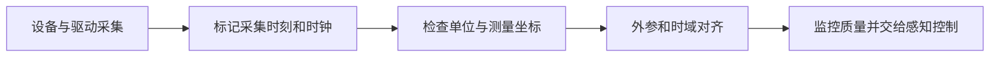

# Robot Sensor Interface and Integration · 机器人传感器接口与集成

## 一句话定义

将相机、激光雷达、触觉等传感器数据接入机器人系统并核对时间与坐标。

## 英文缩写速查

| 缩写 | 英文全称 | 说明 |
|---|---|---|
| IMU | Inertial Measurement Unit | 测角速度及线加速度等的设备 |
| SI | International System of Units | 接口记录物理量的共同单位 |
| F/T | Force and Torque | 力与力矩测量 |

## 为什么重要

时钟漂移和轴向错配常只在快速运动、接触或长时运行暴露，增加一台传感器不会自动减少这种误差。

## 主要技术路线（核心机制）

ROS REP 103 规定机身坐标采用右手系，x 向前、y 向左、z 向上；相机 optical frame 则 z 前、x 右、y 下。ROS sensor_msgs/Image 约定消息头记录采集时间，frame_id 使用相机光学坐标。

## 工程实践

用静止 IMU 和已知相机标靶核验轴和单位，保存内参、外参和校准日期。分别记录采集、到达与处理时刻，测丢帧、漂移和时延，设置配对时间窗和超窗行为。压力测试带宽并检查设备重连后时钟是否复位。

## 局限与风险

不能将相机 optical frame 套到全部传感器。同步与标定无法消除硬件噪声、非固定安装或不可观测偏置，应按实际环境检验。

## 关联页面

- [传感器融合](../concepts/sensor-fusion.md)
- [状态估计](../concepts/state-estimation.md)
- [机器人软件系统集成](robot-software-integration.md)

## 参考来源

- [ROS REP 103 与 Humble sensor_msgs/Image](../../sources/sites/platform-method-robot-sensor-integration.md)

## 推荐继续阅读

- [REP 103 原规范](https://github.com/ros-infrastructure/rep/blob/master/rep-0103.rst)
- [Image.msg 原消息定义](https://github.com/ros2/common_interfaces/blob/humble/sensor_msgs/msg/Image.msg)
