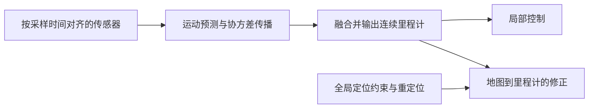

# Robot State Estimation Workflow · 机器人状态估计与定位

## 一句话定义

融合机器人传感器和运动信息，估计位置、姿态、速度及其不确定性。

## 英文缩写速查

| 缩写 | 英文全称 | 简要说明 |
|---|---|---|
| IMU | Inertial Measurement Unit | 提供角速度与加速度等测量 |
| EKF | Extended Kalman Filter | 使用局部线性化更新状态与协方差 |
| UKF | Unscented Kalman Filter | 利用采样点传播非线性系统的不确定性 |
| TF | Transform | 描述坐标系间随时间变化的变换 |

## 为什么重要

控制器需要短时间连续的位姿反馈，任务层则需要长期一致的全局定位。若将两种输出混为一个坐标系，全局重定位的跳变会直接传给跟踪误差。

## 主要技术路线（核心机制）

1. 编码器、视觉或惯性运动信息用于预测或增量约束，按量测坐标系、噪声及有效时间执行修正。可依据约束结构选择滤波或图优化；局部里程计、已有地图定位和联合建图并不是同一问题。
2. REP-105 的 `odom` 连续但可漂移，`map` 可发生离散跳变。以 robot_localization 为例，只融合连续信号时通常令 `world_frame=odom`；融合全局位置时可用 `world_frame=map` 产生 `map → odom`，另由连续里程计提供 `odom → base_link`。

### 流程总览

## 工程实践

- 先校单位、轴向、外参与时间戳，再逐路增加量测。记录协方差和创新残差，避免把同一个编码器积分得到的位姿和速度当作互不相关的独立证据。
- 以参考轨迹、静止误差和往返漂移做基线；回放量测缺失、延迟和全局重定位，分别看局部连续性、全局误差与估计延迟。

## 局限与风险

滤波器输出频率不等于真实新增信息速率。量测超时后的纯预测可维持输出，误差仍会随时间增大；未标定、不同步或高度相关的输入可能导致看似稳定但有偏的结果。

## 关联页面

- [状态估计](../concepts/state-estimation.md)
- [传感器集成](robot-sensor-integration.md)
- [雷达与里程计融合](lidar-odometry-fusion.md)

## 参考来源

- [方法一手资料与核对范围](../../sources/sites/methods-primary-robot-state-estimation-workflow-2026-11-26.md)

## 推荐继续阅读

- [ROS REP-105](https://www.ros.org/reps/rep-0105.html)
- [robot_localization State Estimation Nodes](https://github.com/cra-ros-pkg/robot_localization/blob/rolling-devel/doc/state_estimation_nodes.rst)
