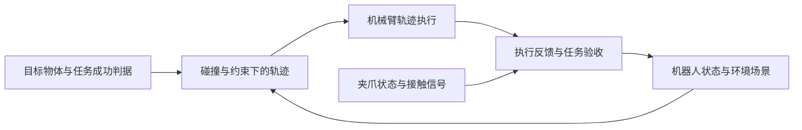

# Robotic Manipulation Systems · 机器人操作系统与末端执行器

## 一句话定义

将机械臂、末端执行器、感知和控制接口组合为可执行的物体操作系统。

## 英文缩写速查

| 缩写 | 英文全称 | 简要说明 |
|---|---|---|
| TCP | Tool Center Point | 工具的参考点与坐标系 |
| PSM | Planning Scene Monitor | 维护规划中的机器人状态与环境几何 |
| DoF | Degrees of Freedom | 独立运动自由度 |

## 为什么重要

物体操作把机械选型、感知、运动规划和执行验收连在一起。仅有可达位姿或无碰路径不能证明夹持稳定、动作及时或装配成功。

## 主要技术路线（核心机制）

1. MoveIt 以规划场景描述机器人与环境，并用 PSM 同步机器人状态、传感器占用图和应用加入的物体。规划请求以当前状态、目标和约束为输入，输出受关节速度及加速度约束的时序轨迹，而不只是路径。
2. 对机械臂和抓手分别验证轨迹、夹持动作和回馈。MoveIt 的控制器接入文档分别说明 `FollowJointTrajectory` 与 `GripperCommand`；接触阶段是否需要力控取决于任务和实际低层控制器。

### 流程总览

## 工程实践

- 固定末端、负载、TCP、夹具和场景物体的尺寸，用空载加低速试运行核对关节顺序、轨迹起点与场景同步。
- 按对齐、接近、夹持、搬运和放置分阶段验收；记录夹持滑移、对象姿态误差、停顿、超时以及恢复结果，排查成功率下降究竟来自感知、规划还是抓手。

## 局限与风险

规划等效几何与真实软体、摩擦和夹持力不同。几何无碰不等同于稳定抓取；可控性、检测到的接触和急停需由独立硬件及控制链保证。

## 关联页面

- [全身控制](../concepts/whole-body-control.md)
- [机器人操作](../tasks/manipulation.md)
- [机器人视觉感知](robot-visual-perception.md)

## 参考来源

- [方法一手资料与核对范围](../../sources/sites/methods-primary-robotic-manipulation-systems-2026-11-26.md)

## 推荐继续阅读

- [MoveIt Planning Scene Monitor](https://moveit.picknik.ai/main/doc/concepts/planning_scene_monitor.html)
- [MoveIt Motion Planning](https://moveit.picknik.ai/main/doc/concepts/motion_planning.html)
- [MoveIt Low Level Controllers](https://moveit.picknik.ai/main/doc/examples/controller_configuration/controller_configuration_tutorial.html)
