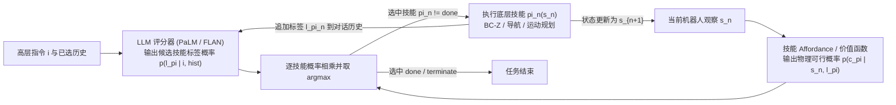

# SayCan（Do As I Can）

## 一句话定义

**SayCan**（Ahn et al., arXiv:2204.01691）将大语言模型对候选技能标签的任务相关性概率 $p(\ell_\pi \mid i, \text{history})$ 与底层技能在当前状态下的强化学习可行性价值估计 $p(c_\pi \mid s, \ell_\pi)$ 相乘，在「语义有用（Say）」与「物理可行（Can）」之间做概率分解，迭代输出可直接在机器人上执行的原子技能序列。

## 英文缩写速查

| 缩写 | 英文全称 | 简要说明 |
|------|----------|----------|
| LLM | Large Language Model | 大语言模型；在 SayCan 中作评分式任务分解器（非自由生成文本） |
| RL / TD | Reinforcement Learning / Temporal Difference | 强化学习 / 时序差分；以稀疏 0/1 奖励训练语言条件价值函数作 affordance |
| BC | Behavioral Cloning | 行为克隆；SayCan 真机 `pick` 策略主干基于 BC-Z 架构训练 |
| VLA | Vision-Language-Action | 视觉–语言–动作端到端多模态策略路线（与 SayCan 分层规划形成对照） |

## 为什么重要

1. **LLM 物理接地的奠基范式**：直接让 LLM 回答「可乐洒了怎么办」往往会给出「用吸尘器」等不适配当前机器人的叙事；SayCan 用固定技能文本词表和当前视觉价值函数同时约束 LLM，把开放常识推理接到有限具身系统上。
2. **首次验证 LLM 能力缩放可直接传导到真机成功率**：在 101 条厨房指令评测中，从 FLAN（137B，Plan 70% / Execute 61%）升级到 PaLM（540B，Plan 84% / Execute 74%），规划与执行错误率约减半（且无需重新训练底层技能）。
3. **打通「分层语言规划 → 端到端 VLA」演进主轴**：SayCan 暴露了固定底层技能库与开环无状态纠错的瓶颈，直接催生了闭环反馈（Inner Monologue）以及后续将高层推理与底层动作统一在同一多模态骨干中的 RT 系列与 VLA 路线。

## 核心原理

SayCan 把「在状态 $s$ 执行技能 $\pi$ 推进指令 $i$ 成功完成」的概率建模为两项乘积（见 [SayCan 论文实体](../entities/paper-saycan.md) 与原文 Sec. 3, Algorithm 1）：

$$
p(c_i \mid i, s_n, \ell_\pi) \propto \underbrace{p(c_\pi \mid s_n, \ell_\pi)}_{\text{World-grounding (Can)}} \cdot \underbrace{p(\ell_\pi \mid i, \ell_{\pi_{n-1}}, \dots, \ell_{\pi_0})}_{\text{Task-grounding (Say)}}
$$

- **评分模式而非自由生成（Sec. 3）：** SayCan 不直接解码自由文本后再去匹配最近技能（原文 `Generative` 消融仅 74% Plan，低于 PaLM-SayCan 的 84%），而是由提示工程固定「Human / Robot: 1. ...」对话格式，对每个合法技能标签 $\ell_\pi \in \ell_\Pi$ 计算条件对数似然，从而保留显式概率分布并与 affordance 数值融合。
- **价值函数作为 Affordance 抽象（Sec. 2 & 4）：** 对于无折扣、成功奖励 $1.0$、失败奖励 $0.0$ 的有限回合任务，时序差分（TD）训练的语言条件 Q 函数 $v(s) = \max_a Q_\pi(s, a)$ 等价于技能成功完成概率。实验显示去掉 affordance（`No VF`）Plan 成功率从 84% 降至 67%（尤其 Embodiment 状态测试从 64% 暴跌到 18%）。
- **技能组合与可扩展推理（Sec. 5.2）：** 新增技能（如开/关抽屉）只需扩展候选标签集、挂接对应价值函数并在 prompt 中补入少数示例即可零微调接入；若在生成技能前先让 LLM 产出一段 `Explanation:`（Chain-of-Thought），即可显著改善「无咖啡因」「非水果」等否定与隐式约束推理。

## 主要技术路线

- **概率分解式分层规划（SayCan 本线）：** 上层冻结大语言模型做技能相关性打分，下层并行运行异构技能族（学习型 BC-Z 策略、RL 价值函数或经典规划/导航），靠统一概率接口拼接，抽象层级详见 [Foundation Policy](../concepts/foundation-policy.md)。
- **闭环状态反馈演进：** 原版 SayCan 仅在每步决策前读取当前 affordance，执行失败后不会主动重规划；后续 Inner Monologue 引入成功检测器与场景描述反馈形成语言内循环。
- **向端到端 VLA 演进：** SayCan 仍受制于固定原子技能词表，而 [Robotics Transformer](./robotics-transformer-rt-series.md) 与 [VLA](./vla.md) 则尝试把视觉、语言推理与连续/离散动作统一到同一端到端骨干；现代 VLM planner 如 [Vesta](../entities/paper-vesta-generalist-embodied-reasoning.md) 也将文本子任务规划升级为含空间 grounding 与记忆的推理前级，再交由动作策略执行。

## 工程实践

- **异构技能与 Affordance 标定（Appendix D.2）：** 真机厨房栈（551 个设计技能、评测涵盖 15 物体 × 5 地点）并没有强求全部分支同构——`Pick` 采用 BC-Z 多任务视觉语言策略（68k 遥操作 + 12k 自主过滤轨迹，16 TPUv3 训练 ~27h）配 MT-Opt 仿真+RetinaGAN 价值函数并用经验区间 $v_{\min}^{\text{pick}}=0.2, v_{\max}^{\text{pick}}=0.5$ 线性截断；`Go to` 用已知地图导航配距离反比 affordance；`Place` 用笛卡尔运动规划并设 $p=1.0$；`Terminate` 固定为 $0.1$，并在外层逻辑禁止重复执行刚完成且已获奖励的技能。
- **Prompt 工程敏感点（Appendix D.3）：**
  1. 示例数从 0（含终止判定仅 10% Plan）增到 4 个即达 82%，17 个示例（Listing 1）在语言模拟器上达 88%。
  2. 步骤间显式加编号（`1. `, `2. `）并按换行符 `\n` 分隔、使用符合自然语法的技能词表（避免 `"a"`/`"an"` 拼写错误）、控制示例物体分布均匀，均可明显提升 LLM 评分稳定性。
- **开源复现边界（Sec. 6）：** 官方公开代码（`google-research/tree/master/saycan`）只包含 UR5 桌面仿真 Colab——用 **CLIPort** 作抓取放置策略、**ViLD** 开放词表目标检测器充当近似 affordance、**GPT-3** 作语言模型；真机移动操作控制栈、68k 遥操作集及 PaLM/FLAN 权重均未开源。

## 局限与风险

- **技能库天花板与迁移衰减：** 论文自述系统主要瓶颈在底层技能覆盖面与执行鲁棒性（真实办公厨房执行率从 Mock Kitchen 的 74% 降至 60%；新增抽屉任务规划 100% 但执行仅 33%）。
- **开环失败恢复弱：** 若某技能虚高报告了 affordance 却中途执行失败，原版 SayCan 缺乏显式失败检测与回退机制（需结合重规划/闭环监控）。
- **语言模型固有缺陷：** 实测规划误差中 **65% 来自 LLM 侧**（长程任务提前输出 `"done"`、否定约束与模糊指代错误），另 **35% 来自 affordance 误判**（例如未能识别薯片袋或海绵可抓取）；且对每个候选技能都需计算 LLM 对数概率，技能词表极大时推理延迟会线性膨胀。

## 关联页面

- [SayCan 论文实体](../entities/paper-saycan.md)
- [Foundation Policy](../concepts/foundation-policy.md)
- [VLA](./vla.md)
- [Robotics Transformer（RT 系列）](./robotics-transformer-rt-series.md)
- [操作任务（Manipulation）](../tasks/manipulation.md)
- [Vesta 通用具身推理](../entities/paper-vesta-generalist-embodied-reasoning.md)
- [Embodied-AI-Guide 微信专辑](../overview/embodied-ai-guide-wechat-album-curator.md)

## 参考来源

- [SayCan 论文全文与项目页核对归档（arXiv:2204.01691v2）](../../sources/papers/saycan_arxiv_2204_01691.md)（主要原文：通读全文 Sec. 1–8、Appendix A–E.6 及 `say-can.github.io`）
- [Ted Xiao 具身智能三时代一手索引](../../sources/blogs/ted_xiao_embodied_three_eras_primary_refs.md)
- [Lumina 具身实践连载（LLM Planner 部分）](../../sources/blogs/wechat_lumina_embodied_practice_part1_llm_planner_2026-09-20.md)

## 推荐继续阅读

- Ahn et al., *Do As I Can, Not As I Say: Grounding Language in Robotic Affordances*（<https://arxiv.org/abs/2204.01691>）
- 项目官网与视频：<https://say-can.github.io/>
- 开源桌面仿真 Colab：<https://github.com/google-research/google-research/tree/master/saycan>
- SayCan Dataset v0（CC BY 4.0）：<https://github.com/say-can/say-can.github.io/tree/main/data>
- 后续闭环演进：Huang et al., *Inner Monologue: Embodied Reasoning through Planning with Language Models*（<https://arxiv.org/abs/2207.05608>）
