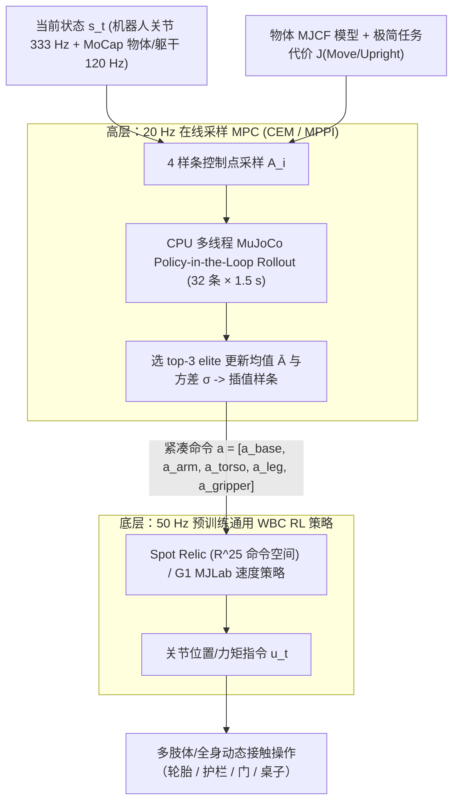
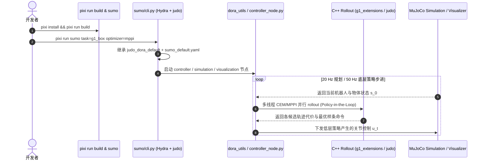

# Sumo (Dynamic and Generalizable Whole-Body Loco-Manipulation)

**Sumo** 是一种由 RAI Institute 提出的层级化机器人控制框架，专门用于解决**动态全身移动操作 (Whole-Body Loco-Manipulation)** 问题。它打破了传统的“高层学习 + 低层模型控制”范式，采用了一种**“高层 MPC 驱动底层 RL”**的反向层级架构，使机器人能够操纵比自身更重、更大或几何形状复杂的物体。

## 一句话定义

**高层 20 Hz 采样 MPC 在预训练 50 Hz 通用 RL 全身控制器的命令空间里并行 rollout 搜索，将不稳定多接触动力学交给底层策略稳住，靠部署期切换代价函数或物体模型即可零样本搬运超限大重物。**

## 英文缩写速查

| 缩写 | 英文全称 | 简要说明 |
|------|----------|----------|
| MPC | Model Predictive Control | 滚动时域内优化控制序列的预测控制 |
| RL | Reinforcement Learning | 通过与环境交互最大化长期回报来学习策略的范式 |
| Manipulation | Robot Manipulation | 抓取、移动、操作物体的任务总称 |
| WBC | Whole-Body Control | 协调全身关节满足多任务/约束的控制基础设施 |
| MuJoCo | Multi-Joint dynamics with Contact | 接触丰富的刚体物理仿真引擎 |
| Reward | Reward Function | 塑造强化学习策略行为的标量反馈 |
| G1 | Unitree G1 Humanoid | 宇树入门级教育科研人形平台 |
| OCP | Optimal Control Problem | MPC 每步求解的有限时域最优控制问题 |
| VLA | Vision-Language-Action | 视觉-语言-动作多模态基础策略方向 |

## 为什么重要

- **反直觉但更稳定的分层分工：** 传统端到端采样 MPC 容易在腿式系统 single-shooting rollout 中发散且受维度灾难限制；Sumo 将底层全身稳定封装进 `Relic` / `MJLab` RL 策略，令高层仅需搜索低维样条命令（32 条 rollout / 1.5 s 仅耗时 `43.45±1.88 ms`，满足 20 Hz 实时重规划）。
- **免重训的测试期泛化：** 端到端或分层 RL 在未见物体几何与新任务目标上明显掉分；Sumo 仅在部署期更换物体 MJCF 模型或极简几何代价函数（如 3 项 Move 代价 / 2 项 Upright 代价），即可在真机 Spot 上以 `8/10–10/10` 成功率完成扶起 15 kg 轮胎（超臂端 11 kg 额定负载）等 8 项任务。

## 核心机制：MPC-over-RL

Sumo 的创新在于其分工明确的双层结构：

### 1. 底层：通用 RL WBC 策略
- **角色**：负责高频（50Hz）的全身稳定与基础移动。
- **作用**：底层是一个预训练的通用全身控制（WBC）策略（如 *Relic*）。它将高度不稳定、非线性的足式机器人动力学抽象化，转化为一个稳定的**命令空间 (Command Space)**，如基座线速度/角速度、机械臂末端目标位姿。
- **优势**：利用了强化学习在处理复杂接触和鲁棒控制方面的天然优势。

### 2. 高层：基于采样的在线 MPC
- **角色**：负责中频（20Hz）的任务规划与长时程协调。
- **方法**：使用交叉熵方法 (CEM) 进行在线轨迹采样。
- **机制**：MPC 不直接输出电机力矩，而是在底层 RL 策略的“命令空间”内进行搜索。
- **Policy-in-the-Loop**：在前向模拟（Rollouts）时，MPC 将底层 RL 策略作为动力学的一部分进行并行模拟（通常使用 MuJoCo）。

## 主要技术路线

## 主要优势

- **零样本任务泛化**：由于 RL 策略是通用的，只需在部署时更换 MPC 的代价函数 (Cost Function) 或物体模型，即可让机器人执行全新的操作任务（如从推桌子切换到抬轮胎），无需任何重新训练。
- **处理超限载荷**：通过全身各部位（躯干、四肢）的协同接触，Sumo 能够操纵超过机械臂额定载荷的物体（例如 Spot 扶起 `15 kg` 轮胎，高于机械臂 `11 kg` 额定载荷）。
- **极简工程代价**：相比端到端 RL 需 15 项精细 reward 与 ~2 h GPU/任务调参，Sumo 仅需 2–3 项极简几何代价即可工作，贝叶斯超参搜索收敛算力比分层 RL 低约 1 个数量级。

## 工程实践与开放范围

[官方项目页](https://sumo.rai-inst.com/)已链接 [rai-opensource/sumo](https://github.com/rai-opensource/sumo)。README 提供 `pixi install` → `pixi run build`（编译本地 `g1_extensions` 与 `judo` MuJoCo 扩展）→ `pixi run sumo` 仿真入口，及 `pixi run python -m sumo.run_mpc` 无界面评测/采数入口（HDF5 记录），详见[代码归档](../../sources/repos/rai-opensource-sumo.md)。本次未运行仿真；公开研究代码不等于完整真机驱动或全部论文资产开放。

## 源码运行时序图

图依据：基于 `rai-opensource/sumo` `README.md`、`sumo/cli.py` 与 `g1_extensions/g1_rollout.cpp` 核实。

## 硬件与仿真验证（论文 Table II–III）

- **Spot 真机（8 项任务 × 10 trials，Off-board 64 核 Threadripper + 120 Hz MoCap）：** Tire Upright `10/10` (`9.2±4.7 s`)、Barrier Upright `9/10`、Cone Upright `9/10`、Chair Upright `8/10`、Tire Stack `8/10`、Barrier Drag `9/10`、Tire Rack Drag `9/10`、Rugged Box Push `10/10`。
- **G1 人形仿真（Table III × 10 trials）：** Box Push `9/10` (`11.83 s`)、Door Open `10/10` (`4.73 s`)、Chair Push `10/10` (`6.86 s`)、Table Push `8/10` (`4.86 s`)。

## 常见误区或局限

- **依赖外部动捕与离线算力（论文 §VI）：** 真机 Spot 实验使用 120 Hz 外部 MoCap 与 64 核 off-board 工作站经 WiFi 下发指令，尚未实现完全机载感知与机载规划。
- **需要已知物体动力学/几何模型：** 跨物体泛化依赖在规划器里替换物体 MJCF 模型，尚无在线系统辨识与视觉即时网格重建闭环。
- **能力上限受制于底层 RL 接口：** 当前 G1 复用 `MJLab` 速度策略并覆盖手臂指令，若想做更精细的全身多接触力控仍需更具可操纵性的底层追踪策略。

## 关联页面

- [MPC 与 WBC 集成](../concepts/mpc-wbc-integration.md) — Sumo 采用的反向层级架构基础
- [Loco-Manipulation](../tasks/loco-manipulation.md) — Sumo 解决的核心任务领域
- [Whole-Body Control (WBC)](../concepts/whole-body-control.md) — 被 Sumo 底层 RL 策略替代的模块
- [Centroidal Dynamics](../concepts/centroidal-dynamics.md) — MPC 层常用的物理模型
- [Optimal Control (OCP)](../concepts/optimal-control.md) — MPC 的理论源头
- [MuJoCo (物理引擎)](../entities/mujoco.md) — Sumo 运行并行 Rollouts 的引擎
- [Unitree G1](../entities/unitree-g1.md) — Sumo 验证的人形平台
- [VLA](./vla.md) — 未来可能的更高层指令提供者
- [SMPC-to-RL](../entities/paper-smpc2rl-loco-manipulation.md) — 同实验室对照：SMPC **离线教书** + 稀疏 FastTD3，而不是部署期 CEM
- [Robot Juggling / AthenaZero](../entities/paper-robot-juggling-athenazero.md) — 同研究所原地动态操作：正则化记忆学习 + MRS（arXiv:2608.26800）

## 参考来源
- [Sumo: Dynamic and Generalizable Whole-Body Loco-Manipulation](../../sources/papers/sumo.md)
- [Sumo 官方代码归档](../../sources/repos/rai-opensource-sumo.md)
- [RAI Institute Project Page](https://sumo.rai-inst.com/)

## 推荐继续阅读

- [arXiv:2604.08508v3 论文全文](https://arxiv.org/abs/2604.08508)
- [rai-opensource/sumo 官方代码库](https://github.com/rai-opensource/sumo)
- [SMPC-to-RL](../entities/paper-smpc2rl-loco-manipulation.md) — 同研究所对照：离线采数 vs 在线搜索
