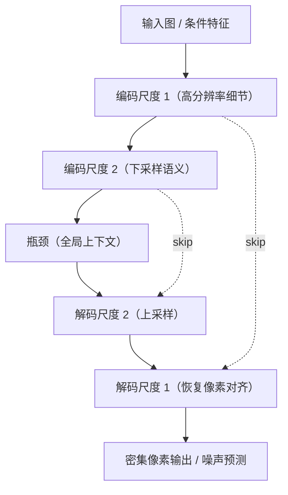

# U-Net

**U-Net**：对称的 **收缩路径（编码器）** 与 **扩张路径（解码器）**，并在每一尺度用 **跳跃连接** 把浅层高分辨率特征裁剪拼接到解码器，一次前向输出与输入同空间尺寸的密集预测图。

## 一句话定义

把「看懂全局上下文」与「对准像素边界」拆成下采样编码器与上采样解码器两条路径，再用同尺度跳跃连接把高分辨率细节抄近道送回解码端。

## 英文缩写速查

| 缩写 | 英文全称 | 简要说明 |
|------|----------|----------|
| U-Net | U-shaped Convolutional Network | U 形对称编码–解码卷积网络 |
| Skip | Skip Connection | 同尺度特征拼接，保留局部空间与边界细节 |
| FCN | Fully Convolutional Network | 无全连接的密集预测全卷积网络族 |
| DDPM | Denoising Diffusion Probabilistic Models | 经典图像与策略扩散降噪骨干常采用 U-Net |
| Dice | Dice Loss / Coefficient | 类别不平衡医学/缺陷分割常用损失与指标 |
| FPS | Frames Per Second | 机载分割与感知的实时推理帧率约束 |

## 为什么重要

- **少标注高精分割奠基**：验证了即使在**极少标注样本**下配合弹性形变数据增广，也能稳定完成像素级精确分割（[Ronneberger et al., 2015](../../sources/papers/unet_ronneberger_arxiv_1505_04597.md)）。
- **扩散模型经典去噪骨干**：DDPM 等扩散生成与部分扩散策略将 U 形多尺度跳跃结构用于条件去噪——浅层修局部高频纹理/动作，深层控全局语义与结构布局。
- **机器人与工业感知常备底座**：机载占用栅格、可通行区域分割、触觉图像重建、可抓取掩码与工业缺陷分割大量采用 U-Net 变体；在课程框架中也是与 SETR / SegFormer 等 ViT 分割路线对照的 CNN 基线。

## 主要技术路线

| 路线 | 机制 | 说明 |
|------|------|------|
| 经典 U-Net | 对称卷积编解码 + 同尺度 skip | 医学与少样本像素级分割经典底座 |
| U-Net++ / 注意力 U-Net | 嵌套密集 skip / 门控注意力 | 增强跨尺度语义对齐与边缘细化 |
| 时序 / 扩散 U-Net | 残差块注入时间步/语言/动作条件 + 中低分辨率自注意力 | 经典图像 DDPM 与 1D 动作块扩散骨干 |
| 3D U-Net | 体数据三维卷积编解码 | 医学体积图像、局部占用场与 SDF 重建 |

## 核心原理

收缩路径反复 `Conv → 下采样`，通道数加倍而空间分辨率减半，逐步提取高层语义上下文；扩张路径逐步上采样并将同尺度的编码特征**裁剪对齐并沿通道拼接（concat）**，再经过卷积融合。最终输出层通道数对应分割类别数或密集回归维度（如深度、SDF、噪声预测等）。

## 工程实践

| 项 | 建议 |
|----|------|
| **分割与损失** | 样本/像素类别极不平衡时采用加权交叉熵（CE）或 Dice Loss；大图分块推理可用 overlap-tile 策略；留意 ADE20K / Cityscapes / 自有数据类别映射 |
| **扩散建模** | 将扩散时间步与条件嵌入注入残差块；在中低空间分辨率层插入 self/cross-attention |
| **机器人与机载部署** | 先明确输出分辨率与控制期延迟约束（FPS），评估输入降采样及是否升级到 1D 时序或 3D 变体 |
| **预训练迁移** | 医学黑白权重几乎不能直接迁移到 RGB 操作场景；RGB 分割或抓取预测优先采用 ImageNet 预训练卷积骨干替换编码端 |

## 局限与风险

- **感受野与长程依赖**：纯卷积 U-Net 受限局部感受野与手工多尺度设计；需要开放词表、提示词分割或超强全局上下文时，应转向 SAM / SEEM 或 SETR / SegFormer 等 Transformer 路线。
- **固定裁剪与尺寸约束**：原版无 padding 卷积与多级下采样依赖输入尺寸对齐（通常须为 `2^k` 倍数或补边界策略）。
- **不是生成模型本身**：U-Net 是特征图骨干几何形态，生成或分割能力来自训练目标与扩散/密集监督损失。
- **高维体积显存代价**：高分辨率 3D 体积 U-Net 显存与算力开销极高；点云与稀疏三维占据任务应优先评估稀疏卷积或 [GNN](../concepts/graph-neural-network.md)，且标注噪声会直接放大到像素边界指标上。

## 关联页面

- [CNN（卷积神经网络）](../concepts/convolutional-neural-network.md)
- [扩散模型](../concepts/diffusion-model.md)
- [视觉骨干](../concepts/vision-backbones.md)
- [分割任务分类](../concepts/image-segmentation-taxonomy.md)
- [GNN（图神经网络）](../concepts/graph-neural-network.md)
- [SETR](../entities/setr.md)
- [SegFormer](../entities/segformer.md)
- [ResNet（深度残差学习）](../entities/paper-resnet-deep-residual-learning.md)
- [Transformer CV 课程策展](../entities/transformer-cv-curriculum.md)
- [ADE20K 数据集](../entities/dataset-ade20k.md)
- [AI 架构地图](../overview/ai-architecture-map.md)
- [机器人视觉感知栈选型闭环知识链](../queries/robot-perception-stack-selection-loop.md)

## 参考来源

- [U-Net 论文（arXiv:1505.04597）](../../sources/papers/unet_ronneberger_arxiv_1505_04597.md)
- [AI 架构地图一手论文簇](../../sources/papers/ai_architecture_foundations.md)
- [Transformer 视觉应用课程大纲](../../sources/courses/transformer_cv_applications_syllabus.md)

## 推荐继续阅读

- [U-Net 原论文 arXiv:1505.04597](https://arxiv.org/abs/1505.04597)
- [Ronneberger 项目主页](https://lmb.informatik.uni-freiburg.de/people/ronneberger/u-net/)
