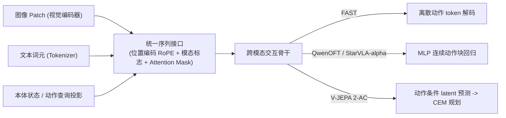

# 统一多模态 Token（Unified Multimodal Tokens）

## 一句话定义

将图像、语言、状态等表示映射为可在序列模型中交互的 token 接口；不同模态仍可保留各自的编码器、时间轴与输出头，动作也可采用连续回归或生成式解码。

## 英文缩写速查

| 缩写 | 英文全称 | 简要说明 |
|---|---|---|
| VLA | Vision-Language-Action | 从视觉与语言生成机器人动作 |
| MLP | Multi-Layer Perceptron | 状态投影或连续动作读出头 |
| RoPE | Rotary Position Embedding | 对序列的空间/时间位置编码 |
| JEPA | Joint-Embedding Predictive Architecture | 在表征空间预测目标 |

## 为什么重要

统一接口便于跨模态注意力与骨干复用，但接口相容不代表物理含义、时间采样或损失函数已经一致。先明确哪些量进入同一骨干、哪些量由独立头读出，才能判断可迁移性和部署开销。

## 核心原理

视觉编码器生成 patch 表征，文本 tokenizer 生成词元嵌入；机器人状态可经投影形成条件。位置与模态信息使模型区分 token 的空间、时间及用途。动作输出可以是离散词元，也可以从查询隐藏状态回归连续动作块；新增传感器仍需标定、对齐数据、训练与输入分布验证。

## 主要技术路线

| 路线 | 输入/输出接口 | 已读原文中的实例 |
|---|---|---|
| 离散动作序列 | 编码动作，再以序列目标解码 | StarVLA 框架的 FAST 分支 |
| 查询与连续读出 | 共享图文骨干，动作 query 接 MLP | StarVLA-α / 当前 QwenOFT |
| 动作条件 latent 预测 | 交错状态、动作与图像表征，预测下一状态 | V-JEPA 2-AC 的 block-causal 预测器 |

这些路线统一的是表征交互边界，不是所有模态都必须用同一个词表或同一种生成目标。V-JEPA 2-AC 没有语言控制头，列为架构对照，不能把它当作完整 VLA。

## 工程实践

1. 保存各模态的张量形状、单位、帧率、时间戳与有效维掩码；padding 不改变本体含义。
2. 明确 attention mask：允许部署时已经到达的当前观测，隔离未来未观测状态与训练标签；用户实际提供的目标条件另行标注。
3. 分别量化图像编码、融合骨干与动作解码开销，不按 token 数或“统一”名称直接推断控制频率。
4. 以已有论文的实际接口核对实现。QwenOFT 读取动作 query 后回归连续 chunk；V-JEPA 2-AC 则用动作/状态条件预测 latent，再交给外部 CEM 规划。

## 局限与风险

统一序列不消除传感器专属编码器、跨模态同步、机器人动作适配或多峰分布问题。共享隐藏状态还可连接多个生成分支；新近 [XBot-Omni](../entities/paper-xbot-omni.md) 的已有归档也区分 Thinker、Talker 与 Actor，不能据统一表征推断统一关节控制接口或代码已发布。本页原文通读依据为下列 α、框架与 V-JEPA 2 记录，不声称本次重读 XBot-Omni 全文。

## 关联页面

- [动作分词](../formalizations/vla-tokenization.md)
- [跨模态注意力](../formalizations/cross-modal-attention.md)
- [VLA](./vla.md)
- [StarVLA-α](../entities/paper-starvla-alpha.md)
- [SenseNova-U1.5](../entities/sensenova-u1-5.md) — 既有多模态输出的相邻实例。
- [LAMR](../entities/paper-lamr.md)：同一序列可跨模态交互，但模型仍可能过度依赖单一模态；LAMR 通过层角色画像，在推理时区分稳态调节与跨模态传播。
- [模型架构纵深路线](../../roadmap/depth-model-architecture.md) — Stage 4 的多模态表征接口。

## 参考来源

- [StarVLA-α 原文与 QwenOFT 实现核对](../../sources/papers/star_vla_alpha_arxiv_2604_11757_full_reading_2026_11_15.md)
- [StarVLA 框架原文与官方指南](../../sources/papers/starvla_framework_arxiv_2604_05014_full_reading.md)
- [V-JEPA 2 原文与动作条件预测器](../../sources/papers/vjepa2_arxiv_2506_09985_full_reading_2026_11_15.md)

## 推荐继续阅读

- [StarVLA-α 全文](https://arxiv.org/html/2604.11757)
- [V-JEPA 2 全文](https://arxiv.org/html/2506.09985)
