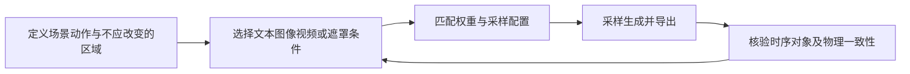

# Video Generation and Editing Workflow · 视频生成与编辑流程

## 一句话定义

利用生成模型或编辑工具产生、变换和检查时序视觉内容。

## 英文缩写速查

| 缩写 | 英文全称 | 简要说明 |
|---|---|---|
| T2V | Text-to-Video | 用文本作为生成视频的条件 |
| I2V | Image-to-Video | 用参考图像与可选文本引导视频 |
| V2V | Video-to-Video | 将已有视频作为编辑输入 |
| FPS | Frames Per Second | 导出帧率，与视频时长和回放节奏有关 |

## 为什么重要

同样叫视频生成，文本生成、参考图像和带遮罩编辑的输入约束并不相同。在机器人数据或仿真中使用生成结果时，应单独证明视觉质量和动作条件一致性。

## 主要技术路线（核心机制）

1. 先按任务锁定条件和权重。Wan2.1 的公开示例区分 T2V、I2V、首尾帧生成和 VACE 编辑；后者可传参考图、原视频和遮罩，部分编辑任务需先生成额外条件。不同权重的官方示例分辨率不同。
2. 固定种子、提示词、帧数、帧率和尺寸，记录条件输入配置；按所用模型的采样器生成后，检查跨帧身份、几何、动作和保留区的一致性，必要时回改条件、遮罩或相机描述。

### 流程总览

## 工程实践

- 从固定镜头、单对象、短时间窗起步；在相同条件/种子下逐项更改约束，分开比较内容保真、镜头运动和跨帧一致性。
- 若输出用于机器人训练，先检查每段动作是否可解释、能否重建对应状态与时间戳，再和真实/仿真闭环基线对照。

## 局限与风险

看起来合理的视频不提供可执行动作或动力学真值；遮罩外也可能出现闪烁或身份漂移。官方发布的推理示例和权重不是对任意任务、许可证或数据来源的担保，本页未运行模型。

## 关联页面

- [生成式视觉预训练](../concepts/generative-vision-pretraining.md)
- [生成式世界模型](generative-world-models.md)
- [视频生成与编辑流程 vs 动作条件交互式世界模型](../comparisons/video-generation-workflow-vs-interactive-world-models.md)
- [具身评测与 Benchmark](../overview/hub-embodied-eval-benchmark.md)

## 参考来源

- [方法一手资料与核对范围](../../sources/sites/methods-primary-video-generation-workflow-2026-11-26.md)

## 推荐继续阅读

- [Wan2.1 官方仓库 README](https://github.com/Wan-Video/Wan2.1)
