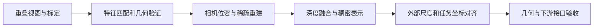

# Visual 3D Reconstruction · 视觉三维重建流程

## 一句话定义

从图像、视频或深度观测恢复可用于测量、渲染或仿真的三维场景表示。

## 英文缩写速查

| 缩写 | 英文全称 | 简要说明 |
|---|---|---|
| SfM | Structure from Motion | 多视图匹配和几何估计得到相机及稀疏结构 |
| MVS | Multi-View Stereo | 从已注册视图估计稠密深度并融合 |
| 3DGS | 3D Gaussian Splatting | 以三维高斯为基元进行视图渲染 |

## 为什么重要

渲染、导航和仿真要求不同：看得像原场景，不表示有正确的米制尺度、障碍表面、碰撞网格或可通行区域。

## 主要技术路线（核心机制）

1. COLMAP 的经典流程先做特征匹配与几何验证，通过 SfM 配准相机、三角化稀疏点并优化；再用 MVS 生成多视角深度/法线、融合稠密点云，按需网格化。
2. 依据下游选输出：稠密点云便于测量和占用采样，网格对碰撞与表面计算更直接，渲染表示更适合重放外观。单目多视图若无尺度约束，不能仅凭重投影误差判断米制尺寸正确。

### 流程总览

## 工程实践

- 采集时保留视角重叠与视差，避免只有纯旋转或大量重复纹理；在稠密重建之前检查相机注册率、相机轨迹和稀疏点分布。
- 用已知距离、标定尺或真实里程计核对尺度及轴向，验收应另测关键区域覆盖、孔洞、动态残影和下游碰撞/导航；保留未参与建模的视角做重投影和渲染检查。

## 局限与风险

镜面、透明、弱纹理和运动物体挑战同视角一致性；可注册相机、低重投影误差和视觉清晰不是几何完整性保证。仿真还需要材质、质量和接触属性。

## 关联页面

- [MoGe-4D](../entities/paper-moge-4d.md)：从无位姿 RGB 用双坐标点图联合恢复稠密动态几何与相机轨迹。

- [具身感知空间表示](../concepts/embodied-perception-six-spatial-representations.md)
- [视觉表征学习](visual-representation-learning.md)
- [机器人视觉感知](robot-visual-perception.md)

## 参考来源

- [方法一手资料与核对范围](../../sources/sites/methods-primary-visual-3d-reconstruction-2026-11-26.md)

## 推荐继续阅读

- [COLMAP Tutorial](https://colmap.github.io/tutorial.html)
