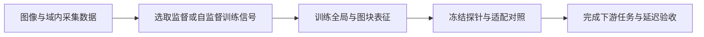

# Visual Representation Learning · 视觉表征学习

## 一句话定义

从图像或视频中学习可用于识别、定位或下游任务的特征表示。

## 英文缩写速查

| 缩写 | 英文全称 | 简要说明 |
|---|---|---|
| CNN | Convolutional Neural Network | 通过卷积提取局部视觉结构 |
| ViT | Vision Transformer | 把图像块编码为 Transformer token |
| EMA | Exponential Moving Average | 自监督训练中平滑更新教师权重的方法 |
| k-NN | k-Nearest Neighbors | 基于邻近特征测试表示可分性 |

## 为什么重要

表征可迁移性取决于训练目标、数据和任务接口。用同一编码器做图像级分类、像素级检测、深度或机器人动作条件时，特征粒度和评测都要不同。

## 主要技术路线（核心机制）

1. 监督分类、自监督和跨模态对齐提供不同信号。DINOv2 的例子以 ViT 同时产生图像和图块级表征，用教师与学生约束全局图像特征及遮盖图块上的预测；冻结骨干后，用线性探针等下游头检验特征。
2. 下游按输出选择全局或图块特征：[目标检测](object-detection.md) 要保留空间定位，[语义分割](fcn-semantic-segmentation.md) 需要稠密输出；机器人使用还要另测视角、遮挡、延迟和误差对策略的影响。

### 流程总览

## 工程实践

- 固定骨干版本、输入分辨率和特征层，先比较冻结探针、微调与低成本基线；按场景或轨迹划分训练验证，避免相邻视频帧泄漏。
- 若重视精细定位，记录图块分辨率、插值方式和空间误差；以真实任务成功率和推理时延判断是否值得换大骨干。

## 局限与风险

公开基准上的冻结特征表现不保证在腕部相机、强反光、热成像或遮挡下可迁移；视觉相似度也不包含单位、尺度和坐标保证。

## 关联页面

- [视觉骨干网络](../concepts/vision-backbones.md)
- [机器人视觉感知](robot-visual-perception.md)
- [视觉三维重建](visual-3d-reconstruction.md)

## 参考来源

- [方法一手资料与核对范围](../../sources/sites/methods-primary-visual-representation-learning-2026-11-26.md)

## 推荐继续阅读

- [DINOv2 论文](https://arxiv.org/html/2304.07193v2)
- [DINOv2 代码仓库 README](https://github.com/facebookresearch/dinov2)
