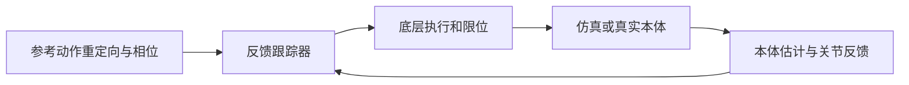

# Whole-Body Motion Tracking · 人形全身动作跟踪

## 一句话定义

使人形机器人在动态和接触约束下追踪时间对齐的参考全身运动，而非只重放关节角。

## 英文缩写速查

| 缩写 | 英文全称 | 说明 |
|---|---|---|
| WBC | Whole-Body Control | 协调全身任务和约束 |
| MDP | Markov Decision Process | 定义跟踪中的状态、动作和奖励 |
| PPO | Proximal Policy Optimization | BeyondMimic 使用的策略优化法 |
| PD | Proportional–Derivative Control | 跟踪关节位置设定点的低层环 |

## 为什么重要

人体动作映射后的姿态可能在机器人上碰撞、打滑或超载。分开评估参考是否可行、跟踪是否准确和扰动后能否恢复，才能定位失败来源。

## 主要技术路线（核心机制）

Motion retargeting 生成目标姿态与相位；反馈跟踪器读取参考和本体估计，再产生受限命令。BeyondMimic 通过锚点相对的肢体跟踪保留局部动作形状，允许一定的全局漂移；其第一阶段 PPO 策略输出关节位置设定点由 PD 执行。用于任务生成的潜扩散蒸馏是第二阶段，不能把它当成基本跟踪必要组件。

## 工程实践

1. 固定时间基、根节点坐标与接触标签；在参考上先扫关节限位、脚底穿透和自碰撞。
2. 按动作片段比较锚点系与世界系的误差、落脚滑动、失败率、恢复时间，另报执行器饱和与状态估计时延。
3. 从训练范围内参考开始，再单列未见动作、地形和扰动条件；如测试扩散组合，需要单独报告其额外观测与计算开销。

## 局限与风险

锚点相对指标可能掩盖全局航迹漂移；可跟踪若干动作不等于能零样本完成任意技能。BeyondMimic 的部分导航与避障会用动捕定位，不能解释为纯本体感知。

## 关联页面

- [全身跟踪管线](../concepts/whole-body-tracking-pipeline.md)
- [GMR 重定向](motion-retargeting-gmr.md)
- [BeyondMimic](beyondmimic.md)
- [人形运动任务](../tasks/humanoid-locomotion.md)

## 参考来源

- [BeyondMimic 一手资料归档](../../sources/papers/beyondmimic_reading_arxiv_2508_08241.md)

## 推荐继续阅读

- [BeyondMimic 原文](https://arxiv.org/html/2508.08241v4)
