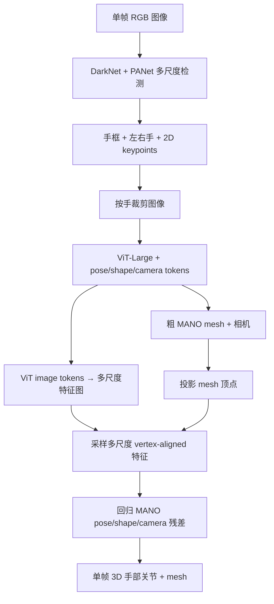
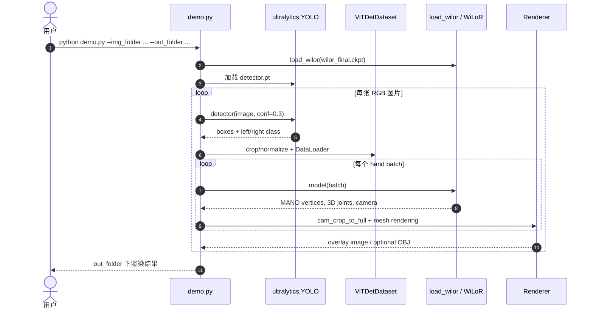

# WiLoR（野外 3D 手部定位与重建）

**WiLoR**（CVPR 2025）面向 **单目 RGB** 场景下的 **双手** 检测与 **MANO 类 3D 重建**：先用轻量全卷积结构在高分辨率特征上定位手部，再用 Transformer 细化三维姿态与形状，强调野外光照、遮挡与交互多样性。其输出可作为 [State Estimation（状态估计）](../concepts/state-estimation.md) 链条中的 **视觉前处理**，为下游策略提供手部关节级观测。

## 一句话定义

**WiLoR 对单目 RGB 图像先检测左右手，再用视觉特征估计参数化手网格、三维关节及对应的手部位姿。**

## 英文缩写速查

| 缩写 | 英文全称 | 简要说明 |
|------|----------|----------|
| RGB | Red-Green-Blue | 彩色图像通道，常与深度 (RGB-D) 配合 |
| MANO | Model with Articulated and Non-rigid defOrmations | 参数化手部网格、关节姿态与形状 |
| WHIM | in-the-Wild Hands in Motion | 作者构建的 200 万余图手部检测集 |
| ViT | Vision Transformer | 视觉 Transformer 手部重建主干 |
| PANet | Path Aggregation Network | 检测器多尺度特征融合结构 |
| PA-MPJPE | Procrustes Aligned Mean Per Joint Position Error | 对齐后的 3D 关节点误差（mm） |

## 为什么重要？

- **机器人双手栈的常见前端**：许多模仿学习与视频驱动流程需要「像素 → 手腕 / 手指关节」的可扩展估计器；WiLoR 提供开源权重与持续推理优化。
- **与全身估计互补**：全身 SMPL（如 [GENMO](./genmo.md)）或 MHR（如 [SAM 3D Body](../entities/sam-3d-body.md)）对手指细节往往不足，WiLoR 这类专用网络可并行估计双手并再融合到控制接口。
- **数据驱动泛化**：作者构建大规模野外手部数据集（论文报告数百万帧量级），支撑 in-the-wild 叙事与后续微调。

## 主要技术路线（核心原理）

| 模块 | 要点 |
|------|------|
| **定位** | DarkNet + PANet + anchor-free 3-head 检测器输出手框、左右手类别、2D keypoints；**不直接回归 3D MANO**。 |
| **粗重建** | ViT-Large + pose / shape / camera tokens 回归 MANO 与相机参数；输入为每个检测到的手的 crop。 |
| **细化** | 投影初始 MANO mesh 的每个顶点，在 ViT 的多尺度图像特征中采样，回归 pose/shape/camera residual，改善图像对齐。 |
| **视频时序** | 逐帧应用，论文展示较低 jitter；**不使用显式时序网络**，不保证世界坐标或交互接触一致性。 |

## 流程总览

依据 CVPR 2025 正文图 3–4 及 §3–4，以下是网络内部的信息流，而非完整的视频到机器人控制闭环。

## 论文实验与消融（CVPR 2025）

| 数据集或模块 | WiLoR 原文结果 | 注意事项 |
|---|---:|---|
| Hand detector Proposed-M（RTX 4090） | 138 FPS；OxfordHands mAP 48.98 | **仅检测器**的速度 |
| Hand detector Proposed-S（RTX 4090） | 175 FPS；WHIM mAP 46.50 | 更快，精度低于 M（WHIM mAP 53.79） |
| FreiHAND | PA-MPJPE **5.5 mm**、PA-MPVPE **5.1 mm** | HaMeR 分别为 6.0/5.7 mm |
| HO3Dv2 | PA-MPJPE **7.5 mm** | 不等于 4D-HOF 使用的 HO3D-v3 评测 |
| 动态 HO3D | Jitter **5.92** | 相同论文协议下 HaMeR 为 20.43 |
| FreiHAND 去 refinement | PA-MPJPE **6.1 mm** | 完整模型 5.5 mm |

**关键训练口径：** WHIM 检测数据超过 200 万张；重建网络另由 14 个数据集构成约 420 万张训练图像。Supplementary 报告检测器两张 RTX 4090 训练三周，重建网络使用 ViTPose 预训练的 ViT-Large（隐藏维度 1280），预测 MANO 参数并通过多尺度采样残差校正。

## 工程实践

- **输入与输出：** 将单帧 RGB 送入手部检测和网格重建，再把相机系手关节或参数化网格交给下游机器人重定向/视觉观测管线。
- **视频使用：** 逐帧估计时需额外检测漏帧、左右手身份跳变与轨迹抖动；不要将逐帧网络输出等同已具备因果时序校正。
- **与 FAH 的工程选型：** 有直接 2D/3D 关节对应点、逐点接触概率与单机实时预算需求时，可比较 [FAH](../entities/paper-fah.md) 的可选输出和 FPS 测试边界。

## 源码运行时序图

以下严格对应官方 [rolpotamias/WiLoR](https://github.com/rolpotamias/WiLoR) 的公开 `demo.py` 调用链，和论文训练代码不是同一范围。可选 `--fast` 切到 FP16 + backbone skip-block，作者 README 报告最多约 1.6 倍加速（具体性能取决于设备）。

## 常见误区或局限

- **论文失败案例：** 极端手指姿态与拥挤场景的小手可能检测/重建失败；独立逐手处理并不直接建模双手接触。
- **坐标尺度：** 重建在相机系；不应把输出直接当成全局度量手部轨迹，机器人部署需额外标定、时序滤波及交互几何约束。
- **许可：** 官方模型 CC-BY-NC-ND，MANO 和 Ultralytics 各有单独许可证；涉及商用应逐项复核。

- **语义离散化另需一层**：在 [ExoActor](./exoactor.md) 等系统中，抓取语义常把手部映射为 {open, half-open, closed} 等离散状态——这不属于 WiLoR 原生输出，需要任务相关的规则或小型分类头。
- **视角与左右手歧义**：第三人称视频中左右手与机器人末端对应需额外几何或标定逻辑，否则易出现手腕轴向错误（相关讨论见 ExoActor 失败案例分析）。
- **接触与力**：WiLoR 输出运动学假设，不包含接触力或抓取稳定性信息。

## 在 4D-HOF 中的角色

[4D-HOF：手-物体流匹配驱动的 4D 交互重建](../entities/paper-4d-hof.md)（arXiv:2610.08782）将 WiLoR 的 MANO 手部状态与 2D 关节点作为**初始化**，再融合 MoGe-3 度量深度与物体 FoundationPose 初值，通过条件流匹配细化手/物体接触和时间连续性；因此 WiLoR 的单帧误差不可直接当成最终 4D HOI 重建质量。详见 [4D-HOF 原文归档](../../sources/papers/4d_hof_arxiv_2610_08782.md)。

## 与其他页面的关系

- [FAH：快速准确的手部估计](../entities/paper-fah.md)：使用直接 2D/3D 关节及稠密点预测，再独立拟合 MANO/MHR-Hand；另提供部位、接触和因果视频/世界系能力。HOT3D FAH-L 关节 PA-MPJPE 4.31 mm，RTX 4070 Ti SUPER 上含拟合 65 FPS（不含部位与接触）。

- [ExoActor](./exoactor.md)：将 WiLoR 用作生成视频的双手分支估计。
- [ViDiHand](../entities/paper-vidihand.md)：同为 egocentric 双手 MANO 路线；WiLoR 是 **per-frame 检测+重建** 强基线，ViDiHand 在 ARCTIC/HOT3D/HOI4D 上以 **无 detector** 取得更低 jitter；截至 2026-08-13 ViDiHand **代码仍待发布**（项目页有 GitHub 占位）。
- [Hand Visibility Detector](../entities/paper-hand-visibility-detector.md)：冻结 WiLoR / HaMeR 骨干，只训轻量头估计 **MANO 21 点可见概率**；HInt mAP 0.931，多视三角化重投影最多降 10.1%。WiLoR 出坐标，HVD 出「这个点能不能当观测」。
- [Macrodata Egocentric Hand-Action](./macrodata-egocentric-hand-action.md)：在 HOT3D **Action MPJPE** 管线中，WiLoR 作 **检测前端**（置信阈值 0.75 + 保守短间隙）；**逐帧 WiLoR 重建** 长视频轨迹弱于时序 [HaWoR](../../sources/repos/hawor.md)（约 77 vs 54 mm）。
- [Manipulation](../tasks/manipulation.md)：手部估计是灵巧操作感知链路的一环。
- [SONIC](./sonic-motion-tracking.md)：全身跟踪控制器接收融合后的双手目标。

## 推荐继续阅读

- 论文：<https://arxiv.org/abs/2409.12259>
- 项目页：<https://rolpotamias.github.io/WiLoR/>
- 代码：<https://github.com/rolpotamias/WiLoR>

## 参考来源

- [WiLoR CVPR 2025 正文及补充材料通读归档](../../sources/papers/wilor_cvpr_2025.md)

- [WiLoR（野外单图 / 视频端到端手部 3D 定位与重建）](../../sources/repos/wilor.md)
- [macrodata_egocentric_video_3d_hand_actions.md](../../sources/blogs/macrodata_egocentric_video_3d_hand_actions.md) — HOT3D Action MPJPE 管线中的检测阈值与逐帧重建对照
- [hand_visibility_detector_arxiv_2608_11574.md](../../sources/papers/hand_visibility_detector_arxiv_2608_11574.md) — 冻结 WiLoR 骨干做逐关节可见性

## 关联页面

- [GENMO（统一人体运动估计与生成）](./genmo.md)
- [ExoActor (视频生成驱动的交互式人形控制)](./exoactor.md)
- [Macrodata Egocentric Hand-Action](./macrodata-egocentric-hand-action.md)
- [Hand Visibility Detector](../entities/paper-hand-visibility-detector.md)
- [Ego2Robot](../entities/paper-ego2robot.md) — Path B 用 WiLoR 逐帧重建未标注 ego 视频
- [DigitCode](../entities/paper-digitcode.md) — 消费 3D 关节的符号化手表示
- [Manipulation（操作任务）](../tasks/manipulation.md)
