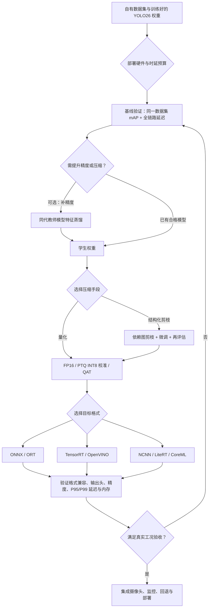
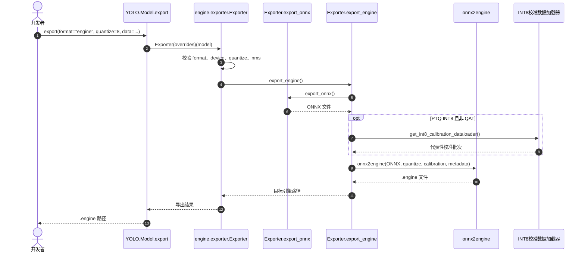

# YOLO26 边缘部署与模型压缩：ONNX、TensorRT、量化、剪枝、蒸馏（YOLO26 Edge Deployment & Compression）

## 一句话定义

**先按目标设备和精度/时延预算选择推理格式，再通过 PTQ/QAT、结构化剪枝或教师–学生蒸馏优化 YOLO26 检测模型，并在同一业务数据上回归 mAP、端到端延迟、功耗与模型大小。** 量化/蒸馏不能保证零精度损失，型号和位宽也不能直接推出帧率。

## 英文缩写速查

| 缩写 | 英文全称 | 简要说明 |
|---|---|---|
| ONNX | Open Neural Network Exchange | 跨框架计算图交换格式；不等于已经被某设备优化执行 |
| ORT | ONNX Runtime | 执行 ONNX 图的推理运行时 |
| TRT | TensorRT | NVIDIA GPU 推理引擎及优化工具链 |
| PTQ | Post-Training Quantization | 训练后使用样本校准数值范围 |
| QAT | Quantization-Aware Training | 训练中加入模拟量化以补偿误差 |
| INT8 | 8-bit Integer | 低比特权重/激活表示，收益取决于后端实现 |
| NMS | Non-Maximum Suppression | 检测框非极大值抑制，YOLO26 默认 one-to-many 路径会使用 |
| mAP | mean Average Precision | 多 IoU 阈值下汇总检测精度的指标 |
| NCNN | Neural Network Computing Framework | 面向移动端与嵌入式的轻量推理框架 |

## 为什么重要

机器人机载视觉常同时受**算力、峰值显存、热功耗、最坏时延**和误检/漏检约束。安全帽、机械臂工位目标检测或人形足球的检测器，即使离线 mAP 较高，也可能因摄像头解码、预处理、后处理和控制接口延迟而无法上机。

本文根据[公众号文章归档](../../sources/blogs/wechat_ahu_yolo26_edge_compression_2026_11_22.md)的工程场景，使用[Ultralytics 官方文档与源码](../../sources/sites/ultralytics_yolo26_edge_deployment_guide_2026_11_22.md)纠正默认 NMS、INT8 精度和跨格式支持等结论；**所有未附可复跑配置的转载速度表仅是作者自述，不作为本页 benchmark**。

## 核心原理

部署优化的关键是把感知精度与真实设备约束拆开核算：先固定检测模型、数据集和输入输出协议，再选择推理运行时与压缩策略，最终在业务数据和目标硬件上验证。

## 主要技术路线

### 1. 先选运行时，再定压缩路线

| 设备 / 目标 | 可优先评估 | 必查限制 |
|---|---|---|
| 开发阶段 | PyTorch `.pt` | 方便调试，不代表最低部署开销 |
| 跨平台 CPU/GPU | ONNX + ORT | opset、provider、算子覆盖及后处理 |
| NVIDIA GPU / Jetson | TensorRT `.engine`，FP16 / INT8 | 构建环境、JetPack/TensorRT 版本、校准样本、Engine 可移植性 |
| Intel 工控机 | OpenVINO | CPU/GPU 插件、INT8 NNCF 校准 |
| ARM / 树莓派 | NCNN | 官方直接导出 FP32/FP16，**不支持 INT8 NCNN** |
| 手机/嵌入式 | LiteRT、CoreML、MNN 等 | 精度矩阵与 delegate/硬件加速能力各不相同 |

完整精度支持以 [Ultralytics Export 官方矩阵](https://docs.ultralytics.com/modes/export/) 为准。旧 `format="tflite"` 在当前源码中作为弃用别名映射到 `format="litert"`。

### 2. 三种压缩路线的责任边界

- **量化：** `model.export(format="engine", quantize=16)` 导出 FP16；`quantize=8` 为 INT8 PTQ（需业务代表性 `data` 校准）或导出已 QAT 训练的权重。对于 PTQ，离线校准样本及 `nms` 推理头必须与验证和上线保持一致。
- **量化感知训练：** 官方支持 `model.train(..., quantize=8)` 进行 QAT，导出时携带学到的量化信息；成本更高，不是对所有模型都更优。官方表在 COCO 上显示不同规模收益差别显著。
- **结构化剪枝：** 删除通道/卷积核后可以真正减少计算；与逐权重置零不同，仍要处理 YOLO 的残差/拼接依赖和检测头结构。官方导出 API **没有一行式通用剪枝操作**；第三方 `torch-pruning` 等仅是研究实现路线，须另行代码适配和微调。
- **知识蒸馏：** 官方 `distill_model` 使用冻结教师的 Neck 特征监督学生，并与标准检测损失结合；推理只保留学生网络。官方已验证主要是 detection 的准确率收益，不能一概延伸到 segmentation/pose/OBB，也不能跨 YOLO 家族直接蒸馏。

### 3. 端到端流程



**注意：** 该流程是工程决策路径，不表示 Ultralytics 官方将蒸馏、剪枝、量化自动串为单个 API。

### 4. YOLO26 推理头的关键纠错

YOLO26 **去除了 DFL**，但默认预测和验证使用 one-to-many + NMS。需要 NMS-free one-to-one 检测时，须在预测、验证与导出显式指定 `nms=False`：

```python
from ultralytics import YOLO

model = YOLO("yolo26n.pt")
model.val(data="my_data.yaml", nms=False)
model.export(format="onnx", imgsz=640, nms=False)
```

官方说明：640 检测时默认 raw one-to-many 输出形状 `(N, nc+4, 8400)`，`nms=False` 导出的 one-to-one 输出是 `(N, 300, 6)`，字段为 `[x1, y1, x2, y2, confidence, class_id]`。**格式/版本/量化组合可能回退到原始 one-to-many 路径**；必须以导出日志和真实张量形状校验，不能只凭 YOLO26 名称推断无需 NMS。

## 工程实践

### 1. 可复用的导出与精度验证命令

```python
from ultralytics import YOLO

# 同一份验证集：先建立 FP32 / one-to-one 基线
src = YOLO("helmet_yolo26n.pt")
base = src.val(data="helmet.yaml", imgsz=640, nms=False)
src.export(format="onnx", imgsz=640, nms=False, quantize=16)

# 在 NVIDIA 目标环境构建 FP16 TensorRT 引擎
src.export(format="engine", imgsz=640, nms=False, quantize=16)

# PTQ INT8：使用自己的代表性校准图片，不要仅靠 coco8.yaml 冒烟
src.export(format="engine", imgsz=640, nms=False,
           quantize=8, data="helmet.yaml")

# 对导出的推理产物独立 val，确认头选择/精度未异常
trt = YOLO("helmet_yolo26n.engine")
trt.val(data="helmet.yaml", imgsz=640)
```

同名 `.engine` 会被再次导出覆盖；**实际对比 FP16 与 INT8 时应分别保存到不同目录/不同文件名，并分别验证**。`data` 的校准使用哪个 split、`fraction`、batch 和目标硬件需要记录。官方建议 TensorRT PTQ 有约 500 张代表性校准图片，`coco8.yaml` 仅 4 张验证图片，不能据此作生产校准。

### 2. 教师–学生蒸馏

```python
from ultralytics import YOLO

student = YOLO("yolo26n.pt")
student.train(
    data="helmet.yaml",
    epochs=100,
    distill_model="yolo26s.pt",
)
```

教师须与学生同 YOLO 家族、同任务并适配业务类别；`coco8` 等 toy 数据只能做 API 冒烟。`distill_model` 提供训练时额外监督，不给部署推理添加教师模型。

### 3. 官方源码运行时序图（基于实际入口）

源码已核对：`ultralytics/engine/model.py::Model.export`，`engine/exporter.py::Exporter.__call__/export_onnx/export_engine`，`nn/distill_model.py::DistillationModel.loss`。这张图体现**导出**真实调用链，不把流程方案误画成自动剪枝调用。



**训练期的蒸馏运行路径**：`YOLO.train(distill_model=...)` 创建 `DistillationModel`，其 `loss` 对教师做 `torch.no_grad()` 前向并通过 hooks 取特征，再对学生前向，计算任务损失与置信度加权蒸馏损失；`fuse()` 仅保留学生供导出。对应 [官方源码](https://github.com/ultralytics/ultralytics/blob/main/ultralytics/nn/distill_model.py)，与上图的导出支路相互独立。

### 4. 工业/机器人验收矩阵（不填写猜测数值）

| 维度 | 如何测 |
|---|---|
| 检测质量 | 同一测试集 mAP50-95、关键类召回率、误检及不同光照/运动模糊的分桶表现 |
| 延迟 | 同 batch、分辨率、后处理和热稳定状态；分别统计模型前向及摄像头到结果的 P50/P95/P99 |
| 资源 | 产物磁盘体积、峰值 RAM/VRAM、功率与持续推理温度 |
| 导出一致性 | FP32 ↔ FP16 ↔ INT8 输出框、类别与置信度，确认 NMS 分支与阈值 |
| 可靠性 | 重启恢复、模型版本/许可证、Engine 和驱动版本兼容、失败回退 |

## 局限与风险

- **未经证实的转载数字不能作为官方 benchmark：** 公众号中的 RTX 4060、i7-13700H、树莓派 5、Jetson Orin Nano 性能和“INT8 必缩小 75%”缺独立可复跑日志；官方 TensorRT 还给出了 INT8 精度损失及某些模型 Engine 体积**变大**的反例。
- **FP16 和 INT8 不是“零损失”保证：** 精度变化高度依赖校准集、算子支持及硬件；INT8 并非总比 FP16 快，尤其比较 Engine 文件体积时不能用权重位宽估计。
- **剪枝不是直接一键上线：** 第三方工具对 YOLO26 的层依赖、残差及融合必须逐模型验证；剪枝后需要再训练、重新导出和回归。文章建议“INT8→NCNN”与当前官方 NCNN 导出矩阵不符。
- **RT 与 ORT 不是同一层概念：** ONNX 是图格式，ONNX Runtime 是执行器，TensorRT 会经过构建；不同格式在 NMS 分支/量化算子上有兼容性差异。
- **YOLO27 未正式发布：** 截至 2026-11-22，官方预览没有公开模型权重及确定发售日；不能提前将其预览指标用于设备选型承诺。
- **许可证与真实工况：** Ultralytics 主仓 AGPL-3.0/商业授权需核实；真机场景不能用开发机离线 FPS 代替完整感知链安全验收。

## 关联页面

- [Ultralytics YOLO 主仓](../entities/ultralytics.md) — 模型家族、统一 API 与许可
- [YOLO26 论文详情](../entities/paper-yolo26-unified-realtime-e2e-vision.md) — DFL、端到端头及官方基准的研究背景
- [机器人视觉感知栈选型闭环](../queries/robot-perception-stack-selection-loop.md) — 检测器部署前后仍需与数据采集、推理后处理、视觉表征及下游任务统一验收
- [目标检测方法](./object-detection.md) — 模型评测、检测输出接口
- [视觉骨干](../concepts/vision-backbones.md) — 感知模块的参数量/特征计算预算
- [策略视觉表征](../concepts/visual-representation-for-policy.md) — 机载视觉编码与策略接口
- [模型架构纵深路线 Stage 5](../../roadmap/depth-model-architecture.md) — 时延预算、量化/蒸馏和工程部署

## 参考来源

- [公众号转载全文与逐项勘误（用户提供）](../../sources/blogs/wechat_ahu_yolo26_edge_compression_2026_11_22.md)
- [Ultralytics 一手文档/代码核验归档](../../sources/sites/ultralytics_yolo26_edge_deployment_guide_2026_11_22.md)
- [Ultralytics 主源码归档](../../sources/repos/ultralytics.md)

## 推荐继续阅读

- [Ultralytics：Export 格式与量化参数](https://docs.ultralytics.com/modes/export/)
- [Ultralytics：YOLO26 one-to-one / NMS-free 选择](https://docs.ultralytics.com/guides/end2end-detection/)
- [Ultralytics：TensorRT INT8 与校准限制](https://docs.ultralytics.com/integrations/tensorrt/)
- [Ultralytics：Knowledge Distillation](https://docs.ultralytics.com/guides/knowledge-distillation/)
- [Ultralytics：NCNN 集成](https://docs.ultralytics.com/integrations/ncnn/)
