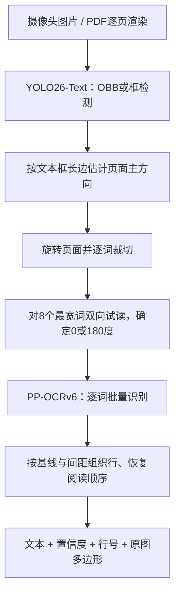
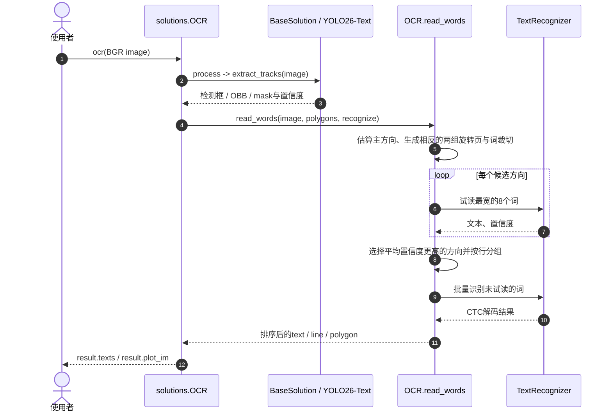

# YOLO26-Text + PP-OCRv6：场景与文档 OCR

## 一句话定义

**用 YOLO26-Text 定位旋转文本区域、PP-OCRv6 读取单词，再恢复整页方向与行序**的模块化 OCR 工程管线，适用于图片、扫描页与逐页渲染的 PDF。

## 英文缩写速查

| 缩写 | 英文全称 | 简要说明 |
|------|----------|----------|
| OCR | Optical Character Recognition | 从图像中检测并识别文字 |
| OBB | Oriented Bounding Box | 倾斜文字的旋转检测框 |
| ONNX | Open Neural Network Exchange | PP-OCRv6 的推理模型表示 |
| CTC | Connectionist Temporal Classification | 识别器将逐帧字符预测压缩成文字序列 |
| F1 | F1 Score | 词级准确率与召回率的调和平均 |
| PDF | Portable Document Format | 先栅格化为页面图像后才能送入本管线 |

## 为什么重要

- 传统 OCR 很容易把 **识别**与**检测**混为一谈：YOLO26-Text 只找文字，PP-OCRv6 才读文字；分别替换组件可适配自定义标签、机载相机、票据与多语言。
- 可恢复大角度翻转页面的主导阅读方向，并保留原图 `polygon`、`line` 和两个置信度，适合对可疑字段做人工复核。
- 对机器人视觉工作流，可用来读取铭牌、物料标签或指示牌；延迟与识别率必须对真实机载相机另测，不能将文档基准当作真机结果。

## 核心原理

## 主要技术路线

这是一条**可替换的检测 → 识别 → 排序三级路线**，不是单个端到端 OCR 模型：

1. **定位（Detection）：** YOLO26-Text 在页面上检测文字框；`OCR.process()` 同时接受轴对齐框、OBB 和实例分割多边形，输出原图像素坐标中的文字区域。
2. **识别（Recognition）：** `OCR.read_words()` 先对主方向与其反向进行小样本试读，`TextRecognizer` 再使用 PP-OCRv6 按词批量推理并以 CTC 解码；需要其他语言时替换识别器而不是只改检测器。
3. **结构化（Ordering）：** `OCR.lines()` 按基线和词间距分行，输出文字、置信度、行编号及原图多边形；复杂版面（多栏、表格和跨页）仍需更专用的文档结构分析。

检测到的多边形先经过图像平面内的方向纠正、裁切和坐标映射，与[感知后处理与坐标变换](../concepts/perception-coordinate-postprocessing.md)同属检测后几何处理；但本 OCR 流程**不涉及**将像素直接反投影到机器人三维坐标系。

### 流程总览



- `OCR.process()` 调用检测器并整理 bbox / OBB / mask，`OCR.read_words()` 完成两向试读、逐词识别与行排序；`TextRecognizer.__call__()` 将词裁切调整到高 48px、按宽排序、batch 8，通过 ONNX Runtime 或 TensorRT 解码 CTC 输出。
- 页面主方向由足够细长的文本框估算；相反方向各试读最宽 8 词，以平均置信度决定朝向；输出多边形仍是**原图坐标**。
- 两种置信度分开记录：`detection_confidence` 表示是否找到字，`confidence` 表示读出的文字是否可靠；均不等同于人工校验的事实真值。

### 官方基准（2026-11-12 博客；非独立复现）

| 数据 / 条件 | 官方报告 |
|-------------|----------|
| 80 张 HierText 验证照片，单词级 F1 | **0.722** |
| 6 页 PDF，单词级 F1 | **0.931** |
| RTX PRO 6000、1280 输入、251 个词，`read_words` | ONNX Runtime CUDA **249ms**；FP16 TensorRT **82ms** |

前两项是作者选取样本的**词级 F1**，不是整个 HierText 官方测试集结论；最后一项仅为检测之后的词读取阶段，不是端到端延迟。选型不能直接拿这个数字与另一工具在不同数据集上的精度比。

## 工程实践

### Python 最短路径

```python
import cv2
from ultralytics import solutions

ocr = solutions.OCR()  # 默认 yolo26x-text + PP-OCRv6
image = cv2.imread("document.jpg")
assert image is not None
result = ocr(image)
for word in result.texts:
    print(word["line"], word["text"], word["confidence"])
```

- 安装：`pip install -U "ultralytics>=8.4.211"`。默认 PP-OCRv6 识别器依赖 Python 3.11+ 与 ONNX Runtime 1.26+；首次调用会下载权重。
- PDF：用 PyMuPDF `get_pixmap()` 把**每一页**转为 RGB，再转换 BGR 传入 `ocr(image)`，`solutions.OCR()` 不直接读取 PDF 文件对象。
- 追求吞吐可尝试 `solutions.OCR(recognizer="tensorrt")`（需 NVIDIA GPU，首次构建 FP16 engine），或 `model="yolo26s-text.pt"` 缩小检测器；质量和耗时都要重测。
- 自定义语言/领域识别器可传一个接收 BGR 词图并返回 `(text, confidence)` 的函数；官方文档也列出按语言选择的 PP-OCRv5 可替换识别器。
- 对表单、合同，先训练 YOLO 检测字段、表格、签名/印章，再按区域做 OCR；官方 [Signature 数据集](../../sources/datasets/ultralytics-signature.md) 仅定位签名，不提供签名真伪判断。

### 源码运行时序图

以下直接对应 [官方 `ultralytics/solutions/ocr.py`](https://github.com/ultralytics/ultralytics/blob/main/ultralytics/solutions/ocr.py) 的 `OCR.process`、`read_words`、`TextRecognizer.__call__`，非推测的服务架构。



### 如何衡量

在自己的采集环境区分**文本检测召回**、**词级识别 F1**、**阅读顺序**、**旋转/手写/低照场景**及**整链路时延**；对隐私文档优先选择本地运行。官方在线 [OCR 演示](https://www.ultralytics.com/use-cases/document-processing) 会上传页面，不应用未脱敏的敏感文件随意测试。

## 局限与风险

- 默认 PP-OCRv6 字符集对中文、日文和拉丁文覆盖较好；韩文、西里尔文、阿拉伯文、希伯来文、梵文、泰文等**不受默认识别器完整支持**，换语言识别模型后仍需测精度。
- 主导文本方向假设不适合复杂多方向混排；`max_det=1000`、`imgsz=1280` 也不是所有票据的最优参数。
- 导出 YOLO 检测器不等于导出完整 OCR；识别器与排序逻辑须另行部署。
- Ultralytics 框架代码为 AGPL-3.0；PP-OCRv6 权重按文档采用 Apache-2.0；闭源部署须分别核实许可证。
- 官方博客的自测数值非全数据集排行榜；`HierText` 验证照片、PDF 与签名检测数据集的任务定义不同，不应混为一个 benchmark。

## 关联页面

- [Ultralytics YOLO](../entities/ultralytics.md) — 检测器框架与许可
- [HierText 数据集](../entities/hiertext.md) — 分层文本检测数据
- [目标检测](./object-detection.md) — 检测模型的基础概念
- [感知后处理与坐标变换](../concepts/perception-coordinate-postprocessing.md) — 文本框像素位置、旋转及后处理的相关知识
- [TeleOCR](../entities/paper-teleocr.md) — 文档解析中的识别路线
- [Unlimited OCR Works 2](../entities/unlimited-ocr-2.md) — 面向长文档的解析路线

## 参考来源

- [官方博客原文归档](../../sources/blogs/ultralytics_yolo26_ocr_python_2026_11_12.md)
- [OCR Guide 原文/源码核对归档](../../sources/sites/ultralytics_yolo26_ocr_guide.md)
- [HierText 数据集归档](../../sources/datasets/hiertext.md)
- [Signature 数据集归档](../../sources/datasets/ultralytics-signature.md)
- [Ultralytics 主仓归档](../../sources/repos/ultralytics.md)

## 推荐继续阅读

- [Ultralytics 官方 OCR Guide](https://docs.ultralytics.com/guides/ocr)
- [Ultralytics 官方博客（2026-11-12）](https://www.ultralytics.com/blog/yolo-ocr-python)
- [开源 OCR 模型概览](https://www.ultralytics.com/blog/popular-open-source-ocr-models-and-how-they-work)
- [智能文档分析实例](https://www.ultralytics.com/blog/using-ultralytics-yolo11-for-smart-document-analysis)
