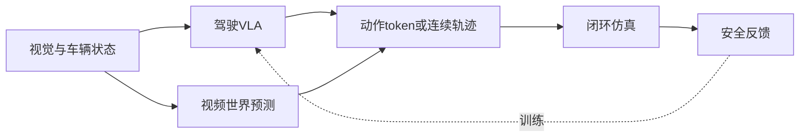

# 2026 年，最值得复现的 10 个自动驾驶开源项目

## 一句话定义

基于深蓝AI 2026-11-18 盘点逐一对齐 **10个不同的模型/项目身份与唯一详情节点**；不把文章排名当作论文实测性能排名。

## 英文缩写速查

| 缩写 | 英文全称 | 说明 |
|---|---|---|
| VLA | Vision-Language-Action | 语义推理和动作规划 |
| WAM | World-Action Model | 未来场景和动作联合建模 |
| DiT | Diffusion Transformer | 连续动作生成 |
| RL | Reinforcement Learning | 通过反馈更新模型 |

## 为什么重要

相近的 VLA、WAM 与世界模型可能共享评测但训练监督不同；复现前先按一手资料核对开源范围与输入输出。

## 核心原理

### 驾驶 VLA 与生成式规划

- [Alpamayo 1](../entities/paper-alpamayo-r1-2511-00088.md)：因果链推理与扩散动作专家
- [OpenDriveVLA](../entities/paper-rcl-ref-b5386c6f934f87f4cec4-opendrivevla-towards-end-to-end-autonomous-drivi.md)：层级视觉语言对齐到端到端轨迹
- [AutoVLA](../entities/paper-rcl-2506-13757-autovla-a-vision-language-action-model-for-end-t.md)：按需快慢推理、离散动作token及GRPO
- [ReCogDrive](../entities/paper-recogdrive-2506-08052.md)：驾驶认知引导扩散规划与DiffGRPO
- [DiffusionDrive](../entities/paper-diffusiondrive.md)：多模态轨迹锚点与截断扩散

### 未来世界与动作模型

- [DriveVLA-W0](../entities/paper-sa-2510-12796-drivevla-w0-world-models-amplify-data-scaling-la.md)：训练时加入未来视觉世界监督
- [DriveWAM](../entities/paper-rcl-2605-28544-drivewam-video-generative-priors-enable-scalable.md)：视频生成先验的世界动作联合建模
- [NVIDIA Cosmos](../entities/nvidia-cosmos.md)：可复用世界基础模型开发平台

### 分层场景认知与闭环后训练

- [SGDrive](../entities/paper-sgdrive-2601-05640.md)：场景、关键交通参与者和短期目标的分层认知
- [WorldEngine](../entities/paper-worldengine-2606-19836.md)：高保真闭环仿真与长尾驾驶强化后训练

## 流程总览

图为领域关系综览，不是某个项目的运行时序。

## 工程实践

- [OpenDriveVLA](../entities/paper-rcl-ref-b5386c6f934f87f4cec4-opendrivevla-towards-end-to-end-autonomous-drivi.md)已开放推理但训练脚本尚未发布；[Alpamayo 1](../entities/paper-alpamayo-r1-2511-00088.md)公开10B没有RL后训练权重。
- [WorldEngine](../entities/paper-worldengine-2606-19836.md)提供闭环测试入口，但Behavior World Model integration仍在官方待办。
- 优先用同版本NAVSIM建立基线，再比较开放的 SFT、RFT、世界模型训练。

## 局限与风险

- 二手技术宣传与官方论文、代码的发布状态有时间差。
- 模型权重、训练代码与原始数据的开放程度不相同。
- NAVSIM、CARLA、实车验证的指标不同；本次入库没有执行训练/真车实验。

## 关联页面

- [原有端到端算法十项盘点](./e2e-autonomous-driving-top10-algorithms.md)
- [VLA](../methods/vla.md)
- [生成式世界模型](../methods/generative-world-models.md)

## 参考来源

- [深蓝AI原文索引](../../sources/blogs/wechat_shenlan_ai_autonomous_driving_top10_2026.md)
- [官方Alpamayo](https://github.com/NVlabs/alpamayo)
- [官方Cosmos](https://github.com/NVIDIA/cosmos)

## 推荐继续阅读

- [深蓝AI原始文章](https://mp.weixin.qq.com/s/BPoNtj3-CvcLny3uT-023g)
- [NVIDIA Cosmos](../entities/nvidia-cosmos.md)
