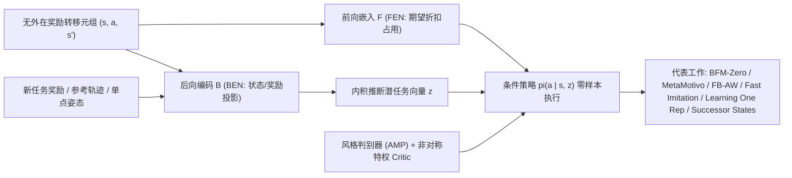

# BFM 分类 01：Forward-backward 表征

> **分类页**：对应 [具身智能研究室 · BFM 41 篇专题](https://mp.weixin.qq.com/s/Ei32la_vo0UW9Y_QCAqB2g) 与 [awesome-bfm-papers](https://github.com/friedrichyuan/awesome-bfm-papers) 的 **01 Forward-backward 表征** 分组；本页汇集该组 **6 篇** 论文的站内实体与 source 索引。总地图见 [BFM 技术地图](./bfm-41-papers-technology-map.md)。

## 一句话定义

**Forward–Backward（FB）表征把无监督强化学习的动力学转移拆分为前向状态嵌入 \(F\) 与后向奖励/状态嵌入 \(B\)，从而把多任务动作空间压缩成可零样本推断新奖励或新目标的连续潜空间身体接口。**

## 英文缩写速查

| 缩写 | 英文全称 | 简要说明 |
|------|----------|----------|
| BFM | Behavior Foundation Model | 大规模行为数据预训练的可复用全身行为先验 |
| RL | Reinforcement Learning | 通过与环境交互最大化长期回报来学习策略的范式 |
| AMP | Adversarial Motion Prior | 用对抗判别约束状态转移接近专家运动分布的先验 |
| FB | Forward–Backward Representation | 无外在奖励下联合学得的前向 \(F\) 与后向 \(B\) 嵌入 |

## 为什么重要

- **实现「无奖励预训练 → 测试期零样本奖励推断」：** 相比必须枚举参考轨迹的 Goal-Conditioned 跟踪器，FB 族工作支持通过状态投影直接在潜向量 \(z\) 上推断任意新任务奖励函数、参考轨迹或单点姿态。
- **支撑真实人形零样本全身控制落地：** BFM-Zero（ICLR 2025）与 MetaMotivo 已把该范式从抽象 MDP 推向 Unitree G1/人形全身控制与多任务调用。

## 核心机制与本组论文（6 篇）

多任务能否压进**可调用的身体潜空间**（latent prompt / FB 嵌入），而非每换一个任务就重训全身策略？核心 mechanism 是以无外在奖励的转移元组同时学习前向期望折扣占用嵌入（FEN）与后向编码（BEN），在测试期通过内积估算任务 \(z\) 并直接以条件策略执行。

**代表工作（策展）：** BFM-Zero、MetaMotivo、FB-AW、Fast Imitation、Learning One Representation、Successor States

| # | 工作 | Wiki 实体 | Source |
|---|------|-----------|--------|
| 01 | BFM-Zero | [paper-bfm-zero.md](../entities/paper-bfm-zero.md) | [source](../../sources/papers/bfm_awesome_bfm_zero_arxiv_2511_04131.md) |
| 02 | Zero-shot Whole-body Humanoid Control via Behavioral Foundation Models | [paper-bfm-02-metamotivo.md](../entities/paper-bfm-02-metamotivo.md) | [source](../../sources/papers/bfm_awesome_metamotivo_arxiv_2504_11054.md) |
| 03 | Finer Behavioral Foundation Models via Auto-regressive Features and Advantage Weighting | [paper-bfm-03-fb-aw.md](../entities/paper-bfm-03-fb-aw.md) | [source](../../sources/papers/bfm_awesome_fb_aw_arxiv_2412_04368.md) |
| 04 | Fast Imitation via Behavior Foundation Models | [paper-bfm-04-fast-imitation-bfm.md](../entities/paper-bfm-04-fast-imitation-bfm.md) | [source](../../sources/papers/bfm_awesome_fast_imitation_bfm_neurips_2024.md) |
| 05 | Learning One Representation to Optimize All Rewards | [paper-bfm-05-learning-one-representation.md](../entities/paper-bfm-05-learning-one-representation.md) | [source](../../sources/papers/bfm_awesome_learning_one_representation_neurips_2021.md) |
| 06 | Learning Successor States and Goal-Dependent Values | [paper-bfm-06-successor-states.md](../entities/paper-bfm-06-successor-states.md) | [source](../../sources/papers/bfm_awesome_successor_states_arxiv_2101_07123.md) |

## 在 BFM taxonomy 中的位置

| 字段 | 内容 |
|------|------|
| 分组 | 01 Forward-backward 表征 |
| 篇数 | 6/41 |
| 概念对照 | [Behavior Foundation Model](../concepts/behavior-foundation-model.md) |
| 姊妹分类 | 见 [BFM 技术地图 · 五类问题](./bfm-41-papers-technology-map.md#流程总览五类问题--身体-api) |

## 工程实践

- **配合风格判别器与非对称特权 Critic 稳住类人姿态：** 无监督 FB 预训练常在自由探索中生成鬼畜或低能效步态，部署真机前须如 BFM-Zero 般叠加无标签动捕正样本判别器、域随机化与辅助平滑代价。
- **注意隐维度 \(D\) 与全局根运动漂移权衡：** 在快速旋转或长程移动任务中，单纯 FB 易出现根部漂移，可参照 P-BFM 引入显式根速度指令（ERI）或对比时间距离编码（TeCH）对比验证。

## 常见误区或局限

- **线性 MDP 假设在强非线性多接触下存在近似瓶颈：** FB 分解假定转移占用率可用双网络低秩内积准确近似，碰撞与脚滑频繁的场景下跟踪精度常略逊专用监督跟踪器。
- **早期 FB 算法偏理想化仿真环境：** 本组早年基础理论（05/06）无现成人形真机迁移方案，选型落地应直接对照 BFM-Zero、MetaMotivo 与 UFO 框架。

## 架构与路线图

## 关联页面

- [BFM 41 篇技术地图](./bfm-41-papers-technology-map.md)
- [Behavior Foundation Model](../concepts/behavior-foundation-model.md)
- [人形 RL 身体系统栈](./humanoid-rl-motion-control-body-system-stack.md)
- [AMP 运动先验综述](./humanoid-amp-motion-prior-survey.md)
- [FB / BFM-Zero / INTACT / Mimic / VLA 任务空间表征对比](../comparisons/fb-bfm-zero-intact-mimic-vla-task-space.md)

## 参考来源

- [wechat_embodied_ai_lab_bfm_41_papers_survey.md](../../sources/blogs/wechat_embodied_ai_lab_bfm_41_papers_survey.md) — 微信公众号编译（<https://mp.weixin.qq.com/s/Ei32la_vo0UW9Y_QCAqB2g>）
- [bfm_awesome_41_catalog.md](../../sources/papers/bfm_awesome_41_catalog.md)
- [awesome-bfm-papers](https://github.com/friedrichyuan/awesome-bfm-papers)
- [A Survey of Behavior Foundation Model](https://arxiv.org/abs/2506.20487)（TPAMI 2025）
- [zhihu_jagger_task_space_fb_bfm_intact_mimic_vla.md](../../sources/blogs/zhihu_jagger_task_space_fb_bfm_intact_mimic_vla.md) — FB 球相对 Mimic/VLA 的对照读法

## 推荐继续阅读

- [Behavior Foundation Model 概念页](../concepts/behavior-foundation-model.md)
- [BFM 41 篇技术地图](./bfm-41-papers-technology-map.md)
- [P-BFM 论文实体](../entities/paper-p-bfm.md) — FB 表征结合深度地形感知的后续演进
