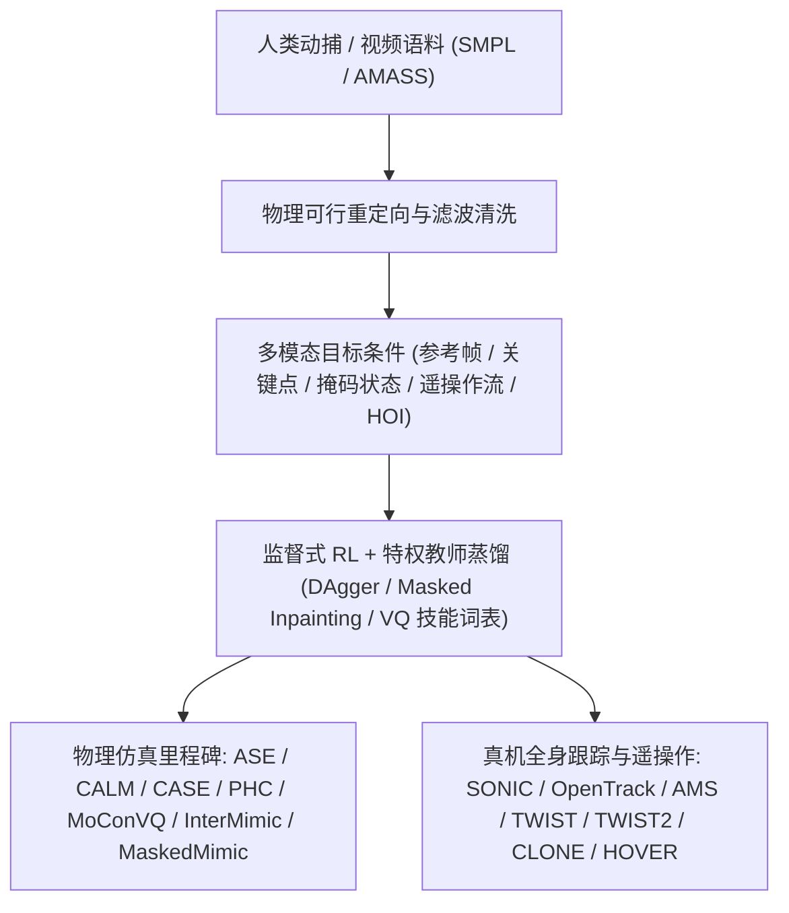

# BFM 分类 02：Goal-conditioned 学习

> **分类页**：对应 [具身智能研究室 · BFM 41 篇专题](https://mp.weixin.qq.com/s/Ei32la_vo0UW9Y_QCAqB2g) 与 [awesome-bfm-papers](https://github.com/friedrichyuan/awesome-bfm-papers) 的 **02 Goal-conditioned 学习** 分组；本页汇集该组 **19 篇** 论文的站内实体与 source 索引。总地图见 [BFM 技术地图](./bfm-41-papers-technology-map.md)。

## 一句话定义

**Goal-Conditioned BFM 以目标参考帧、关键点、掩码目标状态或遥操作流作为条件输入，依托大规模动捕/视频重定向与监督式 RL 扩展人形全身动作的覆盖规模。**

## 英文缩写速查

| 缩写 | 英文全称 | 简要说明 |
|------|----------|----------|
| BFM | Behavior Foundation Model | 本分类所属运控基座范式 |
| GC | Goal-conditioned Learning | 以目标/参考条件扩展动作覆盖面 |
| HOI | Human–Object Interaction | 人-物交互技能纳入统一目标条件 |
| WBC | Whole-Body Control | 跟踪与全身技能的控制载体 |
| TWIST | Teleoperated Whole-body Imitation System | 遥操作数据采集代表工作 |

| # | 工作 | Wiki 实体 | Source |
|---|------|-----------|--------|
| 07 | Sonic | [sonic-motion-tracking.md](../entities/nvidia-sonic.md) | [source](../../sources/papers/bfm_awesome_sonic_arxiv_2511_07820.md) |
| 08 | Track Any Motions under Any Disturbances | [paper-opentrack.md](../entities/paper-opentrack.md) | [source](../../sources/papers/bfm_awesome_opentrack_arxiv_2509_13833.md) |
| 09 | Agility Meets Stability | [ams.md](../methods/ams.md) | [source](../../sources/papers/bfm_awesome_ams_arxiv_2511_17373.md) |
| 10 | TWIST2 | [paper-twist2.md](../entities/paper-twist2.md) | [source](../../sources/papers/bfm_awesome_twist2_arxiv_2505_02833.md) |
| 11 | TWIST | [paper-twist.md](../entities/paper-twist.md) | [source](../../sources/papers/bfm_awesome_twist_corl_2025.md) |
| 12 | CLONE | [paper-bfm-12-clone.md](../entities/paper-bfm-12-clone.md) | [source](../../sources/papers/bfm_awesome_clone_corl_2025.md) |
| 13 | Behavior Foundation Model for Humanoid Robots | [paper-behavior-foundation-model-humanoid.md](../entities/paper-behavior-foundation-model-humanoid.md) | [source](../../sources/papers/bfm_awesome_bfm_humanoid_arxiv_2509_13780.md) |
| 14 | HOVER | [paper-bfm-14-hover.md](../entities/paper-bfm-14-hover.md) | [source](../../sources/papers/bfm_awesome_hover_arxiv_2410_21229.md) |
| 15 | InterMimic | [paper-bfm-15-intermimic.md](../entities/paper-bfm-15-intermimic.md) | [source](../../sources/papers/bfm_awesome_intermimic_arxiv_2502_20390.md) |
| 16 | ModSkill | [paper-bfm-16-modskill.md](../entities/paper-bfm-16-modskill.md) | [source](../../sources/papers/bfm_awesome_modskill_arxiv_2502_14140.md) |
| 17 | MaskedMimic | [paper-bfm-17-maskedmimic.md](../entities/paper-bfm-17-maskedmimic.md) | [source](../../sources/papers/bfm_awesome_maskedmimic_tog_2024.md) |
| 18 | H-GAP | [paper-bfm-18-hgap.md](../entities/paper-bfm-18-hgap.md) | [source](../../sources/papers/bfm_awesome_hgap_arxiv_2312_02682.md) |
| 19 | CALM | [paper-bfm-19-calm.md](../entities/paper-bfm-19-calm.md) | [source](../../sources/papers/bfm_awesome_calm_siggraph_2024.md) |
| 20 | MoConVQ | [paper-bfm-20-moconvq.md](../entities/paper-bfm-20-moconvq.md) | [source](../../sources/papers/bfm_awesome_moconvq_tog_2023.md) |
| 21 | CASE | [paper-bfm-21-case.md](../entities/paper-bfm-21-case.md) | [source](../../sources/papers/bfm_awesome_case_arxiv_2309_11351.md) |
| 22 | PHC | [phc.md](../entities/phc.md) | [source](../../sources/papers/bfm_awesome_phc_arxiv_2305_06456.md) |
| 23 | TeamPlay | [paper-bfm-23-teamplay.md](../entities/paper-bfm-23-teamplay.md) | [source](../../sources/papers/bfm_awesome_teamplay_arxiv_2105_12196.md) |
| 24 | MTM | [paper-bfm-24-mtm.md](../entities/paper-bfm-24-mtm.md) | [source](../../sources/papers/bfm_awesome_mtm_arxiv_2305_02968.md) |
| 25 | ASE | [ase.md](../methods/ase.md) | [source](../../sources/papers/bfm_awesome_ase_arxiv_2205_01906.md) |

## 为什么重要

- **是当前真机交付最成熟的 BFM 主流路线：** SONIC、HOVER、TWIST/TWIST2、CLONE、AMS 等多篇真机部署标杆均出自本组，验证了目标条件跟踪能直接撑起高动态全身控制与遥操作。
- **构建起从虚拟角色控制到真机规模化的完整谱系：** 纵跨 ASE/CALM/CASE/PHC 等物理仿真里程碑至 G1/H1 真机大规模通用跟踪器。

## 核心机制与本组论文（19 篇）

运控基座的**动作覆盖面**——跟踪、全身技能、遥操作、人-物交互（HOI）能否在统一目标条件下扩展？核心范式是以人类海量动捕语料重定向后作参考或密集奖励监督（配合 DAgger、Masked Inpainting 或向量量化技能词表），在特权教师引导下把多模态指令压进同一策略。

**代表工作（策展）：** SONIC、OpenTrack、AMS、TWIST/TWIST2、BFM4Humanoid、HOVER、InterMimic、MaskedMimic、ASE/CALM/CASE…

## 在 BFM taxonomy 中的位置

| 字段 | 内容 |
|------|------|
| 分组 | 02 Goal-conditioned 学习 |
| 篇数 | 19/41 |
| 概念对照 | [Behavior Foundation Model](../concepts/behavior-foundation-model.md) |
| 姊妹分类 | 见 [BFM 技术地图 · 五类问题](./bfm-41-papers-technology-map.md#流程总览五类问题--身体-api) |

## 工程实践

- **用物理可行的重定向清洗过滤动捕语料：** 直接拿 SMPL/AMASS 裸轨迹训跟踪常因脚滑与穿模崩坏，须配套物理滤波或两阶段蒸馏先淘汰不可执行片段。
- **区分「密集跟踪器」与「掩码多模式条件器」：** 纯遥操作落地宜选用 HOVER / MaskedMimic 这类支持稀疏末端或部分观测掩码的统一模型。

## 常见误区或局限

- **把图形学虚拟角色成果等同于可直接真机部署：** 本组早年顶会工作（如 ASE、PHC、MoConVQ、TeamPlay）针对 MuJoCo/IsaacGym 仿真角色设计，缺足端摩擦与电机执行器延迟适配。
- **算力与数据瓶颈高度分化：** 如 SONIC 级大规模通用跟踪需数十至百卡级别 GPU 训练预算，且在不连续姿态恢复上往往弱于无监督探索基座。

## 架构与路线图

## 关联页面

- [BFM 41 篇技术地图](./bfm-41-papers-technology-map.md)
- [Behavior Foundation Model](../concepts/behavior-foundation-model.md)
- [人形 RL 身体系统栈](./humanoid-rl-motion-control-body-system-stack.md)
- [AMP 运动先验综述](./humanoid-amp-motion-prior-survey.md)

## 参考来源

- [wechat_embodied_ai_lab_bfm_41_papers_survey.md](../../sources/blogs/wechat_embodied_ai_lab_bfm_41_papers_survey.md) — 微信公众号编译（<https://mp.weixin.qq.com/s/Ei32la_vo0UW9Y_QCAqB2g>）
- [bfm_awesome_41_catalog.md](../../sources/papers/bfm_awesome_41_catalog.md)
- [awesome-bfm-papers](https://github.com/friedrichyuan/awesome-bfm-papers)
- [A Survey of Behavior Foundation Model](https://arxiv.org/abs/2506.20487)（TPAMI 2025）

## 推荐继续阅读

- [Behavior Foundation Model 概念页](../concepts/behavior-foundation-model.md)
- [BFM 41 篇技术地图](./bfm-41-papers-technology-map.md)
- [Humanoid Motion Tracking 选型 Query](../queries/humanoid-motion-tracking-method-selection.md)
