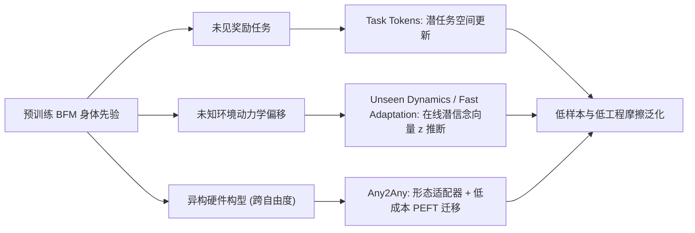

# BFM 分类 04：Adaptation

> **分类页**：对应 [具身智能研究室 · BFM 41 篇专题](https://mp.weixin.qq.com/s/Ei32la_vo0UW9Y_QCAqB2g) 与 [awesome-bfm-papers](https://github.com/friedrichyuan/awesome-bfm-papers) 的 **04 Adaptation** 分组；本页汇集该组 **4 篇** 论文的站内实体与 source 索引（awesome 列表 2026-07 增至 42 篇，本组新增 Any2Any）。总地图见 [BFM 技术地图](./bfm-41-papers-technology-map.md)。

## 一句话定义

**BFM 适应路线解决预训练全身行为基础模型在面对未见奖励任务、未知环境动力学偏移或异构硬件构型时，如何通过潜空间微调、任务 Token、信念推断或参数高效迁移低成本泛化。**

## 英文缩写速查

| 缩写 | 英文全称 | 简要说明 |
|------|----------|----------|
| BFM | Behavior Foundation Model | 大规模行为数据预训练的可复用全身行为先验 |
| RL | Reinforcement Learning | 通过与环境交互最大化长期回报来学习策略的范式 |
| AMP | Adversarial Motion Prior | 用对抗判别约束状态转移接近专家运动分布的先验 |
| PEFT | Parameter-Efficient Fine-Tuning | 如 LoRA 等不改主干全参数的低秩或前缀适配器微调 |

## 为什么重要

- **决定「基础模型」是否真能跨场景省掉重训：** 预训练 BFM 若只能在名义标定仿真参数与原本体上运行，则仍属于静态技能库；适应技术打通了跨负载、跨摩擦乃至跨机器人的工程复用。
- **连接无监督预训练与真机残差校准：** Fast Adaptation（CoRL 2025）与 Any2Any 分别处理动力学隐信念适应和跨本体全参替代难题。

## 核心机制与本组论文（4 篇）

预训练 BFM 如何以**低成本**适配新任务、新动力学或新机体（样本与工程摩擦）？核心路径包括：在潜任务空间更新 Task Tokens 或在线信念向量 \(z\) 以应对动力学分布外变化，以及通过形态适配器加低成本 PEFT 迁移到不同自由度构型。

**代表工作（策展）：** Task Tokens、Unseen Dynamics、Fast Adaptation、Any2Any（跨具身 PEFT）

| # | 工作 | Wiki 实体 | Source |
|---|------|-----------|--------|
| 31 | Task Tokens | [paper-bfm-31-task-tokens.md](../entities/paper-bfm-31-task-tokens.md) | [source](../../sources/papers/bfm_awesome_task_tokens_arxiv_2503_22886.md) |
| 32 | Zero-Shot Adaptation of Behavioral Foundation Models to Unseen Dynamics | [paper-bfm-32-unseen-dynamics.md](../entities/paper-bfm-32-unseen-dynamics.md) | [source](../../sources/papers/bfm_awesome_unseen_dynamics_arxiv_2505_13150.md) |
| 33 | Fast Adaptation With Behavioral Foundation Models | [paper-bfm-33-fast-adaptation-bfm.md](../entities/paper-bfm-33-fast-adaptation-bfm.md) | [source](../../sources/papers/bfm_awesome_fast_adaptation_bfm_corl_2025.md) |
| 42 | Any2Any | [paper-any2any-cross-embodiment-wbt.md](../entities/paper-any2any-cross-embodiment-wbt.md) | [source](../../sources/papers/bfm_awesome_any2any_arxiv_2605_23733.md) |

## 在 BFM taxonomy 中的位置

| 字段 | 内容 |
|------|------|
| 分组 | 04 Adaptation |
| 篇数 | 4/42 |
| 概念对照 | [Behavior Foundation Model](../concepts/behavior-foundation-model.md) |
| 姊妹分类 | 见 [BFM 技术地图 · 五类问题](./bfm-41-papers-technology-map.md#流程总览五类问题--身体-api) |

## 工程实践

- **冻结预训练身体先验，优先调潜变量 \(z\) 或轻量适配器：** 对小幅负载与地形摩擦变化，直接在线更新潜任务条件（零权重改动）或低秩残差，避免全参微调导致灾难性遗忘既有平衡与起身能力。
- **跨本体迁移前对齐关节自由度与观测缩放基准：** 使用 Any2Any 类跨具身适配器时，需先校验关节限位、名义站姿与重力/角速度坐标系一致性。

## 常见误区或局限

- **学术适应条目开源度偏低：** 上表 Task Tokens、Unseen Dynamics、Fast Adaptation 与 Any2Any 在上游 `awesome-bfm-papers` 列表中截至刷新日均标记为 `Code: N/A`，工程验证多依赖论文自复现。
- **把动力学外推当作无限安全保障：** 在严重执行器饱和或超出预训练包络的极限姿态下，仅微调潜变量无法弥补底层支撑力学失稳。

## 架构与路线图

## 关联页面

- [BFM 41 篇技术地图](./bfm-41-papers-technology-map.md)
- [Behavior Foundation Model](../concepts/behavior-foundation-model.md)
- [人形 RL 身体系统栈](./humanoid-rl-motion-control-body-system-stack.md)
- [AMP 运动先验综述](./humanoid-amp-motion-prior-survey.md)

## 参考来源

- [wechat_embodied_ai_lab_bfm_41_papers_survey.md](../../sources/blogs/wechat_embodied_ai_lab_bfm_41_papers_survey.md) — 微信公众号编译（<https://mp.weixin.qq.com/s/Ei32la_vo0UW9Y_QCAqB2g>）
- [bfm_awesome_41_catalog.md](../../sources/papers/bfm_awesome_41_catalog.md)
- [awesome-bfm-papers](https://github.com/friedrichyuan/awesome-bfm-papers)
- [A Survey of Behavior Foundation Model](https://arxiv.org/abs/2506.20487)（TPAMI 2025）

## 推荐继续阅读

- [Behavior Foundation Model 概念页](../concepts/behavior-foundation-model.md)
- [BFM 41 篇技术地图](./bfm-41-papers-technology-map.md)
- [Any2Any 论文实体](../entities/paper-any2any-cross-embodiment-wbt.md)
