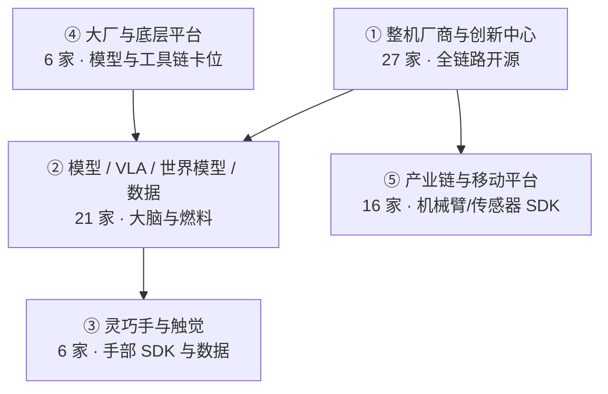

# 国内具身智能开源全景（76 家 · 424 项）

> **本页定位**：[国内具身智能的开源全景](https://mp.weixin.qq.com/s/L2XQBhesU8EiS2nKM7HErw)（2026-09-06）的阅读坐标；**424 个项目逐条可点开**，见 [阅读导航](../queries/china-domestic-opensource-424-coverage.md)。

## 一句话观点

**国内具身开源已从单点仓库扩展为「整机全链路 + 模型大脑 + 灵巧手 + 大厂平台 + 产业链 SDK」五层格局；选型应先定层，再点进各项目页核对训练/部署入口。**

## 一句话定义

**本页是「国内 76 家具身机构 · 424 个开源项目」五层全景的阅读坐标：按机构所处产业位置分层，帮助先定层、再查仓库入口。**

## 英文缩写速查

| 缩写 | 英文全称 | 简要说明 |
|------|----------|----------|
| OEM | Original Equipment Manufacturer | 整机厂商与各地创新中心 |
| VLA | Vision-Language-Action | 视觉–语言–动作模型 |
| SDK | Software Development Kit | 真机驱动与控制接口 |
| HMI | Humanoid Motion Intelligence | 同源 GitHub 知识库 |

## 为什么重要

- 国内具身开源条目多、分散在数十个机构组织下；原文称不到两年即有 420+ 项目，直接翻 GitHub 主页成本高。
- 分层后可区分「整机链路型」「模型/数据型」「SDK 驱动型」，避免把只含驱动的仓库当成可训练的运动栈（推断：据原文各条说明归纳）。

## 五层格局

| 层 | 机构数（文内） | 开源特征 | 本库入口 |
|---|---:|---|---|
| 第一层 | 27 | 本体资产 + RL + 仿真 + 部署 SDK 成套公开 | [208 项索引](../queries/china-domestic-opensource-424-coverage.md) |
| 第二层 | 21 | VLA/世界模型/数据格式立标准 | [73 项索引](../queries/china-domestic-opensource-424-coverage.md) |
| 第三层 | 6 | 手部 SDK、仿真、遥操作、触觉数据 | [36 项索引](../queries/china-domestic-opensource-424-coverage.md) |
| 第四层 | 6 | 模型层与开发者工具链 | [44 项索引](../queries/china-domestic-opensource-424-coverage.md) |
| 第五层 | 16 | 机械臂/相机/雷达 ROS 驱动 | [63 项索引](../queries/china-domestic-opensource-424-coverage.md) |

## 核心机制

原文的组织逻辑是**按机构在产业链中的位置分层**，每层的开源动机不同：

- **整机厂**：开源整条链路（本体资产、RL 训练、仿真、部署 SDK），原文称「代码是生态入口，护城河在硬件与数据」。
- **模型/数据公司**：开源「大脑」与「燃料」，用于立标准、圈开发者（如 LeRobot 数据格式）。
- **灵巧手 / 大厂 / 产业链**：分别以手部 SDK 与触觉数据、模型层与工具链、ROS 驱动为默认交付物。

原文总判断：最成体系的是头部整机厂，最热的是 VLA 与世界模型，最不缺的是 SDK 驱动。

## 这份清单能查到什么

- **424 个项目都有独立详情页**：仓库地址、所属机构、技术方向一页可见。
- **76 家机构 · 19 个技术方向**，可按机构或方向横向比对同类项目。
- 与 [HMI 开源项目主表 166 项](../queries/hmi-opensource-projects-coverage.md) **互补**：主表按技术路线深读算法；本全景按 **国内机构** 查仓库入口。

## 读法建议

1. **选整机厂** — 从智元/宇树/天工等实体页沿 RL → Sim2Sim → SDK 链路读。
2. **选 VLA/世界模型** — 第二层公司实体 + [VLA](../methods/vla.md)。
3. **查方法原理** — 详情页里若链到方法/论文页，从那里读算法细节。

## 工程实践

- 整机厂典型可追踪链路为：训练（Isaac Gym / Isaac Lab / MJLab）→ MuJoCo Sim2Sim → ONNX 等导出 → ROS 2 / SDK 部署（如宇树 RL Lab、北京人形 TienKung-Lab、傅利叶 Wiki-GRx 流水线）。
- 选型时先核对仓库属于哪一类（训练框架、部署运行时、本体资产、SDK），再核对关节顺序、观测契约与控制周期是否与自己的本体一致（推断：据原文对 Booster Gym 等条目的说明）。
- 仓库详情逐项见 [424 项覆盖索引](../queries/china-domestic-opensource-424-coverage.md)。

## 局限

- 原文是清单式综述，各仓库能力描述采信作者一句话说明，部分条目为模板化描述；真实代码质量、许可与维护状态需打开仓库核对。
- 原文自述部分项目仅开放论文或部分模块（如 WALL-SS 仅论文与图示、诺亦腾 AdaPT 仅第一阶段 Tracker、HoloAgent 模型与数据分发未完成），不能当作可直接训练或部署的框架。
- 项目数与归层口径随原文更新而变（原文标题写「420+」，本库逐条落地为 424）。

## 关联页面

- [Humanoid Motion Intelligence](../entities/humanoid-motion-intelligence.md)
- [424 项覆盖索引](../queries/china-domestic-opensource-424-coverage.md)
- [HMI 开源项目主表导读](../queries/hmi-opensource-projects-coverage.md)

## 参考来源

- [国内具身智能开源全景（微信公众号）](../../sources/blogs/wechat_embodied_station_domestic_opensource_panorama_2026-09-06.md)

## 推荐继续阅读

- [GitHub：人形机器人运动智能知识库](https://github.com/RealXiaoze/humanoid-motion-intelligence)
