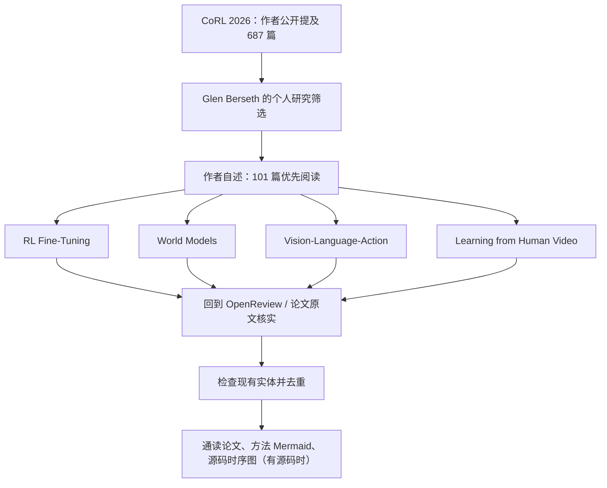

# CoRL 2026 Reading List｜Glen Berseth 的机器人学习优先阅读清单

> **状态：待补全文（draft）。** 已确认作者公开说明与会议官方入口，但尚未读到博客全文；**下述是清单线索与阅读导航，不是 101 篇的已核验索引。**

- 原始文章：<https://www.fracturedplane.com/blog/2026/11/10/CoRL2026-Reading-List.html>
- 作者：Glen Berseth（Université de Montréal / Mila）
- 会议：[CoRL 2026](https://2026.corl.org/)（主会 11 月 9–11 日；Workshop 11 月 12 日）
- 作者公开声明：在 687 篇论文中挑出 101 篇，按其研究组兴趣优先阅读（**不是官方排名**）。
- 可信度：**101/687 属作者公开自述**；官方论文目录具体条目与博客内的 101 篇均未完成逐条核验。

## 一句话定义

一份以 **RL fine-tuning、World Models、VLA 和 Learning from Human Video** 为重点的 CoRL 2026 个人研究阅读清单，适合作为论文发现入口，不能直接替代论文原文。

## 英文缩写速查

| 缩写 | 英文 | 含义 |
|---|---|---|
| CoRL | Conference on Robot Learning | 机器人学习会议 |
| RL | Reinforcement Learning | 强化学习 |
| VLA | Vision-Language-Action | 视觉语言动作模型 |
| WM | World Model | 世界模型 |

## 为什么重要

- CoRL 2026 的论文体量较大；作者按研究方向筛选可降低初筛负担，**但筛选标准为个人研究偏好**。
- 四个公开可确认的兴趣方向覆盖了机器人基础模型训练、真实环境适应、预测式建模，以及利用人类视频学习。
- 对 Robotics_Notebooks 的使用价值在于**先定位研究问题，再回原始论文核对方法与实验**，避免把策展意见当作学术共识。

## 核心原理：主题导航（非文章原图）

作者公开动态明确提到了四个方向。下面按 Robotics_Notebooks 的研究工作流**重新绘制概念阅读图**；不是论文算法图、不是文章原有章节顺序，也不是已验证的 101 篇分组。

## 工程实践：如何用这份清单

1. 从 [CoRL 官方论文入口](https://2026.corl.org/program/accepted-papers) 或 [OpenReview 会议分组](https://openreview.net/group?id=robot-learning.org/CoRL/2026/Conference) 找到对应论文原文；**目前不能把任意论文认定为作者精选的 101 篇之一**。
2. 结合现有 [VLA](../methods/vla.md)、[强化学习](../methods/reinforcement-learning.md) 和 [世界模型](../methods/generative-world-models.md) 页面，判断技术脉络与任务设定。
3. 将来取得完整列表后按原文的优先级/分类补充，按 arXiv/OpenReview、标题及项目主页对已有节点去重，再逐篇通读论文和可用源码。
4. 对评测数据记录机器人本体、任务、数据、成功率定义与基线，不对不同论文直接横向排名。

## 局限与风险

- **原文链接当前访问失败**，无法确认正文准确标题、101 篇逐条名单、作者对论文的具体评价或 Workshop 名称/安排；不得编造论文名次、收录关系或优先级。
- “687 篇、101 篇”来源于作者的公开动态；另有[非官方 CoRL 2026 索引](https://studeas.github.io/corl-2026-papers/)标注 687，但不作为官方验收证据。
- **没有公开对应的运行代码仓库**需要做源码时序图；当前 Mermaid 是清单使用流程图。
- 本条仅为**部分 ingest / 导航节点**，尚不满足“原文通读完成”的 3/3 健康度要求；不应将 `status` 修改为 `complete`。

## 关联页面

- [CoRL 会议实体](../entities/painode-054-corl.md)
- [VLA](../methods/vla.md)
- [Reinforcement Learning](../methods/reinforcement-learning.md)
- [Generative World Models](../methods/generative-world-models.md)

## 参考来源

- [Glen Berseth 原始清单](https://www.fracturedplane.com/blog/2026/11/10/CoRL2026-Reading-List.html) — 待读取正文
- [作者公开说明镜像](https://teapawt.org/GlenBerseth) — 可核对 101/687 与主题
- [CoRL 2026 官方官网](https://2026.corl.org/) — 主会与 Workshop 日期
- [官方会议归档](../../sources/sites/corl-2026-program.md)
- [本条来源核查记录](../../sources/blogs/glen-berseth-corl-2026-reading-list-2026-11-10.md)

## 推荐继续阅读

- [CoRL 2026 Accepted Papers（官方）](https://2026.corl.org/program/accepted-papers)
- [CoRL 2026 OpenReview](https://openreview.net/group?id=robot-learning.org/CoRL/2026/Conference)
