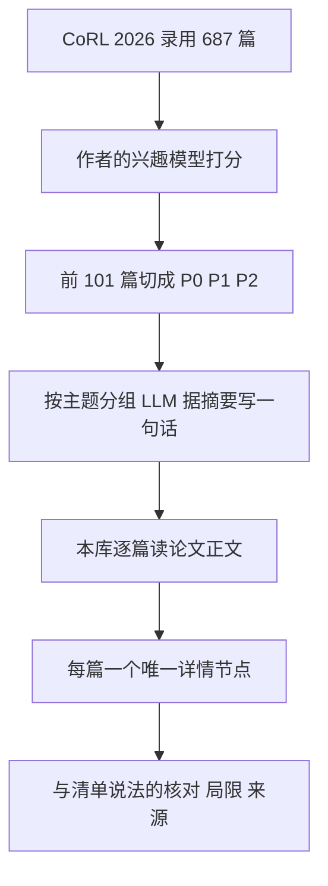

# CoRL 2026 Reading List｜Glen Berseth 的 101 篇优先阅读清单

> **本页定位：** 把作者 Glen Berseth 的博客 [My CoRL 2026 Reading List](https://www.fracturedplane.com/blog/2026/11/10/CoRL2026-Reading-List.html) 的 101 条逐条指向本库**唯一**的论文详情节点。博客正文已通读，见[来源归档](../../sources/blogs/glen-berseth-corl-2026-reading-list-2026-11-10.md)。排序是作者用自己的研究兴趣模型打分得来，**不是论文质量排名**。

## 一句话定义

作者从 CoRL 2026 的 687 篇录用论文里，按自己研究组的兴趣排出前 101 篇（P0 必读 26、P1 应读 45、P2 可读 30），主题是 RL 微调、世界模型与世界动作模型、VLA、从人类视频学习和模仿学习。

## 英文缩写速查

| 缩写 | 英文 | 含义 |
|---|---|---|
| CoRL | Conference on Robot Learning | 机器人学习会议 |
| RL | Reinforcement Learning | 强化学习 |
| VLA | Vision-Language-Action | 视觉语言动作模型 |
| WAM | World Action Model | 世界动作模型 |
| WM | World Model | 世界模型 |
| TPMS | Toronto Paper Matching System | 审稿人匹配系统，作者用其亲和度思路打分 |

## 为什么重要

- 687 篇很难逐篇读，作者公开了自己的筛选结果与方法，可作为论文发现入口；但**筛选标准是个人研究偏好**。
- 清单的一句话摘要由 LLM 据摘要起草；本库逐篇读了论文正文，在每个节点的「与清单说法的核对」里写出了摘要与正文的出入（例如：只有仿真被写成「real-world」、相对提升被读成绝对提升、基线只有一两个）。

## 核心原理与流程总览

作者自己列出的五条主线（原文 Themes Worth Following）：

1. **RL 微调 VLA 与生成式策略**：RL Token、EXPO-FT、Flow Policy Gradients，再看 Learning While Deploying、Training Robots to Reason in Natural Language。
2. **世界动作模型**：DreamZero，再看 TAPESTRY、W2A、FACT。
3. **世界模型作为 RL 的模拟器**：SafeDojo、WoVR、MERL；Training Controllable World Models。
4. **大规模人类视频**：EgoScale、Ego2Robot、Being-H0.5；LAPT-Scale、ELA 从视频学潜在动作。
5. **进度奖励**：WARP-RM、TOPReward、RARM。

## 工程实践

- 使用清单时先看对应节点的「与清单说法的核对」，再回论文原文；**不要把清单摘要当作论文结论**。
- 新增条目前先按 arXiv 号和标题去重（同一 arXiv 号只允许一个 canonical 节点）。
- 评测数字要同时看机器人本体、任务数、试验次数和有没有方差；本库节点里记录了这些。

## 与清单说法的核对（跨论文观察）

以下是读完 101 篇节点后对「清单一句话摘要」的共性观察（本库判断，细节见各节点）：

- **仿真还是真机：** 清单几乎不区分。不少条目全部结果在仿真里（例如 SERF、PA 类规划、MDF++ 的主体、PGPG），或真机只有每任务 5–30 次试验且无方差。
- **「几个示范 / 无监督 / zero-shot」：** 常有隐含前提，例如仍需要一个预训练好的比较器、特权仿真信息、人工标注的成功标签或手调超参（PGPG、HiRE、RARM、SERF 等）。
- **摘要里的百分比：** 多处是相对提升而不是百分点（LFP-VLA、HumanoidMimicGen、EgoScale 的「预测」口径）。
- **「开源」：** 不少论文只给项目页，代码标 coming soon 或仓库在本环境不可访问，因此对应节点没写 `code:` 或标了未核实。
- **清单标题与 arXiv 标题不同：** 例如 Dex4D、ComSim、VISTA、MAESTRO，可能是会议版改名，未逐项核实。

## 局限

- 清单本身只是作者的个人筛选，不代表论文质量，也不代表 CoRL 官方推荐。
- 101 篇里有 2 篇全文拿不到：FlashRFCL（作者主页只有摘要）和 Emergent Control via Prior-Based Free Energy Minimization（只有摘要 / TLDR），对应节点为 draft、未达 3/3，核对只做到摘要级。
- arXiv 号是我用标题精确匹配搜到的，OpenReview 在本环境被验证页挡住，没有逐篇核对 OpenReview 版本；会场标注（Oral / Spotlight）取自清单，未在官方页核对。
- 本页的跨论文观察是我据各节点归纳的判断，不是作者或论文原话。

## 101 篇 → 本库节点

| # | 档 | 分组 | 论文节点 | arXiv | OpenReview |
|---|----|------|----------|-------|------------|
| 001 | P0 | RL Fine-Tuning of VLAs & Generative Policies | [EXPO-FT: Sample-Efficient Reinforcement Learning Finetuning for Vision-Language-Action Models](../entities/paper-expo-ft.md) | [2605.25477](https://arxiv.org/abs/2605.25477) | [OR](https://openreview.net/forum?id=U3Nmrhun8B) |
| 002 | P0 | RL Fine-Tuning of VLAs & Generative Policies | [Flow Policy Gradients for Robot Control](../entities/paper-flow-policy-gradients-robot-control.md) (Oral) | [2602.02481](https://arxiv.org/abs/2602.02481) | [OR](https://openreview.net/forum?id=acslhrig33) |
| 003 | P0 | RL Fine-Tuning of VLAs & Generative Policies | [RL Token: Bootstrapping Online RL with Vision-Language-Action Models](../entities/paper-rcl-2604-23073-rl-token-bootstrapping-online-rl-with-vision-lan.md) (Oral) | [2604.23073](https://arxiv.org/abs/2604.23073) | [OR](https://openreview.net/forum?id=RYXo2ktK1M) |
| 004 | P0 | RL Fine-Tuning of VLAs & Generative Policies | [Scaling Sim-to-Real VLA Reinforcement Learning with Generative 3D Worlds](../entities/paper-sa-2603-18532-scaling-sim-to-real-reinforcement-learning-for-r.md) | [2603.18532](https://arxiv.org/abs/2603.18532) | [OR](https://openreview.net/forum?id=z5Mgc1GGjP) |
| 005 | P0 | RL Fine-Tuning of VLAs & Generative Policies | [RoboFFT: Finetuning generative robot policy via online reinforcement learning with forward process](../entities/paper-robofft.md) | [2609.32236](https://arxiv.org/abs/2609.32236) | [OR](https://openreview.net/forum?id=EfJCm9am0o) |
| 006 | P0 | RL Algorithms & Exploration | [Learning Object Manipulation from Scratch via Contrastive Interaction](../entities/paper-geometry-of-contact.md) | [2606.11525](https://arxiv.org/abs/2606.11525) | [OR](https://openreview.net/forum?id=QLhHHolka7) |
| 007 | P0 | RL Algorithms & Exploration | [Efficient On-policy Visual-RL via Stochastic Decoupled Policy Gradient](../entities/paper-sdpg-visual-rl-stochastic-decoupled.md) | [2605.26478](https://arxiv.org/abs/2605.26478) | [OR](https://openreview.net/forum?id=c7BvD59RpP) |
| 008 | P0 | RL Algorithms & Exploration | [FlashRFCL: Demonstration-Efficient Sparse Reward RL via Reverse-Forward Curriculum Learning in High-Throughput GPU Simulation](../entities/paper-flashrfcl.md) | — | [OR](https://openreview.net/forum?id=DBLXUxxslN) |
| 009 | P0 | RL Algorithms & Exploration | [Play2Perfect: What Matters in Dexterous Play Pretraining for Precise Assembly?](../entities/paper-play2perfect.md) (Oral) | [2606.26428](https://arxiv.org/abs/2606.26428) | [OR](https://openreview.net/forum?id=RRl1xXZLdM) |
| 010 | P0 | RL Algorithms & Exploration | [Learning Loco-Manipulation From SMPC Demonstrations With Sparse Offline-to-Online RL](../entities/paper-smpc2rl-loco-manipulation.md) (Spotlight) | [2608.12063](https://arxiv.org/abs/2608.12063) | [OR](https://openreview.net/forum?id=5b4j0e21aJ) |
| 011 | P0 | RL Algorithms & Exploration | [HARBOR: A Harness Framework for Agentic Robot Reinforcement Learning](../entities/paper-harbor.md) | [2606.08610](https://arxiv.org/abs/2606.08610) | [OR](https://openreview.net/forum?id=JqZEEaNDLJ) |
| 012 | P0 | World Models & World Action Models | [SafeDojo: Safe Reinforcement Learning for VLA via Interactive World Model](../entities/paper-safedojo.md) | [2606.20698](https://arxiv.org/abs/2606.20698) | [OR](https://openreview.net/forum?id=Xgth4qBOmb) |
| 013 | P0 | World Models & World Action Models | [Large Video Planner Enables Generalizable Robot Control](../entities/paper-sa-2512-15840-lvp-large-video-planner-enables-generalizable-ro.md) | [2512.15840](https://arxiv.org/abs/2512.15840) | [OR](https://openreview.net/forum?id=PniGejQAdF) |
| 014 | P0 | World Models & World Action Models | [World Action Models are Zero-shot Policies](../entities/paper-notebook-dreamzero-world-action-models-are-zero-shot-poli.md) (Oral) | [2602.15922](https://arxiv.org/abs/2602.15922) | [OR](https://openreview.net/forum?id=Bshs9HDDiu) |
| 015 | P0 | VLAs & Generalist Policies | [Improving Robotic Generalist Policies via Flow Reversal Steering](../entities/paper-flow-reversal-steering.md) | [2606.13675](https://arxiv.org/abs/2606.13675) | [OR](https://openreview.net/forum?id=AhpH1nGaUp) |
| 016 | P0 | VLAs & Generalist Policies | [RoboTTT: Context Scaling for Robot Policies](../entities/paper-robottt-test-time-training-vla-context.md) (Oral) | [2607.15275](https://arxiv.org/abs/2607.15275) | [OR](https://openreview.net/forum?id=NHE9q2cz1n) |
| 017 | P0 | Learning from Human Video | [LAPT-Scale: Scaling Embodied Policies with Latent Action Pre-Training on Human Videos](../entities/paper-lapt-scale.md) | [2610.13732](https://arxiv.org/abs/2610.13732) | [OR](https://openreview.net/forum?id=wMrKZ9eYBg) |
| 018 | P0 | Learning from Human Video | [ELA: End-to-End Latent Action Policy Learning from Video Demonstrations](../entities/paper-ela.md) | [2611.05571](https://arxiv.org/abs/2611.05571) | [OR](https://openreview.net/forum?id=iy5oCeLdEF) |
| 019 | P0 | Learning from Human Video | [EgoScale: Scaling Dexterous Manipulation with Diverse Egocentric Human Data](../entities/paper-sa-2602-16710-egoscale-scaling-dexterous-manipulation-with-div.md) (Oral) | [2602.16710](https://arxiv.org/abs/2602.16710) | [OR](https://openreview.net/forum?id=WF4X17Al2r) |
| 020 | P0 | Learning from Human Video | [EgoEngine: From Egocentric Human Videos to High-Fidelity Dexterous Robot Demonstrations](../entities/paper-egoengine.md) | [2606.12604](https://arxiv.org/abs/2606.12604) | [OR](https://openreview.net/forum?id=drlpFld34L) |
| 021 | P0 | Learning from Human Video | [Imitation from Heterogeneous Demonstrations using Grounded Latent-Action World Models](../entities/paper-glam-grounded-latent-action-world-models.md) | [2606.21672](https://arxiv.org/abs/2606.21672) | [OR](https://openreview.net/forum?id=RLsVfgv1pS) |
| 022 | P0 | Imitation Learning & Data Quality | [Scalable Behavior Cloning with Open Data, Training, and Evaluation](../entities/paper-abc-scalable-behavior-cloning.md) | [2606.27375](https://arxiv.org/abs/2606.27375) | [OR](https://openreview.net/forum?id=qd6clCx6QY) |
| 023 | P0 | Rewards & Progress Models | [Online World Modeling Enables Real-World Inverse Reinforcement Learning from Observation](../entities/paper-mpail2-irlfo.md) | [2602.24121](https://arxiv.org/abs/2602.24121) | [OR](https://openreview.net/forum?id=74gh4jCB2a) |
| 024 | P0 | Cross-Embodiment & Robot Design | [Morphology-Conditioned World Model for Cross-Embodiment Quadrupedal Locomotion](../entities/paper-morphology-conditioned-world-model-quadruped.md) | [2604.08780](https://arxiv.org/abs/2604.08780) | [OR](https://openreview.net/forum?id=YQoaLlpDD3) |
| 025 | P0 | Cross-Embodiment & Robot Design | [Shape Your Body: Value Gradients for Multi-Embodiment Robot Design](../entities/paper-shape-your-body-value-gradient-design.md) (Spotlight) | [2606.00702](https://arxiv.org/abs/2606.00702) | [OR](https://openreview.net/forum?id=xhO9wj1gGt) |
| 026 | P0 | Cross-Embodiment & Robot Design | [MorFiC: Fixing Value Miscalibration for Zero-Shot Quadruped Transfer](../entities/paper-morfic.md) | [2603.14554](https://arxiv.org/abs/2603.14554) | [OR](https://openreview.net/forum?id=X7QOq3QotA) |
| 027 | P1 | RL Fine-Tuning of VLAs & Generative Policies | [Training Robots to Reason in Natural Language via Reinforcement Learning](../entities/paper-r3-robotic-reasoner.md) | — | [OR](https://openreview.net/forum?id=9I9DPyr2f9) |
| 028 | P1 | RL Fine-Tuning of VLAs & Generative Policies | [Optimal Transport Q-Learning for Flow Policy Steering and Acceleration](../entities/paper-otql-flow-policy-steering.md) | [2607.06262](https://arxiv.org/abs/2607.06262) | [OR](https://openreview.net/forum?id=uNi5VigrGr) |
| 029 | P1 | RL Fine-Tuning of VLAs & Generative Policies | [Learning While Deploying: Fleet-Scale Reinforcement Learning for Generalist Robot Policies](../entities/paper-lwd-fleet-scale-rl.md) | [2605.00416](https://arxiv.org/abs/2605.00416) | [OR](https://openreview.net/forum?id=656PH9MVla) |
| 030 | P1 | RL Fine-Tuning of VLAs & Generative Policies | [X-NavDP: Generalizing Navigation Diffusion Policy to Novel Behavior and Embodiments with Group Q-score Reweighted Matching](../entities/paper-x-navdp.md) | [2607.28560](https://arxiv.org/abs/2607.28560) | [OR](https://openreview.net/forum?id=c0ygOLwL7i) |
| 031 | P1 | RL Algorithms & Exploration | [A Balanced Data Diet: Addressing the Exploration Bottleneck in Mega-Scale RL for Robot Control](../entities/paper-sgs-2610-12465.md) | [2610.12465](https://arxiv.org/abs/2610.12465) | [OR](https://openreview.net/forum?id=MQdt80qzTP) |
| 032 | P1 | RL Algorithms & Exploration | [Combining Constrained Sampling and Reinforcement Learning for Manipulation](../entities/paper-sample-guided-rl-constrained-sampling.md) (Spotlight) | [2602.08557](https://arxiv.org/abs/2602.08557) | [OR](https://openreview.net/forum?id=cJGMjQlgz5) |
| 033 | P1 | RL Algorithms & Exploration | [Emergent Control via Prior-Based Free Energy Minimization](../entities/paper-emergent-control-prior-free-energy.md) (Spotlight) | — | [OR](https://openreview.net/forum?id=XY8QpMSxvq) |
| 034 | P1 | World Models & World Action Models | [Trust-Calibrated VLA Policy Post-Training with Evolving Imagination](../entities/paper-merl-trust-calibrated-vla-post-training.md) | [2610.16517](https://arxiv.org/abs/2610.16517) | [OR](https://openreview.net/forum?id=0PThTAIwPD) |
| 035 | P1 | World Models & World Action Models | [Chunk-wise Model-based Policy Optimization](../entities/paper-cmpo-chunk-wise-model-based-policy-optimization.md) (Spotlight) | [2610.14564](https://arxiv.org/abs/2610.14564) | [OR](https://openreview.net/forum?id=dngZLI0SlV) |
| 036 | P1 | World Models & World Action Models | [Training Controllable World Models via Action Influence Maximization](../entities/paper-aim-action-influence-maximization.md) | [2610.27387](https://arxiv.org/abs/2610.27387) | [OR](https://openreview.net/forum?id=OOCwc3Dn5d) |
| 037 | P1 | World Models & World Action Models | [WoVR: World Models as Reliable Simulators for Post-Training VLA Policies with RL](../entities/paper-rcl-2602-13977-wovr-world-models-as-reliable-simulators-for-pos.md) | [2602.13977](https://arxiv.org/abs/2602.13977) | [OR](https://openreview.net/forum?id=QHIz2k4E88) |
| 038 | P1 | World Models & World Action Models | [Coupled Local and Global World Models for Efficient First Order RL](../entities/paper-coupled-local-global-world-models-fog-rl.md) | [2602.06219](https://arxiv.org/abs/2602.06219) | [OR](https://openreview.net/forum?id=zDGliNPeBL) |
| 039 | P1 | World Models & World Action Models | [PlayWorld: Learning Robot World Models from Autonomous Play Data](../entities/paper-playworld-autonomous-play-data.md) | — | [OR](https://openreview.net/forum?id=HATezFmdN5) |
| 040 | P1 | World Models & World Action Models | [Hierarchical Planning with Latent World Models](../entities/paper-hwm-latent-world-model-planning.md) | [2604.03208](https://arxiv.org/abs/2604.03208) | [OR](https://openreview.net/forum?id=Zts11nHGLq) |
| 041 | P1 | World Models & World Action Models | [Light-WAM: Efficient World Action Models with State-Fusion Action Decoding](../entities/paper-rcl-2606-08242-light-wam-efficient-world-action-models-with-sta.md) | [2606.08242](https://arxiv.org/abs/2606.08242) | [OR](https://openreview.net/forum?id=kB0KO1Wife) |
| 042 | P1 | World Models & World Action Models | [PLaW-VLA: Predictive Latent World Modeling for Vision-Language-Action Policies](../entities/paper-plaw-vla-predictive-latent-world-model-vla.md) | [2610.12285](https://arxiv.org/abs/2610.12285) | [OR](https://openreview.net/forum?id=GMAZdF34n5) |
| 043 | P1 | VLAs & Generalist Policies | [ELASTIC: Efficiently Learning to Adaptively Scale Test-Time Compute for Generative Control Policies](../entities/paper-elastic-test-time-compute-gcp.md) | [2606.31132](https://arxiv.org/abs/2606.31132) | [OR](https://openreview.net/forum?id=wXv81vB0Xt) |
| 044 | P1 | VLAs & Generalist Policies | [MAESTRO: Orchestrating Robotics Modules with Coding Agents for Zero-Shot Generalist Robots](../entities/paper-maestro.md) | [2511.00917](https://arxiv.org/abs/2511.00917) | [OR](https://openreview.net/forum?id=BxW31Dilgn) |
| 045 | P1 | VLAs & Generalist Policies | [OmniGuide: Universal Spatial Guidance Fields for Enhancing Generalist Robot Policies](../entities/paper-omniguide-spatial-guidance-fields.md) | [2603.10052](https://arxiv.org/abs/2603.10052) | [OR](https://openreview.net/forum?id=PEWWDUL10X) |
| 046 | P1 | VLAs & Generalist Policies | [PRTS: A Primitive Reasoning and Tasking System via Contrastive Representations](../entities/paper-prts-primitive-reasoning-tasking-system.md) (Spotlight) | [2604.27472](https://arxiv.org/abs/2604.27472) | [OR](https://openreview.net/forum?id=QwpnI3BlwT) |
| 047 | P1 | VLAs & Generalist Policies | [FTP-1: A Generalist Foundation Tactile Policy Across Tactile Sensors for Contact-Rich Manipulation](../entities/paper-ftp-1.md) | [2606.13102](https://arxiv.org/abs/2606.13102) | [OR](https://openreview.net/forum?id=xc8asDq7QI) |
| 048 | P1 | VLAs & Generalist Policies | [Being-H0.5: Scaling Human-Centric Robot Learning for Cross-Embodiment Generalization](../entities/paper-being-h05.md) (Oral) | [2601.12993](https://arxiv.org/abs/2601.12993) | [OR](https://openreview.net/forum?id=cfzFrOJmKA) |
| 049 | P1 | VLAs & Generalist Policies | [MolmoAct2: Action Reasoning Models for Real-World Deployment](../entities/paper-molmoact2.md) (Spotlight) | [2605.02881](https://arxiv.org/abs/2605.02881) | [OR](https://openreview.net/forum?id=Q6xWLHyg6x) |
| 050 | P1 | VLAs & Generalist Policies | [π0.7: a Steerable Generalist Robotic Foundation Model with Emergent Capabilities](../entities/paper-rcl-2604-15483-0-7-a-steerable-generalist-robotic-foundation-mo.md) (Oral) | — | [OR](https://openreview.net/forum?id=5XKFwWrW0v) |
| 051 | P1 | Learning from Human Video | [Ego2Robot: Scalable Robot Data Synthesis from Egocentric Human Data](../entities/paper-ego2robot.md) (Spotlight) | [2608.02580](https://arxiv.org/abs/2608.02580) | [OR](https://openreview.net/forum?id=JV472m0zgq) |
| 052 | P1 | Learning from Human Video | [Monkey See, Can Monkey Do? A Benchmark for Evaluating Robot Skill Learning by Observation](../entities/paper-roboreel-lfo-benchmark.md) | [2609.08209](https://arxiv.org/abs/2609.08209) | [OR](https://openreview.net/forum?id=SMBnET3Mz9) |
| 053 | P1 | Learning from Human Video | [Counterfactual Video Generation Enables Scalable Humanoid Loco-Manipulation](../entities/paper-prism-real2sim2real.md) | [2609.38172](https://arxiv.org/abs/2609.38172) | [OR](https://openreview.net/forum?id=uZalcCyrVl) |
| 054 | P1 | Learning from Human Video | [WAM-TTT: Steering World-Action Models by Watching Human Play at Test Time](../entities/paper-wam-ttt-human-video-test-time-steering.md) | [2607.06988](https://arxiv.org/abs/2607.06988) | [OR](https://openreview.net/forum?id=oX3ErTz3rv) |
| 055 | P1 | Learning from Human Video | [LUCID: Learning Embodiment-Agnostic Intent Models from Unstructured Human Videos for Scalable Dexterous Robot Skill Acquisition](../entities/paper-lucid-learning-embodiment-agnostic-intent.md) | [2606.11628](https://arxiv.org/abs/2606.11628) | [OR](https://openreview.net/forum?id=QsmD0Pq7uP) |
| 056 | P1 | Learning from Human Video | [ACE-Ego: Unifying Egocentric Human and Robotic Data for VLA Pretraining](../entities/paper-sa-2606-17200-ace-ego-0-unifying-egocentric-human-and-robotic.md) | — | [OR](https://openreview.net/forum?id=aTDKKvOg7W) |
| 057 | P1 | Learning from Human Video | [HARP-VLA: Human-Robot Aligned Representation Learning for Vision-Language-Action Model](../entities/paper-harp-vla-human-robot-aligned-representation.md) | [2605.31234](https://arxiv.org/abs/2605.31234) | [OR](https://openreview.net/forum?id=ghx1d6PQUR) |
| 058 | P1 | Learning from Human Video | [HuRo: Robotizing Human Videos for Scalable VLA Pretraining](../entities/paper-huro.md) | [2609.10706](https://arxiv.org/abs/2609.10706) | [OR](https://openreview.net/forum?id=vQmF2cR04D) |
| 059 | P1 | Learning from Human Video | [The Imitator Game: Benchmarking Robot Imitative Ability Beyond Action Prediction](../entities/paper-imitator-game.md) | [2608.22301](https://arxiv.org/abs/2608.22301) | [OR](https://openreview.net/forum?id=qH1h7UkK0k) |
| 060 | P1 | Imitation Learning & Data Quality | [Q-OIL: Optimistic Exploration in Learning from Human Interventions](../entities/paper-q-oil.md) | [2611.08576](https://arxiv.org/abs/2611.08576) | [OR](https://openreview.net/forum?id=9seU2kEIxR) |
| 061 | P1 | Imitation Learning & Data Quality | [Ambient Diffusion Policy: Imitation Learning from Suboptimal Data in Robotics](../entities/paper-ambient-diffusion-policy.md) | [2606.12365](https://arxiv.org/abs/2606.12365) | [OR](https://openreview.net/forum?id=Sh0dG0HwVK) |
| 062 | P1 | Rewards & Progress Models | [WARP-RM: A Warp-Augmented Relative Progress Reward Model for Data Curation](../entities/paper-warp-rm.md) | [2606.28320](https://arxiv.org/abs/2606.28320) | [OR](https://openreview.net/forum?id=yaYM35u9Su) |
| 063 | P1 | Sim-to-Real, Dexterity & Data Generation | [Dex4D: Task-Agnostic Point Track Policy for Zero-Shot Dexterous Manipulation](../entities/paper-dex4d.md) | [2602.15828](https://arxiv.org/abs/2602.15828) | [OR](https://openreview.net/forum?id=Qa1Uu7lc8n) |
| 064 | P1 | Sim-to-Real, Dexterity & Data Generation | [ExpertGen: Scalable Sim-to-Real Expert Policy Learning from Imperfect Behavior Priors](../entities/paper-expertgen.md) | [2603.15956](https://arxiv.org/abs/2603.15956) | [OR](https://openreview.net/forum?id=gk8bvFSZq3) |
| 065 | P1 | Sim-to-Real, Dexterity & Data Generation | [Object-Centric Residual RL for Zero-Shot Sim-to-Real VLA Enhancement](../entities/paper-object-centric-residual-rl-vla.md) | [2606.18953](https://arxiv.org/abs/2606.18953) | [OR](https://openreview.net/forum?id=tAXtXe4Oqd) |
| 066 | P1 | Sim-to-Real, Dexterity & Data Generation | [TacCoRL: Integrating Tactile Feedback into VLA via Simulation](../entities/paper-sa-2606-11743-taccorl-integrating-tactile-feedback-into-vla-vi.md) | [2606.11743](https://arxiv.org/abs/2606.11743) | [OR](https://openreview.net/forum?id=H7b56xK590) |
| 067 | P1 | Sim-to-Real, Dexterity & Data Generation | [Learning Dexterous Manipulation Using Contact Wrench Guidance From Human Demonstration](../entities/paper-chord-contact-wrench-dexterous-manipulation.md) | [2607.00033](https://arxiv.org/abs/2607.00033) | [OR](https://openreview.net/forum?id=DEPCm83K5I) |
| 068 | P1 | Planning & Compositional Generalization | [What Do You Need for Compositional Generalization in Diffusion Planning?](../entities/paper-compositional-generalization-diffusion-planning.md) | [2505.18083](https://arxiv.org/abs/2505.18083) | [OR](https://openreview.net/forum?id=HBHR1GxaS0) |
| 069 | P1 | Planning & Compositional Generalization | [Long-Horizon Multi-Object Rearrangement via Distilled Tree Search over Continuous Actions](../entities/paper-distilled-tree-search-multi-object-rearrangement.md) (Oral) | [2610.25785](https://arxiv.org/abs/2610.25785) | [OR](https://openreview.net/forum?id=hWuk4y2AeR) |
| 070 | P1 | Planning & Compositional Generalization | [Leave It Better Than Found: Value-Guided Cooperation in Sequential Tasks](../entities/paper-pave.md) (Spotlight) | [2611.08075](https://arxiv.org/abs/2611.08075) | [OR](https://openreview.net/forum?id=N77om40jWL) |
| 071 | P1 | Planning & Compositional Generalization | [Recover, Discover, Plan: Learning Skills and Concepts from Robot Failures](../entities/paper-resync-recovery-driven-skill-concept-discovery.md) | [2606.18328](https://arxiv.org/abs/2606.18328) | [OR](https://openreview.net/forum?id=HuFkyUA5RR) |
| 072 | P2 | RL Fine-Tuning of VLAs & Generative Policies | [Beyond Imitation: Reinforcement Learning-Based Sim-Real Co-Training for VLA Models](../entities/paper-rl-co-sim-real-co-training.md) | [2602.12628](https://arxiv.org/abs/2602.12628) | [OR](https://openreview.net/forum?id=7hdkIcfGRw) |
| 073 | P2 | RL Fine-Tuning of VLAs & Generative Policies | [CounterAlign: Counterfactual Supervision for Vision-Language-Action Models](../entities/paper-counteralign-counterfactual-supervision-vla.md) | [2608.21740](https://arxiv.org/abs/2608.21740) | [OR](https://openreview.net/forum?id=AY4totylcx) |
| 074 | P2 | RL Algorithms & Exploration | [Tactile Curiosity Drives Robot Interaction](../entities/paper-tactile-curiosity-drives-robot-interaction.md) | [2609.40134](https://arxiv.org/abs/2609.40134) | [OR](https://openreview.net/forum?id=h26AmTGnfu) |
| 075 | P2 | RL Algorithms & Exploration | [ENPIRE: Agentic Robot Policy Self-Improvement in the Real World](../entities/paper-enpire.md) | [2606.19980](https://arxiv.org/abs/2606.19980) | [OR](https://openreview.net/forum?id=0cK9Wf9Eeq) |
| 076 | P2 | World Models & World Action Models | [Scaling World Model for Hierarchical Manipulation Policies](../entities/paper-vista-hierarchical-world-model-goalvla.md) | [2602.10983](https://arxiv.org/abs/2602.10983) | [OR](https://openreview.net/forum?id=hCG12ifteJ) |
| 077 | P2 | World Models & World Action Models | [FACT: Failure-Aware Causal Training for World-Action Models](../entities/paper-fact.md) | [2608.10232](https://arxiv.org/abs/2608.10232) | [OR](https://openreview.net/forum?id=YrNlVJcApO) |
| 078 | P2 | World Models & World Action Models | [SuperMimic: Scaling Humanoid Whole-Body Control with One Differentiable World Model](../entities/paper-supermimic.md) (Oral) | [2610.28480](https://arxiv.org/abs/2610.28480) | [OR](https://openreview.net/forum?id=psNqjklVOK) |
| 079 | P2 | World Models & World Action Models | [World-Language-Action Model for Unified World Modeling, Language Reasoning, and Action Synthesis](../entities/paper-sa-2606-05979-world-language-action-model-for-unified-world-mo.md) | [2606.05979](https://arxiv.org/abs/2606.05979) | [OR](https://openreview.net/forum?id=OIhLrULoIq) |
| 080 | P2 | World Models & World Action Models | [W2A: Distilling World Priors into Action Models for Real-Time Robotic Control](../entities/paper-w2a-world-priors-action-models.md) | [2611.02600](https://arxiv.org/abs/2611.02600) | [OR](https://openreview.net/forum?id=gTazI5D0Fj) |
| 081 | P2 | World Models & World Action Models | [Targeting World Models to Compromise Robot Learning Pipelines](../entities/paper-targeting-world-models-robot-learning-pipelines.md) (Spotlight) | [2606.09499](https://arxiv.org/abs/2606.09499) | [OR](https://openreview.net/forum?id=6T2ebANGy5) |
| 082 | P2 | World Models & World Action Models | [TAPESTRY: A Single Backbone for Video Generation and Robot Control](../entities/paper-tapestry.md) | [2610.36823](https://arxiv.org/abs/2610.36823) | [OR](https://openreview.net/forum?id=AilV1LyfXF) |
| 083 | P2 | World Models & World Action Models | [MDF++: Visuo-Tactile World Action Model with End-to-end Representation Learning](../entities/paper-mdf-plus-plus-visuo-tactile-wam.md) | [2611.09293](https://arxiv.org/abs/2611.09293) | [OR](https://openreview.net/forum?id=d0ltfevDaD) |
| 084 | P2 | VLAs & Generalist Policies | [APT: Action Expert Pretraining Improves Instruction Generalization of Vision-Language-Action Policies](../entities/paper-apt-action-expert-pretraining.md) | [2606.12366](https://arxiv.org/abs/2606.12366) | [OR](https://openreview.net/forum?id=8TvqhVkrMd) |
| 085 | P2 | VLAs & Generalist Policies | [SERF: Spatiotemporal Environment and Robot Feature Map for Long-Horizon Mobile Manipulation](../entities/paper-serf.md) (Spotlight) | [2606.12956](https://arxiv.org/abs/2606.12956) | [OR](https://openreview.net/forum?id=nIbnBCtz79) |
| 086 | P2 | VLAs & Generalist Policies | [Learning What to Say to Your VLA: Mostly Harmless Vision Language Action Model Steering](../entities/paper-lfp-vla-language-steering.md) (Spotlight) | [2606.12299](https://arxiv.org/abs/2606.12299) | [OR](https://openreview.net/forum?id=z47bcul4Zk) |
| 087 | P2 | Learning from Human Video | [EgoWAM: World Action Models Beyond Pixels with In-the-Wild Egocentric Human Data](../entities/paper-egowam-egocentric-human-wam-co-training.md) | [2607.08436](https://arxiv.org/abs/2607.08436) | [OR](https://openreview.net/forum?id=EfkPQTtjky) |
| 088 | P2 | Imitation Learning & Data Quality | [FlowDAgger: Human-in-the-Loop Adaptation of Generative Robot Policies in Latent Space](../entities/paper-rcl-2607-08877-flowdagger-human-in-the-loop-adaptation-of-gener.md) (Spotlight) | [2607.08877](https://arxiv.org/abs/2607.08877) | [OR](https://openreview.net/forum?id=aspenN9eir) |
| 089 | P2 | Imitation Learning & Data Quality | [SynthICL: Scalable In-context Imitation Learning with Synthetic Data](../entities/paper-synthicl.md) | [2606.08154](https://arxiv.org/abs/2606.08154) | [OR](https://openreview.net/forum?id=6pHgTk73zs) |
| 090 | P2 | Imitation Learning & Data Quality | [Graph-Reweighted Behavior Cloning with Human Interventions for Precise Robotic Manipulation](../entities/paper-gr-bc.md) | [2610.20504](https://arxiv.org/abs/2610.20504) | [OR](https://openreview.net/forum?id=bsjuF5klA3) |
| 091 | P2 | Imitation Learning & Data Quality | [Diversity You Can Actually Measure: A Fast, Model-Free Diversity Metric for Robotics Datasets](../entities/paper-faktual-signature-entropy-diversity.md) (Oral) | [2603.11634](https://arxiv.org/abs/2603.11634) | [OR](https://openreview.net/forum?id=TscNG5Wcwn) |
| 092 | P2 | Imitation Learning & Data Quality | [Progress-Guided Preference Generation for Aligning Generative Control Policies](../entities/paper-pgpg-progress-guided-preference-generation.md) | [2610.25692](https://arxiv.org/abs/2610.25692) | [OR](https://openreview.net/forum?id=J8pJIDI6rM) |
| 093 | P2 | Imitation Learning & Data Quality | [MIRROR: Reflecting Hidden Symmetries from Offline Robot Interaction Data](../entities/paper-mirror-symmetry-discovery.md) | [2610.17422](https://arxiv.org/abs/2610.17422) | [OR](https://openreview.net/forum?id=Glj2RSQIS4) |
| 094 | P2 | Rewards & Progress Models | [HiRE: Hindsight Reward Editing for Policy Finetuning](../entities/paper-hire-hindsight-reward-editing.md) | [2609.27068](https://arxiv.org/abs/2609.27068) | [OR](https://openreview.net/forum?id=0ua1KHFIUD) |
| 095 | P2 | Rewards & Progress Models | [TOPReward: Token Probabilities as Hidden Zero-Shot Rewards for Robotics](../entities/paper-topreward.md) | [2602.19313](https://arxiv.org/abs/2602.19313) | [OR](https://openreview.net/forum?id=ZDnuAR0GMn) |
| 096 | P2 | Rewards & Progress Models | [RARM: Confidence-Gated Progress Reward Modeling for RL in Manipulation](../entities/paper-rarm-confidence-gated-progress-reward.md) | [2606.22027](https://arxiv.org/abs/2606.22027) | [OR](https://openreview.net/forum?id=AAn8ouEHwO) |
| 097 | P2 | Sim-to-Real, Dexterity & Data Generation | [HumanoidMimicGen Data Generation for Loco-Manipulation via Whole-Body Planning](../entities/paper-humanoidmimicgen.md) | [2605.27724](https://arxiv.org/abs/2605.27724) | [OR](https://openreview.net/forum?id=9kXz22fI7a) |
| 098 | P2 | Sim-to-Real, Dexterity & Data Generation | [Assembling Two Parts in One Hand](../entities/paper-assembling-two-parts-in-one-hand.md) | [2609.10137](https://arxiv.org/abs/2609.10137) | [OR](https://openreview.net/forum?id=Eb5TKtrt2X) |
| 099 | P2 | Sim-to-Real, Dexterity & Data Generation | [Building Scalable Real-World Robot Data Generation via Compositional Simulation](../entities/paper-comsim.md) | — | [OR](https://openreview.net/forum?id=VEsQVsxMMw) |
| 100 | P2 | Sim-to-Real, Dexterity & Data Generation | [Dex-X: Learning Visual-Tactile Dexterous Manipulation From Human Demonstration with Simulated Interaction](../entities/paper-dex-x.md) | — | [OR](https://openreview.net/forum?id=suRtJLXVxI) |
| 101 | P2 | Cross-Embodiment & Robot Design | [Transformer Transformer: A Unified Model for Motion-Conditioned Robot Co-design](../entities/paper-transformer-transformer.md) | [2607.25798](https://arxiv.org/abs/2607.25798) | [OR](https://openreview.net/forum?id=yPkDKkOD11) |

## 关联页面

- [CoRL 会议实体](../entities/painode-054-corl.md)
- [VLA](../methods/vla.md)
- [强化学习](../methods/reinforcement-learning.md)
- [生成式世界模型](../methods/generative-world-models.md)

## 参考来源

- [博客全文归档](../../sources/blogs/glen-berseth-corl-2026-reading-list-2026-11-10.md)（原文落盘：[raw](../../sources/raw/glen_berseth_corl_2026_reading_list_2026-11-10.md)）
- [作者两条公开声明归档](../../sources/blogs/glen-berseth-corl-2026-public-announcement-reading.md)
- [CoRL 2026 官方 Program 归档](../../sources/sites/corl-2026-program.md)

## 继续阅读

- [CoRL 2026 Accepted Papers（官方）](https://2026.corl.org/program/accepted-papers)
- 各详情节点里的 arXiv 原文与项目页。
