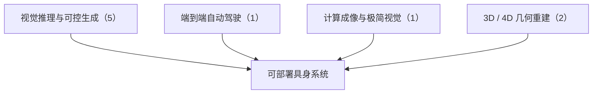

# 从视觉编程到 4D 重建：CV 三大会 2023–2026 Best Paper 阅读坐标

> **本页定位**：为 [深蓝具身智能 · 四年十篇顶会Best Paper，谁在持续霸榜？](https://mp.weixin.qq.com/s/CJki5-KhJ438RdAIhzNbCw)（2026-11-01）提供按研究方向组织的阅读坐标；9 篇全部有独立详情节点。

## 一句话观点

**四年 Best Paper 的主线是计算机视觉从静态 2D 像素处理走向动态、符合物理规律的 3D / 4D 世界重构：视觉编程与可控生成之后，VGGT 把前馈几何做到统一，D4RT 再把它扩展到动态 4D；UniAD、Minimalist Vision、BrickGPT 分别代表端到端驾驶、极简传感与物理可行生成。**

## 英文缩写速查

| 缩写 | 英文全称 | 简要说明 |
|------|----------|----------|
| CVPR | IEEE/CVF Conference on Computer Vision and Pattern Recognition | 计算机视觉三大会之一 |
| ICCV | International Conference on Computer Vision | 计算机视觉三大会之一 |
| ECCV | European Conference on Computer Vision | 计算机视觉三大会之一 |

## 为什么单独做这张地图

- 公众号按年份盘点近四年 CV 三大会 Best Paper（9 篇有独立节点；标题称「十篇」，正文实际列出 9 篇），按年份排列，缺少按主题的横切面；本页按主题重组。
- 节点摘要依据公众号编译与 arXiv 摘要页；Best Paper 奖项与实验室归属为公众号表述，未逐条核实；开源结论为入库日核查结果，见各节点「为什么重要」。

## 流程总览

## 分组索引

### 视觉推理与可控生成（5 篇）

| 论文 | 节点 | 开源 |
|------|------|------|
| VisProg | [paper-visprog](../entities/paper-visprog.md) | 已开源 |
| ControlNet | [paper-controlnet](../entities/paper-controlnet.md) | 已开源 |
| Generative Image Dynamics | [paper-generative-image-dynamics](../entities/paper-generative-image-dynamics.md) | 项目页未列 GitHub |
| Rich Human Feedback | [paper-rich-human-feedback](../entities/paper-rich-human-feedback.md) | 已开源 |
| BrickGPT | [paper-brickgpt](../entities/paper-brickgpt.md) | 已开源 |

### 端到端自动驾驶（1 篇）

| 论文 | 节点 | 开源 |
|------|------|------|
| UniAD | [paper-uniad](../entities/paper-uniad.md)（复用） | 已开源 |

### 计算成像与极简视觉（1 篇）

| 论文 | 节点 | 开源 |
|------|------|------|
| Minimalist Vision | [paper-minimalist-vision-freeform-pixels](../entities/paper-minimalist-vision-freeform-pixels.md) | 项目页未列 GitHub |

### 3D / 4D 几何重建（2 篇）

| 论文 | 节点 | 开源 |
|------|------|------|
| VGGT | [paper-vggt-visual-geometry-grounded-transformer](../entities/paper-vggt-visual-geometry-grounded-transformer.md) | 已开源 |
| D4RT | [paper-d4rt](../entities/paper-d4rt.md)（复用） | 项目页未列 GitHub |

## 关联页面

- [Visual Representation for Policy](../concepts/visual-representation-for-policy.md)

## 参考来源

- [wechat_shenlan_cv_best_papers_2023_2026_labs.md](../../sources/blogs/wechat_shenlan_cv_best_papers_2023_2026_labs.md)

## 推荐继续阅读

- [VisProg](../entities/paper-visprog.md)
- [UniAD](../entities/paper-uniad.md)
