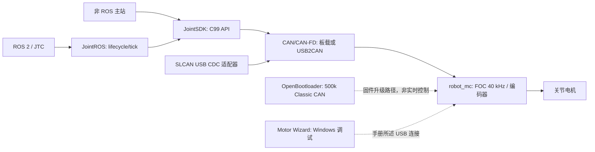
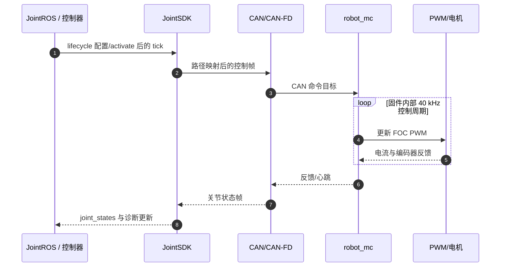

# CyberBeast 关节电机软件栈 / Joint Motor Software Stack

## 一句话定义

CyberBeast 的关节电机工程栈把 **N32H473 裸机 FOC**、**CAN IAP/OTA**、**纯 C99 控制协议 SDK**、**ROS 2 集成**与 **USB-CAN 适配器**分开开源；Motor Wizard 是手册列出的 Windows 调试上位机，而非上述代码仓库的源码模块。

## 英文缩写速查

| 缩写 | 英文全称 | 简要说明 |
|---|---|---|
| FOC | Field-Oriented Control | 固件内电流闭环 |
| IAP | In-Application Programming | CAN 引导程序升级 |
| SDK | Software Development Kit | CAN/CAN-FD 协议与物理量 API |
| JTC | Joint Trajectory Controller | ROS 2 关节轨迹控制器 |
| SLCAN | Serial Line CAN | USB CDC ASCII 转发 CAN 帧 |

## 为什么重要

同一套控制链同时包含硬实时 FOC、应用层控制命令、主机 SDK 与 ROS 2 控制周期；不同层的频率和安全边界不可混为一谈。按源码分层能帮助定位“能收到心跳但不响应参数”“JTC 接口不匹配”“控制循环时延偏大”等问题。

## 核心原理

| 层级 | 官方项目 | 一句话定位 | 核实边界 |
|---|---|---|---|
| MCU 应用固件 | [robot_mc](../entities/cyberbeast-robot-mc.md) | N32H473CE / M4F 裸机，40 kHz 三相 FOC | 是固件中断频率 |
| 引导程序 | [OpenBootloader](../entities/cyberbeast-openbootloader.md) | CAN 500 kbit/s Classic CAN，32 KB @ 0x08000000 | APP 从 0x08008000 起 |
| 协议层 | [JointSDK](../entities/cyberbeast-jointsdk.md) | C99、默认无堆、调用者拥有循环 | 端点 ID 来自运行时 JSON |
| ROS 2 | [JointROS](../entities/cyberbeast-jointros.md) | lifecycle、joint_states、ros2_control 与 JTC | 默认示例 tick 1 kHz |
| USB-CAN | [canable2-fw-n32](../entities/cyberbeast-canable2-n32.md) | N32H473 USB CDC ↔ SLCAN ↔ FDCAN | 不作实时性保证 |
| Windows 工具 | Motor Wizard | 厂家手册的 Windows 可执行程序 | 下载/版本/31 MB 尚未核实 |

### 端到端分层图

## 源码运行时序图

## 工程实践

1. 在主机侧先用 [JointSDK](../entities/cyberbeast-jointsdk.md) 的 virtual 后端验证描述符、模式与 cycle 时序。
2. 使用 [canable2-fw-n32](../entities/cyberbeast-canable2-n32.md) 的 SLCAN 作发现、配置和低频调试；高频主站使用具备实时预算的总线后端，并测量 P99/最差延迟。
3. [JointROS](../entities/cyberbeast-jointros.md) 先通过 virtual launch 再做真机 bring-up；生命周期节点必须 activate 才创建服务和话题。
4. [OpenBootloader](../entities/cyberbeast-openbootloader.md) 使用独立 Classic CAN 500k 协议；不要将其与 robot_mc 应用层协议混用。
5. Motor Wizard 的安装入口见[原始手册归档](../../sources/sites/cyberbeast-motor-wizard.md)；它不是可供本次代码审阅的开源实现。

## 局限与风险

- 40 kHz（MCU FOC）、1 kHz（ROS 默认 tick）、500 kbit/s（Bootloader）分属不同层级，**不能据此推算端到端控制性能**。
- 设备 endpoint ID 会随固件描述符变化，不能固定写“端点 0”；高频控制必须检查总线预算、看门狗、反馈 age 与安全退出。
- 此汇总基于官方 README 与指定源码入口；未进行交叉版本整套实机集成验证；Motor Wizard 安装包大小及现时可用性未知。

## 关联页面

- [robot_mc](../entities/cyberbeast-robot-mc.md)
- [OpenBootloader](../entities/cyberbeast-openbootloader.md)
- [JointSDK](../entities/cyberbeast-jointsdk.md)
- [JointROS](../entities/cyberbeast-jointros.md)
- [canable2-fw-n32](../entities/cyberbeast-canable2-n32.md)
- [关节执行器参数辨识](../methods/joint-actuator-parameter-identification.md)
- [MIT 关节阻抗模式调参](../methods/mit-joint-impedance-mode-tuning.md)
- [电机驱动器底软通信协议](motor-drive-firmware-bus-protocols.md)
- [力矩电机设计纵深路线](../../roadmap/depth-torque-motor-design.md)
- [人形整机硬件设计纵深路线](../../roadmap/depth-humanoid-hardware-design.md)

## 参考来源

- [robot_mc 官方仓库归档](../../sources/repos/cyberbeast-robot-mc.md)
- [OpenBootloader 官方仓库归档](../../sources/repos/cyberbeast-openbootloader.md)
- [JointSDK 官方仓库归档](../../sources/repos/cyberbeast-jointsdk.md)
- [JointROS 官方仓库归档](../../sources/repos/cyberbeast-jointros.md)
- [canable2-fw-n32 官方仓库归档](../../sources/repos/cyberbeast-canable2-n32.md)
- [CyberBeast Motor Wizard 手册对应章节](../../sources/sites/cyberbeast-motor-wizard.md)

## 推荐继续阅读

- [robot_mc 官方仓库](https://github.com/cyberbeast0829/robot_mc)
- [JointSDK 官方仓库](https://github.com/cyberbeast0829/JointSDK)
- [JointROS 官方仓库](https://github.com/cyberbeast0829/JointROS)
