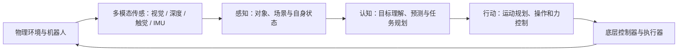

# 具身智能 2026 入门导读｜What is Embodied AI? A Complete Beginner's Guide 2026

## 一句话定义

**具身智能（Embodied AI）**：通过传感器获得环境与机体状态，结合目标生成行动，再利用物理世界反馈持续调整行为的智能系统；这是 [Embodied Global 2026 科普文章](../../sources/blogs/embodiedglobal_embodied_ai_beginners_guide_2026_06_17.md) 所强调的交互视角，并非某一种特定神经网络。

## 英文缩写速查

| 缩写 | 英文全称 | 简要说明 |
|---|---|---|
| AI | Artificial Intelligence | 包含具身与非具身的人工智能 |
| VLA | Vision-Language-Action | 视觉和语言条件下生成机器人动作的模型 |
| VLM | Vision-Language Model | 视觉与语言理解模型，可用作高层感知推理模块 |
| RL | Reinforcement Learning | 通过环境交互和奖励信号学习策略 |
| IL | Imitation Learning | 通过示范数据学习机器人策略 |
| IMU | Inertial Measurement Unit | 测量机体加速度与角速度的惯性传感器 |
| Sim2Real | Simulation-to-Reality Transfer | 从仿真训练或验证迁移到真实环境 |

## 为什么重要

这篇入门文章把传统算法、机器人控制、机器学习与产业场景连成一张地图。对于新手，**先理解「观测从哪来、动作到哪去、反馈如何闭环」**，比背诵厂商排名或模型名称更有帮助。

文章从定义到产业化按六块展开：概念比较、感知/认知/行动、关键技术、应用、厂商、行业挑战。它是**行业编辑部综述，不是原始论文**。

## 核心原理：感知—认知—行动闭环

图是对原文 §2 的**概念层级归纳**，不是某个已开源系统的运行图。闭环中不同模块的运行频率不同：高层规划不必跟电机控制同频。原文把运动输出简述为 joint torques / motor commands，但实际系统也可能通过关节位置、轨迹、动作块等接口与底层控制器对接。

| 层级 | 原文举例 | 对工程问题的意义 |
|---|---|---|
| 感知 Perception | 摄像头、LiDAR/深度、力触觉、麦克风、IMU | 观测同步、遮挡与噪声会影响决策 |
| 认知 Cognition | 场景理解、任务规划、语言理解、世界建模 | 将用户目标转成可执行的子任务 |
| 行动 Action | 导航、步态、抓取、轨迹与力控 | 必须遵守碰撞、接触、实时与安全约束 |
| 闭环反馈 | 传感器再次观测动作后果 | 不能把单次生成文本等同于稳定机器人执行 |

## 技术栈：各方法解决的问题不同

| 技术 | 原文定位 | 典型边界与本站入口 |
|---|---|---|
| Sim2Real | 用仿真安全、规模化训练，并克服现实差距 | 动力学、感知噪声与执行器误差；[主路线 L6](../../roadmap/motion-control.md) |
| VLA | 由图像与指令生成动作 | 动作表征、数据和实时推理的共同约束；[VLA](../methods/vla.md) |
| RL | 用奖励及试错学习运动或操作 | 奖励设计与仿真训练开销；[主路线 L5](../../roadmap/motion-control.md) |
| IL | 利用示范获得起始行为 | 示范覆盖和分布外偏移；[模仿学习入门专辑](./embodied-ai-guide-wechat-album-curator.md) |
| World Model | 预测行动后果、辅助规划 | 预测精度与闭环验证不能混为一谈；[全栈主路线 L11](../../roadmap/motion-control.md) |

原文罗列上述技术，**不表示五者在每台机器人中同时使用**。实际项目应按场景、数据、算力和控制频率选择组合。

## 工程实践：从入门图到可验证系统

1. 选择任务（导航 / 抓取 / 行走），明确观测、动作接口和安全停机条件。
2. 在仿真中验证物理、动作时序和失败恢复；需要迁移时考虑随机化与参数校准。
3. 把**任务成功率、延迟、干预次数、接触异常及长时间稳定性**分开记录，不只展示单次视频。
4. 从仓储、制造、家政、医疗、零售五类场景中选一类，具体能力以实际部署与可复核报告为准。
5. **源码运行时序图：不适用。** 这是科普文章，作者未提供统一可执行代码或数据；上图是概念流程而非源码调用。

## 局限与风险

- **泛化：** 原文前段称 VLA 已解决长期泛化难题，后段又列「真正新场景仍困难」；不能把前一说法当作已完成的研究结论。
- **商业数字：** 市场规模、企业估值、订单、产能、售价与部署数量均是文中叙述或预测；本文未独立核验其原始公告、统计口径及日期。
- **术语：** 原文并称 Embodied AI、Physical AI 和 Embodied Intelligence，实际系统边界与具体任务定义需分别澄清。
- **安全：** 物理动作的碰撞与接触风险不能只靠语言模型输出解释，需有真实测试和底层安全机制。
- **来源类型：** 编辑综述适合建立知识坐标，不应取代官方论文、代码或真机验收资料。

## 关联页面

- [AI 架构地图](./ai-architecture-map.md)：从神经网络与控制接口看模型组合
- [VLA 方法](../methods/vla.md)：深入动作表示与推理延迟
- [具身智能 Infra 2026](./embodied-infra-2026-panorama.md)：从数据—学习—评测—复盘讨论落地闭环
- [运动控制 → 物理智能全栈成长路线](../../roadmap/motion-control.md)：从 L0 物理与控制到 L12 部署
- [Embodied-AI-Guide 微信专辑](./embodied-ai-guide-wechat-album-curator.md)：进阶论文、模型与实践入口

## 参考来源

- [Embodied Global 原文阅读归档](../../sources/blogs/embodiedglobal_embodied_ai_beginners_guide_2026_06_17.md)（2026-06-17；已核对全文结构）
- [What is Embodied AI? A Complete Beginner's Guide 2026](https://embodiedglobal.com/en/article/what-is-embodied-ai-beginners-guide-2026)

## 推荐继续阅读

- [本站主路线：从运动控制到 Physical AI](../../roadmap/motion-control.md)
- [原文全文（Embodied Global）](https://embodiedglobal.com/en/article/what-is-embodied-ai-beginners-guide-2026)
