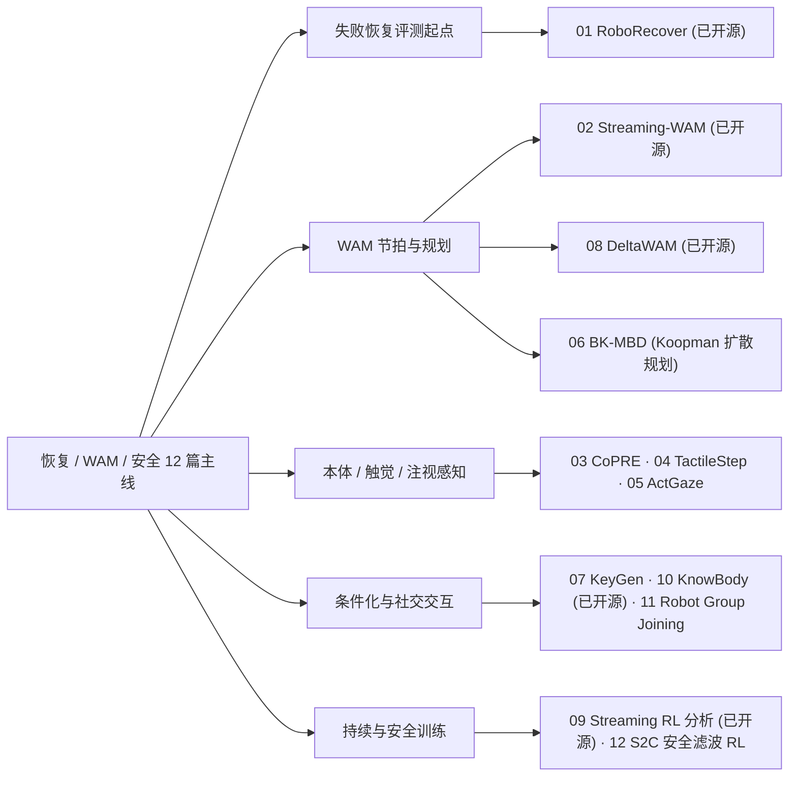

# 具身研究清单：12 篇（恢复 / WAM / 安全）阅读坐标

> **本页定位**：为 [公众号 12 篇盘点](https://mp.weixin.qq.com/s/RL232xWbXrs1XgNlFO3kdA) 提供横切面索引；**12/12 各有独立 `paper-*` 详情节点**。

## 一句话观点

**本期主线是「出错之后怎么办 + 推理慢时怎么动 + 身体/接触/安全怎么补」：RoboRecover 改评测起点，Streaming-WAM/DeltaWAM 改 WAM 节拍，CoPRE/TactileStep/ActGaze 改 sensing，KeyGen/KnowBody 改条件化，Streaming RL/S2C 改持续与安全训练。**

## 英文缩写速查

| 缩写 | 英文全称 | 简要说明 |
|------|----------|----------|
| WAM | World Action Model | 联合预测未来观测与动作 |
| VLA | Vision-Language-Action | 视觉-语言-动作策略 |
| SR | Success Rate | 任务成功率 |
| RL | Reinforcement Learning | 强化学习 |

## 节点索引（12/12）

| # | 节点 | arXiv | 开源 |
|---|------|-------|------|
| 01 | [RoboRecover](../entities/paper-roborecover.md) | 2609.28952 | **已开源** |
| 02 | [Streaming-WAM](../entities/paper-streaming-wam.md) | 2609.28927 | **已开源** |
| 03 | [CoPRE](../entities/paper-copre-proprioceptive-contact.md) | 2609.27381 | 待核实 |
| 04 | [TactileStep](../entities/paper-tactilestep.md) | 2609.28959 | 待发布 |
| 05 | [ActGaze](../entities/paper-actgaze.md) | 2609.28955 | 待发布 |
| 06 | [BK-MBD](../entities/paper-bkmbd-koopman-diffusion.md) | 2609.28920 | 待发布 |
| 07 | [KeyGen](../entities/paper-keygen.md) | 2609.28818 | 待发布 |
| 08 | [DeltaWAM](../entities/paper-deltawam.md) | 2609.28811 | **已开源** |
| 09 | [Streaming RL 分析](../entities/paper-streaming-rl-continual-robotics.md) | 2609.28807 | **已开源** |
| 10 | [KnowBody](../entities/paper-knowbody.md) | 2609.28530 | **已开源** |
| 11 | [Robot Group Joining](../entities/paper-robot-group-joining.md) | 2609.28467 | 待发布 |
| 12 | [S2C](../entities/paper-s2c-safety-filtered-rl.md) | 2609.27312 | 待发布 |

## 架构与路线图

## 关联页面

- [VLA](../methods/vla.md) · [Generative World Models](../methods/generative-world-models.md)
- [Manipulation](../tasks/manipulation.md)

## 参考来源

- [公众号 12 篇归档](../../sources/blogs/wechat_embodied_station_12_papers_recover_wam_2026-09-27.md)

## 推荐继续阅读

- [具身研究 12 篇（采集/部署）技术地图](./embodied-research-12-papers-technology-map.md) — 同期另一批 12 篇清单
