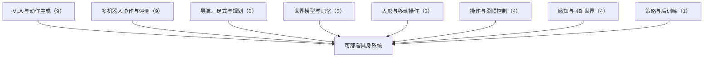

# 流式动作块与世界模型记忆：具身智能小站 10-14 期 41 篇阅读坐标

> **本页定位**：为 [具身智能小站 · 机器人动作为什么总在换块时卡顿？｜附代码与项目入口](https://mp.weixin.qq.com/s/pxBq6lFyzH05LGiBkkR9mQ)（2026-10-14）提供按研究方向组织的阅读坐标；41 篇全部有独立详情节点。

## 一句话观点

**「换块卡顿」是动作块策略部署的共性问题：相邻动作块是否接得上、新观察到达后能否持续细化，比单次推理更快更关键。本期深读 StreamingWAM，跟进 FreeBar 与 RoboCombine。**

## 英文缩写速查

| 缩写 | 英文全称 | 简要说明 |
|------|----------|----------|
| VLA | Vision-Language-Action | 视觉–语言–动作策略 |
| WAM | World Action Model | 世界–动作联合模型 |
| RL | Reinforcement Learning | 强化学习 |
| FM | Flow Matching | 流匹配生成 |

## 为什么单独做这张地图

- 公众号一次列出 41 篇、方向跨度大，需要横切面索引；每篇只保留一个判断，细节在各节点。
- 节点内的数字为公众号转述，未核验原文表格；开源结论为入库日核查结果，见各节点「为什么重要」。
- 与 [失败导向采集与可组合世界动作模型：具身智能小站 10-13 期 34 篇阅读坐标](./embodied-station-2026-10-13-34-papers-technology-map.md) 为相邻两期，可对照阅读（异步动作块：StreamingWAM / FreeBar / EAPN；世界模型记忆：ReCAP / IMPRINT / TTT-RM）。

## 流程总览

## 分组索引

### VLA 与动作生成（9 篇）

| 论文 | 节点 | 开源 |
|------|------|------|
| StreamingWAM | [paper-streamingwam](../entities/paper-streamingwam.md) | 已开源 |
| FreeBar | [paper-freebar-barrier-guidance-async-vla](../entities/paper-freebar-barrier-guidance-async-vla.md) | 已开源 |
| CS-VGB | [paper-cs-vgb-inference-time-scaling](../entities/paper-cs-vgb-inference-time-scaling.md) | 已开源 |
| FlowVLA | [paper-flowvla-pluggable-3d-flow](../entities/paper-flowvla-pluggable-3d-flow.md) | 已开源 |
| Δ-Flow | [paper-delta-flow-matching-robot-foundation-models](../entities/paper-delta-flow-matching-robot-foundation-models.md) | 已开源 |
| PRISM (Precision Forcing) | [paper-prism-precision-forcing-vla](../entities/paper-prism-precision-forcing-vla.md) | 已开源 |
| VPA | [paper-vision-predictor-action-jepa](../entities/paper-vision-predictor-action-jepa.md) | 已开源 |
| CFG-Policy | [paper-cfg-policy-unified-diffusion-policy](../entities/paper-cfg-policy-unified-diffusion-policy.md) | 待发布 |
| π0.5 CALL Astra | [paper-pi05-learn-to-call-astra](../entities/paper-pi05-learn-to-call-astra.md) | 项目页未列 GitHub |

### 多机器人协作与评测（9 篇）

| 论文 | 节点 | 开源 |
|------|------|------|
| RoboCombine | [paper-robocombine-combinatorial-generalization](../entities/paper-robocombine-combinatorial-generalization.md) | 部分开源 |
| AnyRank | [paper-anyrank-anytime-policy-ranking](../entities/paper-anyrank-anytime-policy-ranking.md) | 已开源 |
| 多操作员多机器人遥操作界面 | [paper-collaborative-teleoperation-multi-operator-multi-robot](../entities/paper-collaborative-teleoperation-multi-operator-multi-robot.md) | 已开源 |
| B-Human '26 | [paper-b-human-26-scalable-team-play](../entities/paper-b-human-26-scalable-team-play.md) | 已开源 |
| CARE | [paper-care-team-response-beliefs-multi-robot](../entities/paper-care-team-response-beliefs-multi-robot.md) | 项目页未列 GitHub |
| Akule | [paper-akule-sparse-interaction-diffusion](../entities/paper-akule-sparse-interaction-diffusion.md) | 已开源 |
| CoPlanVLM | [paper-coplanvlm-coordinated-path-planning](../entities/paper-coplanvlm-coordinated-path-planning.md) | 已开源 |
| 类条件保形 STL 推断 | [paper-class-conditional-conformal-stl-inference](../entities/paper-class-conditional-conformal-stl-inference.md) | 项目页未列 GitHub |
| 海上异构任务分配 RL | [paper-rl-heterogeneous-task-allocation-spatio-temporal](../entities/paper-rl-heterogeneous-task-allocation-spatio-temporal.md) | 已开源 |

### 导航、足式与规划（6 篇）

| 论文 | 节点 | 开源 |
|------|------|------|
| nanoflann | [paper-nanoflann-product-manifold-kdtree](../entities/paper-nanoflann-product-manifold-kdtree.md) | 已开源 |
| GG-Nav | [paper-gg-nav-goal-grounding-cot](../entities/paper-gg-nav-goal-grounding-cot.md) | 已开源 |
| TempoLoco | [paper-tempoloco-motion-adaptive-temporal-receptive-fields](../entities/paper-tempoloco-motion-adaptive-temporal-receptive-fields.md) | 部分开源 |
| LOADNav | [paper-loadnav-load-aware-quadruped-navigation](../entities/paper-loadnav-load-aware-quadruped-navigation.md) | 已开源 |
| LERR-Nav | [paper-lerr-nav-exploration-recovery-reminiscing](../entities/paper-lerr-nav-exploration-recovery-reminiscing.md) | 已开源 |
| 四旋翼软连续体臂 MuJoCo 框架 | [paper-quadrotor-tendon-soft-continuum-arm-mujoco](../entities/paper-quadrotor-tendon-soft-continuum-arm-mujoco.md) | 已开源 |

### 世界模型与记忆（5 篇）

| 论文 | 节点 | 开源 |
|------|------|------|
| ReCAP | [paper-recap-long-horizon-world-model-memory](../entities/paper-recap-long-horizon-world-model-memory.md) | 部分开源 |
| PhySimCode | [paper-physimcode-physics-video-to-code](../entities/paper-physimcode-physics-video-to-code.md) | 已开源 |
| BridgeWAM | [paper-bridgewam-latent-bridge-queries](../entities/paper-bridgewam-latent-bridge-queries.md) | 已开源 |
| IMPRINT | [paper-imprint-multi-stream-latent-memory](../entities/paper-imprint-multi-stream-latent-memory.md) | 项目页未列 GitHub |
| PILOT (Visual Subgoals) | [paper-pilot-visual-subgoal-world-model-planning](../entities/paper-pilot-visual-subgoal-world-model-planning.md) | 待发布 |

### 人形与移动操作（3 篇）

| 论文 | 节点 | 开源 |
|------|------|------|
| AIDA | [paper-aida-agent-interface-aligned-mobile-manipulation](../entities/paper-aida-agent-interface-aligned-mobile-manipulation.md) | 项目页未列 GitHub |
| TTCO | [paper-ttco-test-time-compute-humanoid-bfm](../entities/paper-ttco-test-time-compute-humanoid-bfm.md) | 待发布 |
| RoboCompiler-Humanoids | [paper-robocompiler-humanoids-composable-dynamics](../entities/paper-robocompiler-humanoids-composable-dynamics.md) | 已开源 |

### 操作与柔顺控制（4 篇）

| 论文 | 节点 | 开源 |
|------|------|------|
| Residual Compliant Policy | [paper-residual-compliant-policy](../entities/paper-residual-compliant-policy.md) | 待发布 |
| BAMPC | [paper-bampc-compute-budget-sampling-mpc](../entities/paper-bampc-compute-budget-sampling-mpc.md) | 已开源 |
| RAIN | [paper-rain-region-aware-interaction-networks](../entities/paper-rain-region-aware-interaction-networks.md) | 已开源 |
| 硬件感知 LLM-VLM 零样本规划 | [paper-hardware-aware-llm-vlm-zero-shot-task-planning](../entities/paper-hardware-aware-llm-vlm-zero-shot-task-planning.md) | 已开源 |

### 感知与 4D 世界（4 篇）

| 论文 | 节点 | 开源 |
|------|------|------|
| TartanMatch | [paper-tartanmatch-universal-dense-correspondence](../entities/paper-tartanmatch-universal-dense-correspondence.md) | 已开源 |
| TIDE/TIDES | [paper-tide-tides-4d-liquid-forecasting](../entities/paper-tide-tides-4d-liquid-forecasting.md) | 已开源 |
| SurgCast | [paper-surgcast-surgical-world-model-skeletons](../entities/paper-surgcast-surgical-world-model-skeletons.md) | 项目页未列 GitHub |
| Demiurge | [paper-demiurge-navigable-4d-worlds](../entities/paper-demiurge-navigable-4d-worlds.md) | 已开源 |

### 策略与后训练（1 篇）

| 论文 | 节点 | 开源 |
|------|------|------|
| DiTaR | [paper-ditar-task-relevant-latent-dynamics-reward](../entities/paper-ditar-task-relevant-latent-dynamics-reward.md) | 待发布 |

## 关联页面

- [VLA](../methods/vla.md)
- [World Action Models](../concepts/world-action-models.md)
- [Flow Matching 具身策略](../concepts/flow-matching-embodied-policy.md)
- [失败导向采集与可组合世界动作模型：具身智能小站 10-13 期 34 篇阅读坐标](./embodied-station-2026-10-13-34-papers-technology-map.md)

## 参考来源

- [wechat_embodied_station_41_papers_streamingwam_2026-10-14.md](../../sources/blogs/wechat_embodied_station_41_papers_streamingwam_2026-10-14.md)

## 推荐继续阅读

- [StreamingWAM](../entities/paper-streamingwam.md)
- [FreeBar](../entities/paper-freebar-barrier-guidance-async-vla.md)
