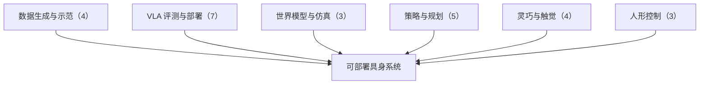

# 编程智能体造数据与 VLA 闭环评测：具身智能小站 10-18 期 26 篇阅读坐标

> **本页定位**：为 [具身智能小站 · 机器人会写控制程序之后，能否自己造训练数据？](https://mp.weixin.qq.com/s/mmnZuhiHkuzKCvdtU_XTNA)（2026-10-18）提供按研究方向组织的阅读坐标；26 篇全部有独立详情节点。

## 一句话观点

**机器人会写控制程序之后，成功程序本身就能变成可验证、可扩增的示范来源；与之配套的是用闭环任务而非数值误差来评测 VLA 的部署改动。本期深读 EmbodiedSWE，跟进 VLAQuantBench 与 Uranus。**

## 英文缩写速查

| 缩写 | 英文全称 | 简要说明 |
|------|----------|----------|
| VLA | Vision-Language-Action | 视觉–语言–动作策略 |
| WAM | World Action Model | 世界–动作联合模型 |
| PTQ | Post-Training Quantization | 训练后量化 |
| JEPA | Joint-Embedding Predictive Architecture | 联合嵌入预测架构 |

## 为什么单独做这张地图

- 公众号一次列出 26 篇（1 深读 + 2 跟进 + 23 扫读）、方向跨度大，需要横切面索引；每篇只保留一个判断，细节在各节点。
- 节点内的数字为公众号转述，未核验原文表格；开源结论为入库日核查结果，见各节点「为什么重要」。

## 流程总览

## 分组索引

### 数据生成与示范（4 篇）

| 论文 | 节点 | 开源 |
|------|------|------|
| EmbodiedSWE | [paper-embodiedswe](../entities/paper-embodiedswe.md)（复用） | 已开源 |
| Touch2Robot | [paper-touch2robot](../entities/paper-touch2robot.md) | 项目页未列 GitHub |
| ARSTAG | [paper-arstag](../entities/paper-arstag.md) | 已开源 |
| GLIDE | [paper-glide-beyond-human-demonstration](../entities/paper-glide-beyond-human-demonstration.md) | 项目页未列 GitHub |

### VLA 评测与部署（7 篇）

| 论文 | 节点 | 开源 |
|------|------|------|
| VLAQuantBench | [paper-vlaquantbench](../entities/paper-vlaquantbench.md) | 已开源 |
| THAW-VLA | [paper-thaw-vla](../entities/paper-thaw-vla.md)（复用） | 已开源 |
| Gaussian Is Enough | [paper-gaussian-is-enough-flow-matching-priors](../entities/paper-gaussian-is-enough-flow-matching-priors.md) | 已开源 |
| LIBERO-VPro | [paper-libero-vpro](../entities/paper-libero-vpro.md) | 项目页未列 GitHub |
| vla.simd | [paper-vla-simd](../entities/paper-vla-simd.md) | 项目页未列 GitHub |
| RoboMP-DINOv2 | [paper-robomp-dinov2](../entities/paper-robomp-dinov2.md) | 已开源 |
| Topology-VLA | [paper-topology-informed-visual-prompting-vla](../entities/paper-topology-informed-visual-prompting-vla.md) | 项目页未列 GitHub |

### 世界模型与仿真（3 篇）

| 论文 | 节点 | 开源 |
|------|------|------|
| Uranus | [paper-uranus](../entities/paper-uranus.md)（复用） | 已开源 |
| H2RBench | [paper-h2rbench](../entities/paper-h2rbench.md)（复用） | 已开源 |
| D-JEPA | [paper-d-jepa-decision-aligned-latent-world-model](../entities/paper-d-jepa-decision-aligned-latent-world-model.md) | 已开源 |

### 策略与规划（5 篇）

| 论文 | 节点 | 开源 |
|------|------|------|
| HiRE | [paper-hire-hindsight-reward-editing](../entities/paper-hire-hindsight-reward-editing.md) | 已开源 |
| X-Planner | [paper-x-planner-event-structured-task-planning](../entities/paper-x-planner-event-structured-task-planning.md) | 已开源 |
| PackLab | [paper-packlab](../entities/paper-packlab.md) | 已开源 |
| Visuomotor Pruning | [paper-visuomotor-robotic-pruning-orchards](../entities/paper-visuomotor-robotic-pruning-orchards.md) | 已开源 |
| MIGU | [paper-migu-multimodal-instruction-grounding](../entities/paper-migu-multimodal-instruction-grounding.md) | 待发布 |

### 灵巧与触觉（4 篇）

| 论文 | 节点 | 开源 |
|------|------|------|
| Contact-Anchored Retargeting | [paper-contact-anchored-retargeting-residual-dexterous](../entities/paper-contact-anchored-retargeting-residual-dexterous.md) | 已开源 |
| Berkeley QUAD Hand | [paper-berkeley-quad-hand](../entities/paper-berkeley-quad-hand.md) | 项目页未列 GitHub |
| SpectRobot | [paper-spectrobot-single-point-tactile](../entities/paper-spectrobot-single-point-tactile.md) | 项目页未列 GitHub |
| Norm2Tex | [paper-norm2tex](../entities/paper-norm2tex.md) | 待发布 |

### 人形控制（3 篇）

| 论文 | 节点 | 开源 |
|------|------|------|
| HOTICE | [paper-hotice](../entities/paper-hotice.md)（复用） | 待发布 |
| DeCap | [paper-smoothness-constraint-locomotion](../entities/paper-smoothness-constraint-locomotion.md)（复用） | 已开源 |
| PRIMO | [paper-primo-human-motion-odometry](../entities/paper-primo-human-motion-odometry.md)（复用） | 已开源 |

## 关联页面

- [VLA](../methods/vla.md)
- [World Action Models](../concepts/world-action-models.md)

## 参考来源

- [wechat_embodied_station_26_papers_embodiedswe_2026-10-18.md](../../sources/blogs/wechat_embodied_station_26_papers_embodiedswe_2026-10-18.md)

## 推荐继续阅读

- [EmbodiedSWE](../entities/paper-embodiedswe.md)
- [VLAQuantBench](../entities/paper-vlaquantbench.md)
