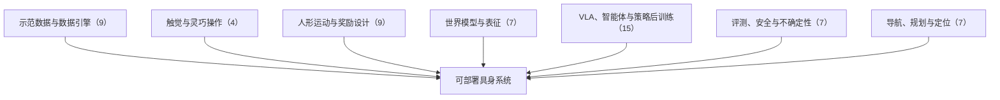

# 多样成功示范、触觉工具链与预见式感知：具身智能小站 10-29 期 58 篇阅读坐标

> **本页定位**：为 [具身智能小站 · 机器人缺的，是更多示范，还是更多成功解法？｜附代码与项目入口](https://mp.weixin.qq.com/s/s23oOBojr5YbchuFmQhcwA)（2026-10-29）提供按研究方向组织的阅读坐标；58 篇全部有独立详情节点。

## 一句话观点

**模仿学习缺的往往不是更多相似轨迹，而是多种可成功的解法：本期深读 DiscoDemo 把强化学习当示范生成器；跟进 OpenTac 的开放触觉工具链与 Watch Your Step 的预见式落脚感知；其余篇幅覆盖世界模型表征、VLA 后训练与不确定性、评测与安全、人形控制和导航。**

## 英文缩写速查

| 缩写 | 英文全称 | 简要说明 |
|------|----------|----------|
| VLA | Vision-Language-Action | 视觉–语言–动作策略 |
| WAM | World Action Model | 世界–动作联合模型 |
| VLM | Vision-Language Model | 视觉语言模型 |

## 为什么单独做这张地图

- 公众号一次列出 58 篇（1 深读 + 2 跟进 + 55 扫读）、方向跨度大，需要横切面索引；每篇只保留一个判断，细节在各节点。
- 节点内的数字为公众号转述，未核验原文表格；开源结论为入库日核查结果，见各节点「为什么重要」。

## 流程总览

## 分组索引

### 示范数据与数据引擎（9 篇）

| 论文 | 节点 | 开源 |
|------|------|------|
| DiscoDemo | [paper-discodemo](../entities/paper-discodemo.md) | 已开源 |
| EgoForesight | [paper-egoforesight](../entities/paper-egoforesight.md) | 已开源 |
| FLORA | [flora-robotics-data-engine](../entities/flora-robotics-data-engine.md)（复用） | 已开源 |
| Learned Speed Prior | [paper-learned-speed-prior](../entities/paper-learned-speed-prior.md) | 项目页未列 GitHub |
| DexPort | [paper-dexport](../entities/paper-dexport.md) | 已开源 |
| Reconstruction-Augmented Bimanual Pretraining | [paper-reconstruction-augmented-bimanual-pretraining-rgb-human-video](../entities/paper-reconstruction-augmented-bimanual-pretraining-rgb-human-video.md)（复用） | 已开源 |
| WorldMirror | [paper-worldmirror](../entities/paper-worldmirror.md) | 项目页未列 GitHub |
| Real2Sem2Real | [paper-real2sem2real](../entities/paper-real2sem2real.md) | 待发布 |
| KiRoSe | [paper-kirose](../entities/paper-kirose.md) | 项目页未列 GitHub |

### 触觉与灵巧操作（4 篇）

| 论文 | 节点 | 开源 |
|------|------|------|
| OpenTac | [paper-opentac-open-3d-tactile-sensing-ecosystem](../entities/paper-opentac-open-3d-tactile-sensing-ecosystem.md)（复用） | 已开源 |
| T-WLA | [paper-t-wla-slow-vision-fast-touch](../entities/paper-t-wla-slow-vision-fast-touch.md)（复用） | 已开源 |
| DONIC | [paper-donic](../entities/paper-donic.md)（复用） | 已开源 |
| VecTile | [paper-vectile](../entities/paper-vectile.md) | 待发布 |

### 人形运动与奖励设计（9 篇）

| 论文 | 节点 | 开源 |
|------|------|------|
| Watch Your Step | [paper-watch-your-step](../entities/paper-watch-your-step.md)（复用） | 已开源 |
| Memory before Goal | [paper-wholebodymem](../entities/paper-wholebodymem.md)（复用） | 已开源 |
| LocoManiLab | [paper-locomanilab](../entities/paper-locomanilab.md)（复用） | 已开源 |
| MPBRS | [paper-mpbrs-humanoid-reward-shaping](../entities/paper-mpbrs-humanoid-reward-shaping.md)（复用） | 已开源 |
| R2E | [paper-r2e](../entities/paper-r2e.md) | 已开源 |
| SMR | [paper-smr-streaming-motion-retargeting](../entities/paper-smr-streaming-motion-retargeting.md)（复用） | 已开源 |
| Test-Time Motion Steering Fall Recovery | [paper-rise-humanoid-fall-recovery](../entities/paper-rise-humanoid-fall-recovery.md)（复用） | 已开源 |
| Motion Transition with Human Prior | [paper-stamp](../entities/paper-stamp.md)（复用） | 已开源 |
| One Policy, Many Styles | [paper-one-policy-many-styles-preference-aggregation](../entities/paper-one-policy-many-styles-preference-aggregation.md)（复用） | 已开源 |

### 世界模型与表征（7 篇）

| 论文 | 节点 | 开源 |
|------|------|------|
| FRED | [paper-self-distilling-future-video-representations-wam](../entities/paper-self-distilling-future-video-representations-wam.md)（复用） | 已开源 |
| DeXplicit | [paper-dexplicit](../entities/paper-dexplicit.md) | 已开源 |
| Physical Canvas | [paper-physical-canvas-vision-tactile-world-model](../entities/paper-physical-canvas-vision-tactile-world-model.md)（复用） | 已开源 |
| UniWALM | [paper-uniwalm](../entities/paper-uniwalm.md)（复用） | 已开源 |
| UniFlowWAM | [paper-uniflowwam-semantics-4d-geometry-world-action-model](../entities/paper-uniflowwam-semantics-4d-geometry-world-action-model.md)（复用） | 已开源 |
| Skeleton-Grounded Latent Action Model | [paper-skeleton-grounded-latent-action-model](../entities/paper-skeleton-grounded-latent-action-model.md)（复用） | 已开源 |
| DepState-JEPA | [paper-depstate-jepa](../entities/paper-depstate-jepa.md) | 已开源 |

### VLA、智能体与策略后训练（15 篇）

| 论文 | 节点 | 开源 |
|------|------|------|
| AgenticRoboRL | [paper-agentic-roborl](../entities/paper-agentic-roborl.md)（复用） | 已开源 |
| AW-0 | [paper-aw-0-agentic-world-action-models](../entities/paper-aw-0-agentic-world-action-models.md)（复用） | 已开源 |
| GeoMem-VLA | [paper-geomem-vla](../entities/paper-geomem-vla.md) | 已开源 |
| RynnUnify | [paper-rynnunify](../entities/paper-rynnunify.md) | 已开源 |
| When One Step Is Enough | [paper-one-step-euler-integration-flow-matching-policies](../entities/paper-one-step-euler-integration-flow-matching-policies.md)（复用） | 已开源 |
| FastHarness | [paper-fastharness-experience-driven-review-scheduling](../entities/paper-fastharness-experience-driven-review-scheduling.md)（复用） | 已开源 |
| TARSphere | [paper-tarsphere](../entities/paper-tarsphere.md) | 已开源 |
| Execution Horizon vs Sampling Depth | [paper-execution-horizon-vs-sampling-depth](../entities/paper-execution-horizon-vs-sampling-depth.md) | 项目页未列 GitHub |
| FORCA | [paper-forca](../entities/paper-forca.md) | 项目页未列 GitHub |
| Plan First, Act Later | [paper-plan-first-act-later](../entities/paper-plan-first-act-later.md) | 部分开源 |
| Training in Deployment | [paper-training-in-deployment](../entities/paper-training-in-deployment.md) | 已开源 |
| State-to-Vision Distribution Matching | [paper-laparoscopic-state-to-vision-policy-distillation](../entities/paper-laparoscopic-state-to-vision-policy-distillation.md)（复用） | 已开源 |
| SCOPE | [paper-scope](../entities/paper-scope.md) | 待发布 |
| Language-Guided Representation Editing | [paper-language-guided-representation-editing](../entities/paper-language-guided-representation-editing.md) | 已开源 |
| CEMIR vs. FISER | [paper-cemir-vs-fiser](../entities/paper-cemir-vs-fiser.md) | 已开源 |

### 评测、安全与不确定性（7 篇）

| 论文 | 节点 | 开源 |
|------|------|------|
| Sensorimotor Alignment | [paper-sensorimotor-alignment](../entities/paper-sensorimotor-alignment.md) | 已开源 |
| Post-hoc VLA Epistemic Uncertainty | [paper-post-hoc-vla-epistemic-uncertainty](../entities/paper-post-hoc-vla-epistemic-uncertainty.md) | 已开源 |
| AWARE | [paper-aware](../entities/paper-aware.md) | 已开源 |
| AstroBench | [paper-astrobench](../entities/paper-astrobench.md) | 已开源 |
| SEVI | [paper-sevi](../entities/paper-sevi.md) | 待发布 |
| From Reasoning to Action | [paper-from-reasoning-to-action](../entities/paper-from-reasoning-to-action.md) | 已开源 |
| Alpha | [paper-alpha-embodied-fault-injection](../entities/paper-alpha-embodied-fault-injection.md) | 已开源 |

### 导航、规划与定位（7 篇）

| 论文 | 节点 | 开源 |
|------|------|------|
| GlobMP | [paper-globmp](../entities/paper-globmp.md) | 已开源 |
| Self-Constructed Navigation Space | [paper-self-constructed-navigation-space](../entities/paper-self-constructed-navigation-space.md) | 待发布 |
| Natural-Language to Nav2 | [paper-natural-language-to-nav2](../entities/paper-natural-language-to-nav2.md) | 已开源 |
| AOV-GS | [paper-aov-gs](../entities/paper-aov-gs.md) | 已开源 |
| Root Locus Harmonic Path Generation | [paper-root-locus-harmonic-path-generation](../entities/paper-root-locus-harmonic-path-generation.md) | 已开源 |
| RangeNav | [paper-rangenav](../entities/paper-rangenav.md) | 待发布 |
| Distributed Invariant EKF SLAM | [paper-distributed-invariant-ekf-slam](../entities/paper-distributed-invariant-ekf-slam.md) | 项目页未列 GitHub |

## 关联页面

- [VLA](../methods/vla.md)
- [World Action Models](../concepts/world-action-models.md)

## 参考来源

- [wechat_embodied_station_58_papers_diverse_demonstrations_2026-10-29.md](../../sources/blogs/wechat_embodied_station_58_papers_diverse_demonstrations_2026-10-29.md)

## 推荐继续阅读

- [DiscoDemo](../entities/paper-discodemo.md)
- [OpenTac](../entities/paper-opentac-open-3d-tactile-sensing-ecosystem.md)
