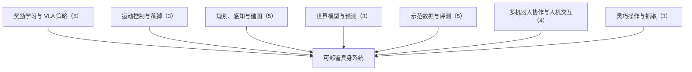

# 进度奖励、接触监督与规划验证：具身智能小站 10-30 期 28 篇阅读坐标

> **本页定位**：为 [具身智能小站 · 机器人做错了，奖励为什么还在增加？｜附代码与项目入口](https://mp.weixin.qq.com/s/dxeEQnbdviUi4D4LuTfEhw)（2026-10-30）提供按研究方向组织的阅读坐标；28 篇全部有独立详情节点。

## 一句话观点

**奖励做错了还在涨，往往是把示范时间当成了进度：本期深读 Event2Reward 用停滞、倒退与恢复事件校正进度奖励；跟进 TACOS 的接触残差监督与 Kairos 的规划语义调度；其余篇幅覆盖 VLA 量化与推理设置、示范评测与采集、世界模型、人形与灵巧操作、建图与多机器人协作。**

## 英文缩写速查

| 缩写 | 英文全称 | 简要说明 |
|------|----------|----------|
| VLA | Vision-Language-Action | 视觉–语言–动作策略 |
| WAM | World Action Model | 世界–动作联合模型 |
| VLM | Vision-Language Model | 视觉语言模型 |

## 为什么单独做这张地图

- 公众号一次列出 28 篇（1 深读 + 2 跟进 + 25 扫读）、方向跨度大，需要横切面索引；每篇只保留一个判断，细节在各节点。
- 节点内的数字为公众号转述，未核验原文表格；开源结论为入库日核查结果，见各节点「为什么重要」。

## 流程总览

## 分组索引

### 奖励学习与 VLA 策略（5 篇）

| 论文 | 节点 | 开源 |
|------|------|------|
| Event2Reward | [paper-event2reward](../entities/paper-event2reward.md) | 已开源 |
| QbD-VLA | [paper-qbd-vla](../entities/paper-qbd-vla.md) | 已开源 |
| Cross-Controller Transfer | [paper-cross-controller-transfer](../entities/paper-cross-controller-transfer.md) | 已开源 |
| Teaching a Tree to Recover | [paper-teaching-a-tree-to-recover](../entities/paper-teaching-a-tree-to-recover.md) | 已开源 |
| pi0.5 Inference Settings on BEHAVIOR-1K | [paper-pi05-inference-settings-behavior-1k](../entities/paper-pi05-inference-settings-behavior-1k.md) | 项目页未列 GitHub |

### 运动控制与落脚（3 篇）

| 论文 | 节点 | 开源 |
|------|------|------|
| TACOS | [paper-tacos](../entities/paper-tacos.md) | 已开源 |
| SONIC-K1 | [paper-sonic-k1](../entities/paper-sonic-k1.md) | 已开源 |
| ELEVATE | [paper-elevate](../entities/paper-elevate.md) | 项目页未列 GitHub |

### 规划、感知与建图（5 篇）

| 论文 | 节点 | 开源 |
|------|------|------|
| Kairos | [paper-kairos-pddl-planning-engine-orchestration](../entities/paper-kairos-pddl-planning-engine-orchestration.md) | 已开源 |
| Continuum Robot Embedded Shape Sensing | [paper-continuum-robot-embedded-shape-sensing](../entities/paper-continuum-robot-embedded-shape-sensing.md) | 已开源 |
| HERON | [paper-heron-obstacle-aware-reachability-maps](../entities/paper-heron-obstacle-aware-reachability-maps.md) | 已开源 |
| LOGIV | [paper-logiv](../entities/paper-logiv.md) | 已开源 |
| OpenFlyV2 | [paper-openflyv2](../entities/paper-openflyv2.md) | 已开源 |

### 世界模型与预测（3 篇）

| 论文 | 节点 | 开源 |
|------|------|------|
| TERRA | [paper-terra-targeted-exploration-rover-adaptation](../entities/paper-terra-targeted-exploration-rover-adaptation.md) | 已开源 |
| WorldFlow | [paper-worldflow](../entities/paper-worldflow.md) | 已开源 |
| GenSight | [paper-gensight](../entities/paper-gensight.md) | 待发布 |

### 示范数据与评测（5 篇）

| 论文 | 节点 | 开源 |
|------|------|------|
| CuraEval | [paper-curaeval](../entities/paper-curaeval.md) | 已开源 |
| ScheduleGen | [paper-schedulegen](../entities/paper-schedulegen.md) | 项目页未列 GitHub |
| RoboSeed | [paper-roboseed](../entities/paper-roboseed.md) | 已开源 |
| UMI-Live | [paper-umi-live](../entities/paper-umi-live.md) | 已开源 |
| Embodied at Sea | [paper-embodied-at-sea](../entities/paper-embodied-at-sea.md) | 待发布 |

### 多机器人协作与人机交互（4 篇）

| 论文 | 节点 | 开源 |
|------|------|------|
| SKiD-SLAM | [paper-skid-slam](../entities/paper-skid-slam.md) | 已开源 |
| Minimum Sufficient Communication | [paper-minimum-sufficient-communication](../entities/paper-minimum-sufficient-communication.md) | 已开源 |
| EARS-Info | [paper-ears-info](../entities/paper-ears-info.md) | 已开源 |
| When No Worries Went Wrong | [paper-when-no-worries-went-wrong](../entities/paper-when-no-worries-went-wrong.md) | 项目页未列 GitHub |

### 灵巧操作与抓取（3 篇）

| 论文 | 节点 | 开源 |
|------|------|------|
| Catch It All | [paper-catch-it-all](../entities/paper-catch-it-all.md) | 部分开源 |
| Skeleton-Guided Grasp Auto-Labeling | [paper-skeleton-guided-grasp-auto-labeling](../entities/paper-skeleton-guided-grasp-auto-labeling.md) | 已开源 |
| DexSuite | [paper-dexsuite](../entities/paper-dexsuite.md) | 待发布 |

## 关联页面

- [VLA](../methods/vla.md)
- [World Action Models](../concepts/world-action-models.md)

## 参考来源

- [wechat_embodied_station_28_papers_event2reward_progress_rewards_2026-10-30.md](../../sources/blogs/wechat_embodied_station_28_papers_event2reward_progress_rewards_2026-10-30.md)

## 推荐继续阅读

- [Event2Reward](../entities/paper-event2reward.md)
- [TACOS](../entities/paper-tacos.md)
