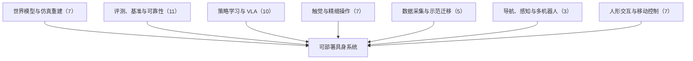

# 单图重建仿真、VLA 适配评测与跨形态世界模型：具身智能小站 10-31 期 50 篇阅读坐标

> **本页定位**：为 [具身智能小站 · 一张照片变成仿真场景，机器人真能用吗？｜附代码与项目入口](https://mp.weixin.qq.com/s/qUVNn3FiT89CDRzqmfN-0Q)（2026-10-31）提供按研究方向组织的阅读坐标；50 篇全部有独立详情节点。

## 一句话观点

**本期主线是让仿真与评测经得起真实机器人检验：SceneRig 把物理验证放进重建循环，VLA-Retain 把适配收益与非目标退化分开，Ropedia W0 用人类视频补跨形态世界模型；其余覆盖触觉安全、策略可靠性、人形交互与移动控制。深读 SceneRig，跟进 VLA-Retain 与 Ropedia W0。**

## 英文缩写速查

| 缩写 | 英文全称 | 简要说明 |
|------|----------|----------|
| VLA | Vision-Language-Action | 视觉–语言–动作策略 |
| WAM | World Action Model | 世界–动作联合模型 |
| VLM | Vision-Language Model | 视觉语言模型 |

## 为什么单独做这张地图

- 公众号一次列出 50 篇（1 深读 + 2 跟进 + 47 扫读）、方向跨度大，需要横切面索引；每篇只保留一个判断，细节在各节点。
- 节点内的数字为公众号转述，未核验原文表格；开源结论为入库日核查结果，见各节点「为什么重要」。

## 流程总览

## 分组索引

### 世界模型与仿真重建（7 篇）

| 论文 | 节点 | 开源 |
|------|------|------|
| SceneRig | [paper-scenerig](../entities/paper-scenerig.md) | 已开源 |
| Ropedia W0 | [paper-ropedia-w0](../entities/paper-ropedia-w0.md)（复用） | 已开源 |
| LaLa-World | [paper-lala-world](../entities/paper-lala-world.md) | 已开源 |
| Plausible Future, Wrong Choice | [paper-plausible-future-wrong-choice](../entities/paper-plausible-future-wrong-choice.md) | 项目页未列 GitHub |
| TrajWAM | [paper-trajwam](../entities/paper-trajwam.md) | 已开源 |
| NeoWorld-3 | [paper-neoworld-3](../entities/paper-neoworld-3.md) | 部分开源 |
| Physical Words | [paper-physical-words-latent-reasoning-manipulation](../entities/paper-physical-words-latent-reasoning-manipulation.md)（复用） | 已开源 |

### 评测、基准与可靠性（11 篇）

| 论文 | 节点 | 开源 |
|------|------|------|
| VLA-Retain | [paper-vla-retain](../entities/paper-vla-retain.md) | 已开源 |
| HandsOn | [paper-handson](../entities/paper-handson.md)（复用） | 已开源 |
| RoboValue | [paper-robovalue-benchmark](../entities/paper-robovalue-benchmark.md)（复用） | 已开源 |
| VLA Corruption Failure Attribution | [paper-vla-corruption-failure-attribution](../entities/paper-vla-corruption-failure-attribution.md) | 项目页未列 GitHub |
| Embodied Playground | [paper-embodied-playground](../entities/paper-embodied-playground.md) | 已开源 |
| Runtime Safety Check Robot Loops | [paper-runtime-safety-check-robot-loops](../entities/paper-runtime-safety-check-robot-loops.md) | 已开源 |
| ForagerSim | [paper-foragersim](../entities/paper-foragersim.md) | 已开源 |
| K-AoI | [paper-k-aoi](../entities/paper-k-aoi.md) | 已开源 |
| Frontier LLMs RoboColiseum | [paper-frontier-llms-robocoliseum](../entities/paper-frontier-llms-robocoliseum.md) | 项目页未列 GitHub |
| FIT-MAC | [paper-fit-mac](../entities/paper-fit-mac.md) | 部分开源 |
| HATCH | [paper-hatch](../entities/paper-hatch.md) | 已开源 |

### 策略学习与 VLA（10 篇）

| 论文 | 节点 | 开源 |
|------|------|------|
| CEL Fleet Experience | [paper-cel-fleet-experience](../entities/paper-cel-fleet-experience.md) | 部分开源 |
| VaDar | [paper-vadar](../entities/paper-vadar.md)（复用） | 已开源 |
| LMM Direct Robot Control | [paper-lmm-direct-robot-control](../entities/paper-lmm-direct-robot-control.md) | 已开源 |
| EventSync | [paper-eventsync](../entities/paper-eventsync.md) | 待发布 |
| Multi-View Latent Action Pretraining | [paper-multi-view-latent-action-pretraining-cross-embodiment](../entities/paper-multi-view-latent-action-pretraining-cross-embodiment.md)（复用） | 已开源 |
| Reinforced ILC Elastic Joint Arms | [paper-reinforced-ilc-elastic-joint-arms](../entities/paper-reinforced-ilc-elastic-joint-arms.md) | 已开源 |
| Learning to Be Different | [paper-learning-to-be-different](../entities/paper-learning-to-be-different.md) | 已开源 |
| VLDA | [paper-vlda](../entities/paper-vlda.md) | 已开源 |
| ReDOA | [paper-redoa](../entities/paper-redoa.md) | 项目页未列 GitHub |
| AWLS | [paper-awls-advantage-weighted-latent-steering](../entities/paper-awls-advantage-weighted-latent-steering.md)（复用） | 已开源 |

### 触觉与精细操作（7 篇）

| 论文 | 节点 | 开源 |
|------|------|------|
| PhantomTac | [paper-phantomtac](../entities/paper-phantomtac.md) | 项目页未列 GitHub |
| Tactile In-Context Learning Agents | [paper-tactile-in-context-learning-agents](../entities/paper-tactile-in-context-learning-agents.md) | 已开源 |
| Touch-JEPA | [paper-touch-jepa](../entities/paper-touch-jepa.md) | 部分开源 |
| GPT-6 Astra Visuo-Tactile Policy | [paper-tactalent-gpt-6-astra-visuo-tactile](../entities/paper-tactalent-gpt-6-astra-visuo-tactile.md) | 已开源 |
| FR-VLA | [paper-fr-vla](../entities/paper-fr-vla.md) | 待发布 |
| Biomimetic Skin Sensory Arrangements | [paper-biomimetic-skin-sensory-arrangements](../entities/paper-biomimetic-skin-sensory-arrangements.md) | 项目页未列 GitHub |
| GPT-6 Astra Tactile Correction | [paper-gpt-6-astra-tactile-correction](../entities/paper-gpt-6-astra-tactile-correction.md) | 待发布 |

### 数据采集与示范迁移（5 篇）

| 论文 | 节点 | 开源 |
|------|------|------|
| Head-Cam UMI Glove | [paper-head-cam-umi-glove](../entities/paper-head-cam-umi-glove.md) | 已开源 |
| DexOAK | [paper-dexoak](../entities/paper-dexoak.md) | 项目页未列 GitHub |
| Fast Motion Retargeting | [paper-fast-motion-retargeting-pipeline-humanoid](../entities/paper-fast-motion-retargeting-pipeline-humanoid.md)（复用） | 已开源 |
| Novice Operators Keypoint Hand View | [paper-novice-operators-keypoint-hand-view](../entities/paper-novice-operators-keypoint-hand-view.md) | 项目页未列 GitHub |
| Feature-Level LfD for Humanoids | [paper-feature-level-lfd-prompt-detection-nao](../entities/paper-feature-level-lfd-prompt-detection-nao.md)（复用） | 已开源 |

### 导航、感知与多机器人（3 篇）

| 论文 | 节点 | 开源 |
|------|------|------|
| CoopUQ | [paper-coopuq](../entities/paper-coopuq.md) | 已开源 |
| GPU-Resident Multi-Robot Inspection | [paper-gpu-resident-multi-robot-inspection](../entities/paper-gpu-resident-multi-robot-inspection.md) | 已开源 |
| VEOcc++ | [paper-veocc-plus-plus](../entities/paper-veocc-plus-plus.md) | 待发布 |

### 人形交互与移动控制（7 篇）

| 论文 | 节点 | 开源 |
|------|------|------|
| Wheel Motion Uncertainty LIO | [paper-wheel-motion-uncertainty-degeneracy-aware-lio](../entities/paper-wheel-motion-uncertainty-degeneracy-aware-lio.md)（复用） | 已开源 |
| REACT | [paper-vlm-contact-retargeting-partner-modeling](../entities/paper-vlm-contact-retargeting-partner-modeling.md)（复用） | 已开源 |
| OmniInteract | [paper-omniinteract-dual-humanoids](../entities/paper-omniinteract-dual-humanoids.md)（复用） | 已开源 |
| LocoPilot | [paper-locopilot-bilateral-teleop-loco-manipulation](../entities/paper-locopilot-bilateral-teleop-loco-manipulation.md)（复用） | 已开源 |
| SkateNav | [paper-skatenav-passive-wheel-quadruped-skating](../entities/paper-skatenav-passive-wheel-quadruped-skating.md)（复用） | 已开源 |
| SWAP | [paper-swap-humanoid-collision-avoidance](../entities/paper-swap-humanoid-collision-avoidance.md)（复用） | 已开源 |
| Spot Bricklaying | [paper-autonomous-bricklaying-boston-dynamics-spot](../entities/paper-autonomous-bricklaying-boston-dynamics-spot.md)（复用） | 已开源 |

## 关联页面

- [VLA](../methods/vla.md)
- [World Action Models](../concepts/world-action-models.md)

## 参考来源

- [wechat_embodied_station_50_papers_scenerig_photo_to_sim_2026-10-31.md](../../sources/blogs/wechat_embodied_station_50_papers_scenerig_photo_to_sim_2026-10-31.md)

## 推荐继续阅读

- [SceneRig](../entities/paper-scenerig.md)
- [VLA-Retain](../entities/paper-vla-retain.md)
