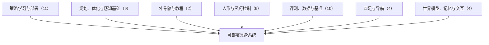

# 动作感知量化、失败定位与可验证自主：具身智能小站 11-03 期 49 篇阅读坐标

> **本页定位**：为 [具身智能小站 · 机器人不仅要完成任务，还要知道哪里出了错](https://mp.weixin.qq.com/s/KBuNOCHIWGw905j4IpOhZw)（2026-11-03）提供按研究方向组织的阅读坐标；49 篇全部有独立详情节点。

## 一句话观点

**本期主线是让机器人不只完成任务、还要知道哪里出了错：SACQ 把量化目标对齐最终动作误差，另有失败模式定位、操作质量与仿真接触伪影审计、可验证自主等工作；其余覆盖策略部署、评测数据、人形与灵巧控制、导航与优化。深读 SACQ，跟进可达性采样极限与仿真驱动膝关节外骨骼。**

## 英文缩写速查

| 缩写 | 英文全称 | 简要说明 |
|------|----------|----------|
| VLA | Vision-Language-Action | 视觉–语言–动作策略 |
| WAM | World Action Model | 世界–动作联合模型 |
| VLM | Vision-Language Model | 视觉语言模型 |

## 为什么单独做这张地图

- 公众号一次列出 49 篇（1 深读 + 2 跟进 + 46 扫读）、方向跨度大，需要横切面索引；每篇只保留一个判断，细节在各节点。
- 节点内的数字为公众号转述，未核验原文表格；开源结论为入库日核查结果，见各节点「为什么重要」。

## 流程总览

## 分组索引

### 策略学习与部署（11 篇）

| 论文 | 节点 | 开源 |
|------|------|------|
| SACQ | [paper-sacq](../entities/paper-sacq.md) | 已开源 |
| Auriga Technical Report | [paper-auriga-technical-report](../entities/paper-auriga-technical-report.md) | 已开源 |
| ResMerge | [paper-resmerge](../entities/paper-resmerge.md) | 已开源 |
| STAR | [paper-star](../entities/paper-star.md) | 已开源 |
| CaPtain | [paper-captain](../entities/paper-captain.md) | 已开源 |
| Validation Loss vs Real-Robot Success | [paper-validation-loss-vs-real-robot-success](../entities/paper-validation-loss-vs-real-robot-success.md) | 项目页未列 GitHub |
| Editing the Goal | [paper-editing-the-goal](../entities/paper-editing-the-goal.md) | 项目页未列 GitHub |
| Scaling Trusted Autonomy | [paper-scaling-trusted-autonomy](../entities/paper-scaling-trusted-autonomy.md) | 已开源 |
| RoboArchitect | [paper-roboarchitect](../entities/paper-roboarchitect.md) | 已开源 |
| RTPolicy | [paper-rtpolicy](../entities/paper-rtpolicy.md) | 已开源 |
| BioAgent | [paper-bioagent](../entities/paper-bioagent.md) | 待发布 |

### 规划、优化与感知基础（9 篇）

| 论文 | 节点 | 开源 |
|------|------|------|
| Sampling-Based Reachability Limits | [paper-sampling-based-reachability-limits](../entities/paper-sampling-based-reachability-limits.md) | 已开源 |
| CuPIQP | [paper-cupiqp](../entities/paper-cupiqp.md) | 已开源 |
| Differentiable ILC Black-Box Manipulators | [paper-differentiable-ilc-black-box-manipulators](../entities/paper-differentiable-ilc-black-box-manipulators.md) | 项目页未列 GitHub |
| OpenVIO | [paper-openvio](../entities/paper-openvio.md) | 已开源 |
| Contact-Based Million-Robot Planning | [paper-contact-based-million-robot-planning](../entities/paper-contact-based-million-robot-planning.md) | 已开源 |
| RapidDOC | [paper-rapiddoc](../entities/paper-rapiddoc.md) | 已开源 |
| FlapSim | [paper-flapsim](../entities/paper-flapsim.md) | 已开源 |
| VI RGB-D SLAM with Encoders | [paper-vi-rgb-d-slam-with-encoders](../entities/paper-vi-rgb-d-slam-with-encoders.md) | 部分开源 |
| GPU Incremental EDT | [paper-gpu-incremental-edt](../entities/paper-gpu-incremental-edt.md) | 已开源 |

### 外骨骼与教程（2 篇）

| 论文 | 节点 | 开源 |
|------|------|------|
| Knee Exoskeleton Sim-Derived Torque | [paper-knee-exoskeleton-sim-derived-torque](../entities/paper-knee-exoskeleton-sim-derived-torque.md) | 已开源 |
| Shape Servoing Tutorial Part I | [paper-shape-servoing-deformable-objects-tutorial-part1](../entities/paper-shape-servoing-deformable-objects-tutorial-part1.md)（复用） | 已开源 |

### 人形与灵巧控制（9 篇）

| 论文 | 节点 | 开源 |
|------|------|------|
| ∇Mimic | [paper-nablamimic](../entities/paper-nablamimic.md) | 已开源 |
| ROOF | [paper-roof](../entities/paper-roof.md) | 项目页未列 GitHub |
| TouchBridge | [paper-touchbridge-contact-aware-dexterous-human-interaction](../entities/paper-touchbridge-contact-aware-dexterous-human-interaction.md)（复用） | 已开源 |
| OmniPiano | [paper-omnipiano](../entities/paper-omnipiano.md) | 已开源 |
| Anchor 1 | [paper-anchor-1](../entities/paper-anchor-1.md) | 待发布 |
| Movens-Zero | [paper-movens-zero](../entities/paper-movens-zero.md) | 已开源 |
| HandMimicX | [paper-handmimicx](../entities/paper-handmimicx.md) | 项目页未列 GitHub |
| Contact Imitation Interface | [paper-contact-imitation-interface](../entities/paper-contact-imitation-interface.md) | 已开源 |
| SwapBot | [paper-swapbot](../entities/paper-swapbot.md) | 项目页未列 GitHub |

### 评测、数据与基准（10 篇）

| 论文 | 节点 | 开源 |
|------|------|------|
| MolmoSpaces-CommonSense | [paper-molmospaces-commonsense](../entities/paper-molmospaces-commonsense.md) | 已开源 |
| Gym-Anything for Robotics | [paper-gym-anything-for-robotics](../entities/paper-gym-anything-for-robotics.md) | 已开源 |
| RoboAtom | [paper-roboatom-atomic-action-supervision](../entities/paper-roboatom-atomic-action-supervision.md)（复用） | 已开源 |
| Shades of Success | [paper-shades-of-success](../entities/paper-shades-of-success.md) | 项目页未列 GitHub |
| TacMind | [paper-tacmind](../entities/paper-tacmind.md) | 已开源 |
| Behavior Graphs | [paper-behavior-graphs](../entities/paper-behavior-graphs.md) | 项目页未列 GitHub |
| Sensorium | [paper-sensorium](../entities/paper-sensorium.md) | 已开源 |
| Simulator Contact Artifacts Audit | [paper-simulator-contact-artifacts-audit](../entities/paper-simulator-contact-artifacts-audit.md) | 已开源 |
| BURGER | [paper-burger](../entities/paper-burger.md) | 已开源 |
| ClothDojo | [paper-clothdojo](../entities/paper-clothdojo.md) | 部分开源 |

### 四足与导航（4 篇）

| 论文 | 节点 | 开源 |
|------|------|------|
| Decentralized Collision Verification Swarms | [paper-decentralized-collision-verification-swarms](../entities/paper-decentralized-collision-verification-swarms.md) | 已开源 |
| UED Quadruped Benchmark | [paper-unsupervised-environment-design-quadruped-benchmark](../entities/paper-unsupervised-environment-design-quadruped-benchmark.md)（复用） | 已开源 |
| LLM-Guided Planar Loco-Manipulation | [paper-llm-guided-planar-loco-manipulation-quadruped](../entities/paper-llm-guided-planar-loco-manipulation-quadruped.md)（复用） | 已开源 |
| Dont Risk It | [paper-dont-risk-it-crowd-navigation](../entities/paper-dont-risk-it-crowd-navigation.md) | 已开源 |

### 世界模型、记忆与交互（4 篇）

| 论文 | 节点 | 开源 |
|------|------|------|
| WorldBridge | [paper-worldbridge](../entities/paper-worldbridge.md) | 项目页未列 GitHub |
| MOST | [paper-most](../entities/paper-most.md) | 已开源 |
| Knowing Where to Look | [paper-knowing-where-to-look](../entities/paper-knowing-where-to-look.md) | 项目页未列 GitHub |
| Teach, Abstract, Apply | [paper-teach-abstract-apply](../entities/paper-teach-abstract-apply.md) | 已开源 |

## 关联页面

- [VLA](../methods/vla.md)
- [World Action Models](../concepts/world-action-models.md)

## 参考来源

- [wechat_embodied_station_49_papers_sacq_action_aware_quantization_2026-11-03.md](../../sources/blogs/wechat_embodied_station_49_papers_sacq_action_aware_quantization_2026-11-03.md)

## 推荐继续阅读

- [SACQ](../entities/paper-sacq.md)
- [Sampling-Based Reachability Limits](../entities/paper-sampling-based-reachability-limits.md)
