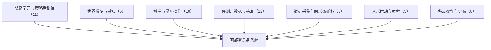

# VLM 奖励评估、动作动力学与开放权重机器人智能体：具身智能小站 11-04 期 57 篇阅读坐标

> **本页定位**：为 [具身智能小站 · 机器人做错了，奖励模型为什么还在加分？｜附代码与评测入口](https://mp.weixin.qq.com/s/Em5CuCvWGpaWc_3R97YnYg)（2026-11-04）提供按研究方向组织的阅读坐标；57 篇全部有独立详情节点。

## 一句话观点

**本期主线是别让奖励与评测把失败看成进步：D&A 先描述视频中实际变化再按成功标准评分，ODE Policy 直接学习动作变化的向量场，uni-robot-agent 用统一接口让开放权重模型参与机器人操作；其余覆盖策略后训练、触觉与灵巧、移动操作、数据平台与评测。深读 D&A，跟进 ODE Policy 与 uni-robot-agent。**

## 英文缩写速查

| 缩写 | 英文全称 | 简要说明 |
|------|----------|----------|
| VLA | Vision-Language-Action | 视觉–语言–动作策略 |
| WAM | World Action Model | 世界–动作联合模型 |
| VLM | Vision-Language Model | 视觉语言模型 |

## 为什么单独做这张地图

- 公众号一次列出 57 篇（1 深读 + 2 跟进 + 54 扫读）、方向跨度大，需要横切面索引；每篇只保留一个判断，细节在各节点。
- 节点内的数字为公众号转述，未核验原文表格；开源结论为入库日核查结果，见各节点「为什么重要」。

## 流程总览

## 分组索引

### 奖励学习与策略后训练（11 篇）

| 论文 | 节点 | 开源 |
|------|------|------|
| D&A | [paper-dna](../entities/paper-dna.md) | 已开源 |
| ODE Policy | [paper-ode-policy-action-dynamics](../entities/paper-ode-policy-action-dynamics.md) | 已开源 |
| Democratizing Robot-Use Agents | [paper-uni-robot-agent](../entities/paper-uni-robot-agent.md)（复用） | 已开源 |
| Route-Guided CBF-QP Repair | [paper-route-guided-cbf-qp-repair](../entities/paper-route-guided-cbf-qp-repair.md) | 已开源 |
| Iterative Gumbel Planning | [paper-iterative-gumbel-planning](../entities/paper-iterative-gumbel-planning.md) | 已开源 |
| Value Forcing | [paper-value-forcing](../entities/paper-value-forcing.md) | 已开源 |
| RAFT | [paper-raft-reasoning-aligned-finetuning](../entities/paper-raft-reasoning-aligned-finetuning.md) | 部分开源 |
| Energy-Based Policy Orchestration | [paper-energy-based-policy-orchestration](../entities/paper-energy-based-policy-orchestration.md) | 项目页未列 GitHub |
| Beyond Policy Patches | [paper-beyond-policy-patches](../entities/paper-beyond-policy-patches.md) | 项目页未列 GitHub |
| W2A | [paper-w2a-world-priors-action-models](../entities/paper-w2a-world-priors-action-models.md) | 项目页未列 GitHub |
| CANDO | [paper-cando-residual-rl](../entities/paper-cando-residual-rl.md) | 项目页未列 GitHub |

### 世界模型与感知（6 篇）

| 论文 | 节点 | 开源 |
|------|------|------|
| SyncHeC | [paper-synchec](../entities/paper-synchec.md) | 已开源 |
| Hybrid Particle-Voxel Dynamics | [paper-hybrid-particle-voxel-dynamics](../entities/paper-hybrid-particle-voxel-dynamics.md) | 已开源 |
| AnchorHEC | [paper-anchorhec](../entities/paper-anchorhec.md) | 待发布 |
| Gnomon4D | [paper-gnomon4d](../entities/paper-gnomon4d.md) | 已开源 |
| CoReMatch | [paper-corematch](../entities/paper-corematch.md) | 已开源 |
| DynaSolver | [paper-dynasolver](../entities/paper-dynasolver.md) | 项目页未列 GitHub |

### 触觉与灵巧操作（10 篇）

| 论文 | 节点 | 开源 |
|------|------|------|
| ForceLDM | [paper-forceldm](../entities/paper-forceldm.md) | 已开源 |
| ReflexArc | [paper-reflexarc](../entities/paper-reflexarc.md) | 项目页未列 GitHub |
| ReContact | [paper-recontact](../entities/paper-recontact.md) | 项目页未列 GitHub |
| Self-Directed Dynamics Gap Closing | [paper-self-directed-dynamics-gap-closing](../entities/paper-self-directed-dynamics-gap-closing.md) | 项目页未列 GitHub |
| BeyondContact | [paper-beyondcontact](../entities/paper-beyondcontact.md) | 已开源 |
| SomaAlign | [paper-somaalign](../entities/paper-somaalign.md) | 已开源 |
| TF²-Steering | [paper-tf2-steering-tactile-forecast](../entities/paper-tf2-steering-tactile-forecast.md) | 待发布 |
| OpenZilo | [paper-openzilo](../entities/paper-openzilo.md) | 已开源 |
| Robot-Matched Soft Fingers for UMI | [paper-robot-matched-soft-fingers-for-umi](../entities/paper-robot-matched-soft-fingers-for-umi.md) | 已开源 |
| PanoTac | [paper-panotac](../entities/paper-panotac.md) | 项目页未列 GitHub |

### 评测、数据与基准（12 篇）

| 论文 | 节点 | 开源 |
|------|------|------|
| Beyond Validation Loss | [paper-policy-coverage-reliability](../entities/paper-policy-coverage-reliability.md)（复用） | 已开源 |
| RoboColosseum | [paper-robocolosseum](../entities/paper-robocolosseum.md) | 项目页未列 GitHub |
| Rollout then Recycle | [paper-rollout-then-recycle](../entities/paper-rollout-then-recycle.md) | 项目页未列 GitHub |
| KlaskTron | [paper-klasktron](../entities/paper-klasktron.md) | 项目页未列 GitHub |
| KlaskTron-IL | [paper-klasktron-il-adversarial-benchmark](../entities/paper-klasktron-il-adversarial-benchmark.md) | 已开源 |
| RoboScope Kit | [paper-roboscope-kit](../entities/paper-roboscope-kit.md) | 项目页未列 GitHub |
| iMED | [paper-imed-multi-endoscope-dataset](../entities/paper-imed-multi-endoscope-dataset.md) | 项目页未列 GitHub |
| FlowBench | [paper-flowbench](../entities/paper-flowbench.md) | 已开源 |
| DexArena | [paper-dexarena](../entities/paper-dexarena.md) | 已开源 |
| VagueBench | [paper-vaguebench](../entities/paper-vaguebench.md) | 已开源 |
| When Robots Outweigh Objects | [paper-inertia-mismatch](../entities/paper-inertia-mismatch.md) | 项目页未列 GitHub |
| Source-Resolved Collective Cognition | [paper-source-resolved-collective-cognition](../entities/paper-source-resolved-collective-cognition.md) | 项目页未列 GitHub |

### 数据采集与跨形态迁移（5 篇）

| 论文 | 节点 | 开源 |
|------|------|------|
| MABEL | [paper-mabel](../entities/paper-mabel.md) | 部分开源 |
| Human-to-Robot Transfer via VLA Bridging | [paper-human-to-robot-transfer-via-vla-bridging](../entities/paper-human-to-robot-transfer-via-vla-bridging.md) | 已开源 |
| AIRoA-0 | [paper-airoa-0](../entities/paper-airoa-0.md) | 部分开源 |
| Pixel | [paper-pixel](../entities/paper-pixel.md) | 待发布 |
| Pixel-UMI | [paper-pixel-umi](../entities/paper-pixel-umi.md) | 待发布 |

### 人形运动与教程（5 篇）

| 论文 | 节点 | 开源 |
|------|------|------|
| VerifLM | [paper-veriflm](../entities/paper-veriflm.md) | 项目页未列 GitHub |
| Shape Servoing Tutorial Part II | [paper-shape-servoing-tutorial-part-ii](../entities/paper-shape-servoing-tutorial-part-ii.md) | 已开源 |
| MAPO | [paper-mapo-motion-tracking](../entities/paper-mapo-motion-tracking.md)（复用） | 已开源 |
| Blockchain DAO Swarm Access Control | [paper-blockchain-dao-swarm-access-control](../entities/paper-blockchain-dao-swarm-access-control.md) | 部分开源 |
| Just Between Us | [paper-just-between-us](../entities/paper-just-between-us.md) | 已开源 |

### 移动操作与导航（8 篇）

| 论文 | 节点 | 开源 |
|------|------|------|
| OpenNWM | [paper-opennwm](../entities/paper-opennwm.md) | 已开源 |
| Feijoa | [paper-feijoa](../entities/paper-feijoa.md) | 项目页未列 GitHub |
| TAMPAgent | [paper-tampagent](../entities/paper-tampagent.md) | 项目页未列 GitHub |
| Practical Causal Framework for Mobile Robots | [paper-practical-causal-framework-for-mobile-robots](../entities/paper-practical-causal-framework-for-mobile-robots.md) | 已开源 |
| SNAP | [paper-snap](../entities/paper-snap.md) | 项目页未列 GitHub |
| Safe-Ballbot | [paper-safe-ballbot](../entities/paper-safe-ballbot.md) | 部分开源 |
| TRAILS | [paper-trails](../entities/paper-trails.md) | 已开源 |
| Local Solution Repair MAPD | [paper-local-solution-repair-mapd](../entities/paper-local-solution-repair-mapd.md) | 已开源 |

## 关联页面

- [VLA](../methods/vla.md)
- [World Action Models](../concepts/world-action-models.md)

## 参考来源

- [wechat_embodied_station_57_papers_da_reward_model_failure_2026-11-04.md](../../sources/blogs/wechat_embodied_station_57_papers_da_reward_model_failure_2026-11-04.md)

## 推荐继续阅读

- [D&A](../entities/paper-dna.md)
- [ODE Policy](../entities/paper-ode-policy-action-dynamics.md)
