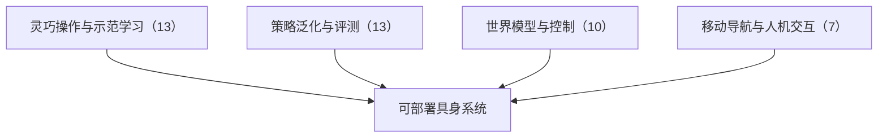

# 接触丰富的手物重定向、分项泛化评测与手持夹爪示范：具身智能小站 11-05 期 43 篇阅读坐标

> **本页定位**：为 [具身智能小站 · 人能稳稳提起的罐子，换一双机器手怎么提？](https://mp.weixin.qq.com/s/VS8xbDtQbQTJM3f_WuB9Og)（2026-11-05）提供按研究方向组织的阅读坐标；43 篇全部有独立详情节点。

## 一句话观点

**本期主线是把人手示范变成机器手真能执行的动作，并把泛化与评测拆开看：GRASP 在物理仿真里用梯度引导采样重定向手物接触，MESA 分项测摆位 / 物体 / 类别 / 子任务组合泛化，AIRoA-0 用手持夹爪采集长程双臂示范；其余覆盖世界模型与控制、移动导航与人机交互。深读 GRASP，跟进 MESA 与 AIRoA-0。**

## 英文缩写速查

| 缩写 | 英文全称 | 简要说明 |
|------|----------|----------|
| VLA | Vision-Language-Action | 视觉–语言–动作策略 |
| WAM | World Action Model | 世界–动作联合模型 |
| VLM | Vision-Language Model | 视觉语言模型 |

## 为什么单独做这张地图

- 公众号一次列出 43 篇（1 深读 + 2 跟进 + 40 扫读）、方向跨度大，需要横切面索引；每篇只保留一个判断，细节在各节点。
- 节点内的数字为公众号转述，未核验原文表格（GRASP 已通读原文，例外）；开源结论为入库日核查结果，见各节点「为什么重要」。

## 流程总览

## 分组索引

### 灵巧操作与示范学习（13 篇）

| 论文 | 节点 | 开源 |
|------|------|------|
| GRASP | [paper-grasp](../entities/paper-grasp.md) | 已开源 |
| AIRoA-0 | [paper-airoa-0](../entities/paper-airoa-0.md)（复用） | 已开源 |
| PyRUA-DataFarm | [paper-pyrua-datafarm](../entities/paper-pyrua-datafarm.md) | 已开源 |
| MABEL | [paper-mabel](../entities/paper-mabel.md)（复用） | 已开源 |
| Robot-Matched Soft Fingers for UMI | [paper-robot-matched-soft-fingers-for-umi](../entities/paper-robot-matched-soft-fingers-for-umi.md)（复用） | 已开源 |
| RoboTryOn | [paper-robotryon](../entities/paper-robotryon.md) | 已开源 |
| Human-to-Robot Transfer via VLA Bridging | [paper-human-to-robot-transfer-via-vla-bridging](../entities/paper-human-to-robot-transfer-via-vla-bridging.md)（复用） | 已开源 |
| DexHOT | [paper-dexhot](../entities/paper-dexhot.md) | 部分开源 |
| ReflexArc | [paper-reflexarc](../entities/paper-reflexarc.md)（复用） | 代码待发布（官网标注 Code Coming soon，2026-11-12 核查） |
| GUILD | [paper-guild](../entities/paper-guild.md) | 项目页未列 GitHub |
| ELA | [paper-ela](../entities/paper-ela.md) | 项目页未列 GitHub |
| Shape Servoing Tutorial Part II | [paper-shape-servoing-tutorial-part-ii](../entities/paper-shape-servoing-tutorial-part-ii.md)（复用） | 已开源 |
| DreamX | [paper-dreamx](../entities/paper-dreamx.md) | 待发布 |

### 策略泛化与评测（13 篇）

| 论文 | 节点 | 开源 |
|------|------|------|
| MESA | [paper-mesa](../entities/paper-mesa.md) | 已开源 |
| iMED | [paper-imed-multi-endoscope-dataset](../entities/paper-imed-multi-endoscope-dataset.md)（复用） | 已开源 |
| RoboScope Kit | [paper-roboscope-kit](../entities/paper-roboscope-kit.md)（复用） | 已开源 |
| FlowBench | [paper-flowbench](../entities/paper-flowbench.md)（复用） | 已开源 |
| PolicyIK | [paper-policyik](../entities/paper-policyik.md) | 已开源 |
| RACE | [paper-race](../entities/paper-race.md) | 待发布 |
| VagueBench | [paper-vaguebench](../entities/paper-vaguebench.md)（复用） | 已开源 |
| Proactive Human-in-the-Loop Correction | [paper-proactive-human-in-the-loop-correction](../entities/paper-proactive-human-in-the-loop-correction.md) | 项目页未列 GitHub |
| GSBR | [paper-gsbr](../entities/paper-gsbr.md) | 已开源 |
| Action-Token Supervision | [paper-action-token-supervision](../entities/paper-action-token-supervision.md) | 项目页未列 GitHub |
| Asynchronous Robot Policies | [paper-asynchronous-robot-policies](../entities/paper-asynchronous-robot-policies.md) | 待发布 |
| CRONOS | [paper-cronos](../entities/paper-cronos.md) | 项目页未列 GitHub |
| CANDO | [paper-cando-residual-rl](../entities/paper-cando-residual-rl.md)（复用） | 已开源 |

### 世界模型与控制（10 篇）

| 论文 | 节点 | 开源 |
|------|------|------|
| Action-Conditioned Latent Foresight | [paper-action-conditioned-latent-foresight](../entities/paper-action-conditioned-latent-foresight.md) | 待发布 |
| FloMo | [paper-flomo](../entities/paper-flomo.md) | 已开源 |
| Hybrid Particle-Voxel Dynamics | [paper-hybrid-particle-voxel-dynamics](../entities/paper-hybrid-particle-voxel-dynamics.md)（复用） | 已开源 |
| HiLo-WAM | [paper-hilo-wam](../entities/paper-hilo-wam.md) | 已开源 |
| Future Representation Distillation | [paper-future-representation-distillation](../entities/paper-future-representation-distillation.md) | 待发布 |
| Closed-Loop Ocean Sampling | [paper-closed-loop-ocean-sampling](../entities/paper-closed-loop-ocean-sampling.md) | 已开源 |
| Barrier-State Safe Navigation | [paper-barrier-state-safe-navigation](../entities/paper-barrier-state-safe-navigation.md) | 已开源 |
| RAIPAL | [paper-raipal](../entities/paper-raipal.md) | 已开源 |
| PrimeSim | [paper-primesim](../entities/paper-primesim.md) | 部分开源 |
| Geometric Abstraction for Agentic Policies | [paper-geometric-abstraction-for-agentic-policies](../entities/paper-geometric-abstraction-for-agentic-policies.md) | 已开源 |

### 移动导航与人机交互（7 篇）

| 论文 | 节点 | 开源 |
|------|------|------|
| WayTrace | [paper-waytrace](../entities/paper-waytrace.md) | 待发布（论文称 will release，仓库与权重待核） |
| Practical Causal Framework for Mobile Robots | [paper-practical-causal-framework-for-mobile-robots](../entities/paper-practical-causal-framework-for-mobile-robots.md)（复用） | 已开源 |
| FEIJOA | [paper-feijoa](../entities/paper-feijoa.md)（复用） | 已开源 |
| Expressive Swarm Perceptual Gaps | [paper-expressive-swarm-perceptual-gaps](../entities/paper-expressive-swarm-perceptual-gaps.md) | 部分开源 |
| OdorSpaces | [paper-odorspaces](../entities/paper-odorspaces.md) | 项目页未列 GitHub |
| For You, Not for Everyone | [paper-for-you-not-for-everyone](../entities/paper-for-you-not-for-everyone.md) | 已开源 |
| Just Between Us | [paper-just-between-us](../entities/paper-just-between-us.md)（复用） | 已开源 |

## 关联页面

- [VLA](../methods/vla.md)
- [World Action Models](../concepts/world-action-models.md)

## 参考来源

- [wechat_embodied_station_43_papers_grasp_mesa_airoa_2026-11-05.md](../../sources/blogs/wechat_embodied_station_43_papers_grasp_mesa_airoa_2026-11-05.md)
- [grasp_arxiv_2611_05754.md](../../sources/papers/grasp_arxiv_2611_05754.md) — GRASP 原文通读：OakInk2 Sharpa 双手 1,352 条示范，1,024 粒子成功率 92.8%、2,000 粒子 94.2%（成功率来自仿真；arXiv:2611.05754）

## 推荐继续阅读

- [GRASP](../entities/paper-grasp.md)
- [MESA](../entities/paper-mesa.md)
