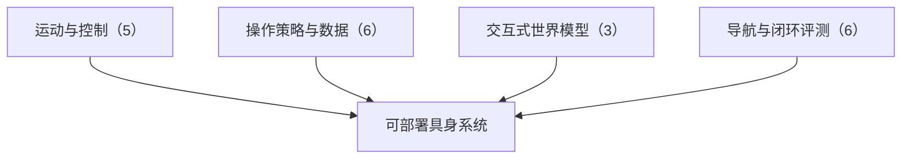

# 按路段调速的规划、虚拟房间到真机的人形动作与人类视频缩放：具身智能小站 11-06 期 20 篇阅读坐标

> **本页定位**：为 [具身智能小站 · 只在虚拟房间练习，人形机器人走进陌生房间能做什么？](https://mp.weixin.qq.com/s/bS_fZx7sMtiE2B4Yd8NNVA)（2026-11-06）提供按研究方向组织的阅读坐标；20 篇全部有独立详情节点。

## 一句话观点

**本期主线是把规划、仿真训练和评测的耗时与失败边界拆开看：cuRoboV2-Fast 把规划耗时与真机抓放周期分开计时，HALO 把虚拟房间里的训练带到真机，Open-HumanWAM 检验人类第一人称视频对陌生场景的帮助；其余覆盖交互式世界模型、导航与闭环评测。深读 cuRoboV2-Fast，跟进 HALO 与 Open-HumanWAM。**

## 英文缩写速查

| 缩写 | 英文全称 | 简要说明 |
|------|----------|----------|
| VLA | Vision-Language-Action | 视觉–语言–动作策略 |
| WAM | World Action Model | 世界–动作联合模型 |
| VLM | Vision-Language Model | 视觉语言模型 |

## 为什么单独做这张地图

- 公众号一次列出 20 篇（1 深读 + 2 跟进 + 17 扫读）、方向跨度大，需要横切面索引；每篇只保留一个判断，细节在各节点。
- 节点内的数字为公众号转述，未核验原文表格；开源结论为入库日核查结果，见各节点「为什么重要」。

## 流程总览

## 分组索引

### 运动与控制（5 篇）

| 论文 | 节点 | 开源 |
|------|------|------|
| cuRoboV2-Fast | [paper-curobov2-fast](../entities/paper-curobov2-fast.md) | 已开源 |
| HALO | [paper-halo-perceptive-humanoid-motion-sim](../entities/paper-halo-perceptive-humanoid-motion-sim.md)（复用） | 已开源 |
| Learned Safe Sets | [paper-learned-safe-sets](../entities/paper-learned-safe-sets.md) | 已开源 |
| Soccerbot | [paper-soccerbot-latent-motion-priors](../entities/paper-soccerbot-latent-motion-priors.md)（复用） | 已开源 |
| Fluidic Body | [paper-fluidic-body](../entities/paper-fluidic-body.md) | 已开源 |

### 操作策略与数据（6 篇）

| 论文 | 节点 | 开源 |
|------|------|------|
| Open-HumanWAM | [paper-open-humanwam](../entities/paper-open-humanwam.md) | 部分开源 |
| PyRUA-REAL | [paper-pyrua-real](../entities/paper-pyrua-real.md) | 已开源 |
| Latent Noise Representation Bridging | [paper-latent-noise-representation-bridging](../entities/paper-latent-noise-representation-bridging.md) | 已开源 |
| Tactile Cues Controlled Study | [paper-tactile-cues-controlled-study](../entities/paper-tactile-cues-controlled-study.md) | 部分开源 |
| RL Generalist Policy Improvement | [paper-rl-generalist-policy-improvement](../entities/paper-rl-generalist-policy-improvement.md) | 已开源 |
| Astra on RoboMME | [paper-astra-on-robomme](../entities/paper-astra-on-robomme.md) | 已开源 |

### 交互式世界模型（3 篇）

| 论文 | 节点 | 开源 |
|------|------|------|
| Cosmos Interactive World Simulation | [paper-cosmos-interactive-world-simulation](../entities/paper-cosmos-interactive-world-simulation.md)（复用） | 已开源 |
| Spatial-UMI-Dream | [paper-spatial-umi-dream](../entities/paper-spatial-umi-dream.md) | 部分开源 |
| ReactWorld | [paper-reactworld](../entities/paper-reactworld.md) | 项目页未列 GitHub |

### 导航与闭环评测（6 篇）

| 论文 | 节点 | 开源 |
|------|------|------|
| Robocasa-Mem | [paper-robocasa-mem](../entities/paper-robocasa-mem.md) | 已开源 |
| Failure-Boundary Profiles | [paper-failure-boundary-profiles](../entities/paper-failure-boundary-profiles.md) | 已开源 |
| STARE | [paper-stare](../entities/paper-stare.md) | 已开源 |
| Commodity-Price Closed-Loop Evaluation | [paper-commodity-price-closed-loop-evaluation](../entities/paper-commodity-price-closed-loop-evaluation.md) | 已开源 |
| MessyNav | [paper-messynav](../entities/paper-messynav.md) | 待发布 |
| VABAR | [paper-vabar-variational-automation-benchmark](../entities/paper-vabar-variational-automation-benchmark.md)（复用） | 已开源 |

## 关联页面

- [VLA](../methods/vla.md)
- [World Action Models](../concepts/world-action-models.md)

## 参考来源

- [wechat_embodied_station_20_papers_curobov2_fast_halo_humanwam_2026-11-06.md](../../sources/blogs/wechat_embodied_station_20_papers_curobov2_fast_halo_humanwam_2026-11-06.md)

## 推荐继续阅读

- [cuRoboV2-Fast](../entities/paper-curobov2-fast.md)
- [HALO](../entities/paper-halo-perceptive-humanoid-motion-sim.md)
